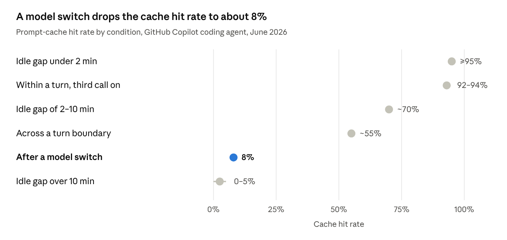
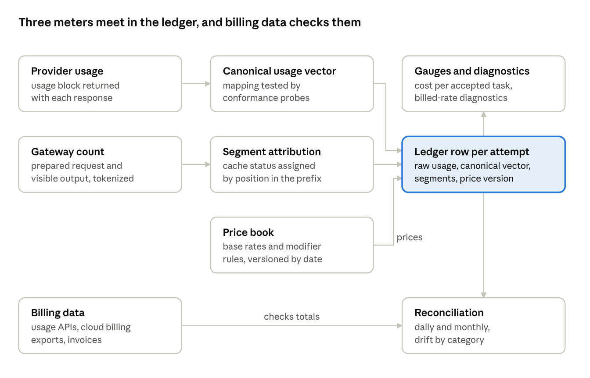

# Token Efficiency in Agentic LLM Systems: Gauging, Measuring and Managing Cost, with Application to Duranki

Larry Mitchell · 22 October 2026

## Abstract

In agentic LLM systems, cost is set less by how many tokens are sent than by when the prompt cache breaks. Agent loops re-send their whole context on every call, so input tokens dominate and grow faster than task length. Production coding agents now serve over 90% of that input from cache, which moves cost onto cache events: model switches, compactions, idle gaps and configuration changes. One billed study found a 38% cut in tool-output tokens raised cost by 6.8%.

This paper turns the 2024–2026 literature and current provider documentation into a framework for gauging, measuring and managing token efficiency, and applies it to Duranki, a routing and metering gateway for collaborating agent systems. The gauge is cost per accepted task over complete cohorts; token and cache metrics are diagnostics priced at the rate actually billed, never gates. Measurement needs three separate meters, a canonical usage vector that resolves providers' conflicting overlap rules, a versioned price book evaluated as a function, and a load-dependent price for self-hosted capacity.

We grade the evidence for six management levers: cache-aware prompt layout, context compaction, tool surfaces, reasoning effort, routing and cascades, and multi-agent fan-out. From that we derive 22 ranked changes to the Duranki v1.1 design. Most of the cache-economics evidence is recent and unreplicated, so we treat its magnitudes as hypotheses for Duranki's own telemetry to test.

## 1. Introduction

Token efficiency for agents is a property of whole tasks, not single calls. A collaborating agent system calls models dozens to hundreds of times per task. Each call re-sends the system prompt, tool definitions, conversation history and accumulated tool results. In coding agents, input outweighs output by roughly 275–300 to 1 ([Copilot traces](https://arxiv.org/html/2608.00101v1); [TraceLab](https://arxiv.org/abs/2606.30560)).

So the levers that work for one call (a cheaper model, a shorter prompt) often fail for a task. A cheaper model may take more turns. A shorter prompt may break a cached prefix. A compressed tool result may send the agent back to re-read the file. What matters is the cost of getting an accepted result, including the work that failed along the way.

### 1.1 Duranki

Duranki is the gateway between Mach33's agent orchestrators and the models they call. Orchestrators run in the cloud and in an office GPU lab. The models are self-hosted open models in the lab (and later the cloud), cheaper frontier models and expensive frontier models. Every call passes mandatory admission, a signed execution plan and a final-dispatch check, and every attempt is recorded in an append-only ledger. Its governing metric is cost per accepted task for each task class:

$$
M = \frac{\mathbb{E}[C_{\text{task}}]}{P(\text{task accepted})}
$$

M is minimized subject to per-class non-inferiority on acceptance, an absolute quality floor and a latency constraint, over complete task cohorts including failed and abandoned tasks.

### 1.2 How this paper was built

The work ran in four steps:

1. **Initial levers.** A first list of token-efficiency levers for agents: context growth, prompt caching, tool definitions and results, output and reasoning tokens, inter-agent handoffs, retries and runaway loops, and batching.
2. **Design review.** Duranki v1.1 was reviewed against two of those areas, cache stickiness and per-segment telemetry. That produced nine cache findings (C1–C9), five telemetry findings (T1–T5) and two others (O1–O2).
3. **Literature review.** Six parallel searches covered routing and cascades, context management, caching and serving, multi-agent communication, reasoning efficiency, and prompt and tool-surface efficiency with cost measurement.
4. **Measurement design.** A scheme for metering token usage and type across providers and pricing it into the cost model, checked against current provider documentation.

### 1.3 Contributions

1. A synthesis showing that cache events, not token volume, now set the cost of agent work, with the break-even rules that follow (Sections 2 and 3).
2. A set of gauges: cost per accepted task as the one gate, and diagnostics priced at the billed rate (Section 3).
3. A measurement architecture: three meters, a canonical usage vector, conformance probes, segment attribution, a functional price book and self-hosted pricing (Section 4).
4. A graded review of the management levers (Section 5) and of how to evaluate policies built from them (Section 6).
5. A mapping onto Duranki v1.1, with the status of each review finding and 22 ranked changes and experiments (Section 7).

### 1.4 Conventions

Evidence is labelled **PR** (peer-reviewed venue), **W** (peer-reviewed workshop), **PP** (arXiv preprint), **V** (vendor blog or provider documentation) and **Prod** (production data). Where a rule or number is our own derivation rather than a source's claim, the text says so. Prices and API behaviour are as documented on 22 October 2026. Section numbers prefixed § refer to the Duranki v1.1 design.

## 2. Anatomy of agent token spend

Agent spend is mostly re-sent input, and since 2025 most of that input is billed at cache-read rates. Cost therefore follows the number of calls and the points where the cache breaks.

### 2.1 Input dominates and grows with every turn

An agent that adds Δ tokens per step to a starting context c₀ sends this much input over N steps:

$$
\sum_{i=1}^{N} (c_0 + i\,\Delta) \;\approx\; N c_0 + \tfrac{1}{2} N^2 \Delta
$$

The quadratic term is what makes long trajectories expensive. In one 40-step SWE-bench trajectory, the final context was 48.4K tokens but cumulative input was about 1.0M, roughly N/2 times the final context ([AgentDiet](https://arxiv.org/html/2509.23586v2), PR). In GitHub Copilot's coding agent the median prompt is about 68K tokens against a median completion of 247 ([Copilot traces](https://arxiv.org/html/2608.00101v1), PP, Prod).

### 2.2 Tool output and tool definitions are the bulk

The same AgentDiet trajectory breaks down as 30.4K tokens of tool messages, 13.7K of assistant messages (11.9K of them tool-call arguments) and 4.4K of system and user text. Across benchmarks, tool observations are about 84% of an average SWE-agent turn ([Complexity Trap](https://arxiv.org/html/2508.21433v3), W) and 45.7–67.8% of tokens across SWE-bench and Terminal-Bench ([CoACT](https://arxiv.org/pdf/2607.02911), PP).

Tool definitions can dominate before any work starts. Five MCP servers exposing 58 tools took about 55K tokens, and Anthropic's internal tool set took 134K before optimization ([Anthropic advanced tool use](https://anthropic.com/engineering/advanced-tool-use), V). Large tool sets also cost accuracy: in MCPVerse, most models got worse as tools were added, with one frontier model falling from 68.1 to 23.4 (PP).

### 2.3 Caching moved cost from volume to events

The largest dataset is Microsoft's study of Copilot's coding agent: 3.2M users, 13M sessions, 761M LLM calls and 95T tokens from June 2026 ([Copilot traces](https://arxiv.org/html/2608.00101v1)). Cache hits average about 90% within a turn, plateauing at 92–94% from the third call. The losses cluster at identifiable events, shown below. After a model switch the average hit rate is about 8%. The first call after a compaction shows a median 66.1% drop, and 34.3% of compactions erase at least 90% of hits.

*Figure 1. Prompt-cache hit rate by condition, GitHub Copilot coding agent, June 2026. Source: Copilot traces (arXiv 2608.00101); medians, except the within-turn plateau and the averages across turn boundaries and after switches.*

Hit rates stay near their ceiling while calls arrive close together on one model, and collapse after a switch or a long idle gap.

Two smaller datasets agree. TraceLab, from 4,300 of its authors' own Claude Code and Codex sessions, finds 95.7% of input served from cache ([TraceLab](https://arxiv.org/abs/2606.30560), PP). TurnCost re-scored 600 public trajectories and found 98.6% served from cache, so flat input pricing overstated loop cost about 7× ([TurnCost](https://arxiv.org/abs/2610.15093), PP). There, **turn count explained 84% of the variance in log cost; mean observation size explained 4%.**

Agent traffic is an unusually good case for caching. The only peer-reviewed production traces, from Alibaba's general chat traffic, show ideal hit rates of only 54–62% and rare cross-user hits ([Alibaba ATC'25](https://www.usenix.org/system/files/atc25-wang-jiahao.pdf), PR, Prod).

### 2.4 Cutting tokens no longer reliably cuts cost

Any edit to earlier context turns every later cached read into a cache write. Three studies show the consequence:

- In a provider-billed study of coding agents, the most aggressive tool-output compression cut tokens by 38.4% and **raised billed cost by 6.8%**. Per-task token reduction correlated with cost reduction at only r = 0.15 ([Token Reduction Is Not Cost Reduction](https://arxiv.org/abs/2607.12161), PP).
- AgentDiet reports 21–36% cost cuts from trajectory reduction. Re-priced with uncached input at 10× cached input, the same method *raised* cost by 10.6% ([CoACT](https://arxiv.org/pdf/2607.02911), PP).
- ACON cut peak tokens by 26–54%, but per-task API cost fell only from $0.331 to $0.272–0.285, and median latency rose from 73 s to 88–102 s ([ACON](https://arxiv.org/pdf/2510.00615), PR, ICML 2026).

### 2.5 Provider cache mechanics

All major providers cache prefixes, and the details decide what breaks a cache:

- **Invalidation order.** Anthropic orders prefixes tools → system → messages, so a change to tool definitions invalidates everything ([Anthropic prompt caching](https://platform.claude.com/docs/en/build-with-claude/prompt-caching), V).
- **Prices.** Writes cost 1.25× base input for a 5-minute TTL and 2× for 1 hour on Anthropic; 1.25× for 30 minutes and 2.5× for 12 hours on OpenAI GPT-5.6 and later ([OpenAI prompt caching](https://developers.openai.com/docs/guides/prompt-caching), V). Reads cost 0.1× by default, but 0.05× on Claude Opus and Sonnet 5.5 and 0.025× on Fable and Mythos 5.1 ([Anthropic pricing](https://platform.claude.com/docs/en/about-claude/pricing), V).
- **Placement.** OpenAI keeps entries on individual machines, routes by a hash of the initial tokens plus `prompt_cache_key`, and spills to other machines above about 15 requests per minute per prefix and key. Bedrock warns that cross-region inference may increase cache writes.
- **Isolation.** Anthropic isolates caches per workspace on its direct API, but only per organization on Bedrock and Google Cloud.

Deeper read discounts make every edit and every switch relatively more expensive, so the effects in this section grow with each model generation.

## 3. Gauging efficiency

One number should gate decisions: cost per accepted task, in dollars, over complete cohorts. Everything else, including token counts and cache hit rates, is a diagnostic that explains movements in that number.

### 3.1 The gate: cost per accepted task

Cost-of-Pass defines exactly M = C/R, expected cost divided by success rate, and argues for it as the economic measure of model efficiency ([Cost-of-Pass](https://arxiv.org/html/2504.13359v2), PR, ICLR 2026). Duranki's version is stricter in three ways. It counts complete task cohorts, including failed and abandoned tasks. It uses task acceptance, not a benchmark pass rate. And it holds quality fixed through per-class non-inferiority, so a policy cannot buy a lower M with worse results.

Results should be drawn as cost–acceptance frontiers per task class. HAL draws its frontiers as convex hulls, because a random mix of two policies is itself a policy ([HAL](https://arxiv.org/html/2510.11977), PR, ICLR 2026). HAL also keeps results re-priceable from stored token counts, after seeing an 80% price cut on one model during its study. Dollar-based and token-based frontiers picked different "efficient" models in HAL, which is why the unit is dollars.

### 3.2 Failure cost belongs beside M

Failed work is disproportionately expensive. In SWE-Effi, unresolved runs used about 4.75× the tokens of resolved ones ([SWE-Effi](https://arxiv.org/html/2509.09853v1), PP). The most common failure mode in a taxonomy of 200+ multi-agent traces was step repetition, at 17.14% of failures ([MAST](https://arxiv.org/html/2503.13657v2)). Two companion figures follow: the failed-task share of spend, and the ratio of failed to accepted cost per class. Step limits and loop detection act directly on both.

### 3.3 Diagnostics

The diagnostics below explain M; none is a gate. Each is priced at the rate actually billed for each token (cache read, cache write or uncached), not at list input price.

| Diagnostic | Definition | What it points to | Basis |
| --- | --- | --- | --- |
| Re-sent share, uncached | Input tokens previously sent in the session and billed uncached, ÷ total input | Prompt-layout failures that broke the prefix | Review finding T3 |
| Re-sent share, cached | Previously sent tokens billed as cache reads, ÷ total input | Context growth; candidates for compaction | Review finding T3 |
| Carried cost per block | A block's tokens × the rate billed on every later call it rides on | Which tool outputs and documents to trim, ranked | Review finding T3; [TurnCost](https://arxiv.org/abs/2610.15093) |
| Invalidation events by cause | Count and dollar loss of cache breaks: compaction, model switch, TTL expiry, tool-set change, effort change, replan | Which policy or agent is breaking caches | [Copilot traces](https://arxiv.org/html/2608.00101v1) |
| Tool-definition utilisation | Tools defined ÷ tools called, per task | Tool surfaces to prune or load on demand | [Anthropic advanced tool use](https://anthropic.com/engineering/advanced-tool-use) |
| Fixed overhead per sub-agent call | System prompt plus tool definitions, split cached and uncached | The cost of fan-out before any work | Multi-agent review (Section 5.6) |
| Re-inlining ratio | Tokens already sent to one agent and re-sent to another | Handoffs that copy content instead of passing references | Multi-agent review (Section 5.6) |
| Repetition counter | Repeated canonical-request hashes within a subtask | Loops and repeated steps | [MAST](https://arxiv.org/html/2503.13657v2) |
| Compaction lengthening | Extra steps after a compaction versus matched tasks without one | Compaction that saves tokens but adds turns | [Complexity Trap](https://arxiv.org/html/2508.21433v3) |
| Cost-model error | Predicted versus realized cost per attempt | Whether routing decisions rest on signal or noise | Section 6.5 |

### 3.4 Why token counts and hit rates mislead

A cache hit rate fails as a gate in both directions. A compaction that cuts cost necessarily causes a burst of misses, and CliffCompaction reports hit rates falling at tighter thresholds even as cost falls ([CliffCompaction](https://arxiv.org/pdf/2609.26779), PP). Meanwhile an agent that re-sends more cached context raises both its hit rate and its cost.

Token counts fail as a cross-model unit. The same text differs by 20–50% in token count across tokenizers, and by about 100% for numbers ([tokenizer study](https://arxiv.org/html/2601.11518v1), PP). Anthropic notes that its tokenizer for Claude 4.7 and later produces about 30% more tokens for the same text than the previous one, so per-million-token prices are not comparable even within one vendor ([Anthropic pricing](https://platform.claude.com/docs/en/about-claude/pricing)). Content volume should be compared in UTF-8 bytes, and cost in dollars.

### 3.5 Break-even rules

Price structure yields three rules that turn intuitions into tests. The first and third are our derivations from published prices.

**Evicting a block.** Let u be the uncached input price, r the cache-read price and w the cache-write price. A block of t tokens with S tokens of suffix after it and K calls remaining is worth evicting only if:

$$
t \cdot r \cdot K \;>\; (w - r)\,S \;+\; \mathbb{E}[\text{re-fetch cost}]
$$

The factor (w − r)/r is 11.5 at r = 0.1u and w = 1.25u, and 24 at r = 0.05u. A 5K-token block ahead of a 50K-token suffix must otherwise be carried for more than 115–240 further calls before evicting it pays. Edits near the tail are cheap; edits deep in a live context almost never pay. This explains three published practices: AgentDiet rewrites only the step two back from the current one (s−2), Anthropic exposes a `clear_at_least` floor for context clearing, and TokenPilot found batched eviction every three turns best among the intervals it tested ([TokenPilot](https://arxiv.org/html/2606.17016v2), PP).

**Switching models.** With home (h) and target (t) read prices R and write prices W, a switch pays back after n requests ([Harness](https://arxiv.org/html/2609.28919v1), PP):

$$
n_{\text{no return}} = \frac{W_t - R_t}{R_h - R_t} \qquad n_{\text{return}} = \frac{W_t + W_h - R_t - R_h}{R_h - R_t}
$$

If the target's read price is not lower than the home model's, the switch never pays back on input. Microsoft's multi-turn study finds a downward switch breaking even after 1.25 calls, while an upward switch costs about $4.9 per million context tokens, roughly 10× a downward one ([Whose Turn](https://arxiv.org/html/2610.19292), PP).

**Keeping a cache warm.** With reads at 0.1u and writes at 1.25u, re-warming a prefix costs 1.15u per token more than reading it. A keep-alive read every five minutes costs 0.1u per token. Keep-alive is cheaper for absences up to about 57 minutes, provided the user returns. Copilot's median user idle gap is 1,512 s, so the decision depends on predicting returns; their idle-time predictor reached ROC-AUC 0.73.

## 4. Measuring tokens across models

Accurate measurement keeps three meters separate and normalizes carefully between them. The largest source of error is that providers report the same concepts with different overlap rules, and those rules change between API versions.

*Figure 2. Measurement pipeline: three meters, one ledger row per attempt.*

Provider usage and the gateway's own count feed each ledger row, the price book turns quantities into dollars, and billing data reconciles the totals.

### 4.1 Three meters, three jobs

| Meter | Source | Used for | Never used for |
| --- | --- | --- | --- |
| Provider usage | The usage block on each response | Billed quantities per attempt | Composition of the prompt |
| Gateway count | Tokenizing the prepared request and the visible output | Segment composition, cache status per block, pre-dispatch estimates | Billing |
| Billing data | Provider usage and cost APIs, cloud billing exports, invoices | Reconciliation | Per-call decisions |

The raw usage block is stored verbatim in the ledger, and every derived figure is computed from it. A mapping bug is then fixed by re-deriving history, not by guessing.

### 4.2 A canonical, mutually exclusive usage vector

Every attempt is normalized into categories that do not overlap, each priced separately:

- **Input:** uncached; cache read; cache write per TTL tier (5 min, 30 min, 1 h, 12 h); provider-injected (billed but not sent by the caller); tool-injected (server-side tool results fed back as input).
- **Output:** visible text; tool-call arguments; reasoning.
- **Unit fees:** server tool calls, container or session hours, explicit-cache storage hours.
- **Request modifiers:** batch, data residency, regional endpoint, fast or priority tier, long-context tier.

Providers disagree on whether the input total includes cached tokens, which is where double counting comes from:

| Provider | Does the input total include cache? | Cache writes | Reasoning |
| --- | --- | --- | --- |
| Anthropic (direct) | No: `input_tokens` excludes reads and writes; the three are added | Broken out by TTL | Inside `output_tokens`; `output_tokens_details.thinking_tokens` gives the split ([extended thinking](https://platform.claude.com/docs/en/build-with-claude/extended-thinking)) |
| OpenAI Responses | Yes: `cached_tokens` and `cache_write_tokens` are subsets of `input_tokens` ([OpenAI prompt caching](https://developers.openai.com/docs/guides/prompt-caching)) | Charged on GPT-5.6 and later | `reasoning_tokens` inside `output_tokens` |
| Gemini | Yes: `promptTokenCount` includes `cachedContentTokenCount` ([usage metadata](https://googleapis.github.io/dotnet-genai/api/Google.GenAI.Types.GenerateContentResponseUsageMetadata.html)) | Explicit caches bill storage time outside the request | `thoughtsTokenCount` is separate from `candidatesTokenCount`; tool results are separate in `toolUsePromptTokenCount` |
| Bedrock Converse | Not documented ([TokenUsage](https://docs.aws.amazon.com/bedrock/latest/APIReference/API_runtime_TokenUsage.html)) | `cacheDetails` breaks writes out by TTL | Depends on the model |
| vLLM / SGLang | OpenAI-style; cached counts only if the server is configured to report them | Not applicable | Not applicable |

### 4.3 Conformance probes

Documentation is not enough, so the mapping for each provider is a tested contract. For each combination of provider, access path, API version and model, a fixed probe set runs:

1. A cold request with a known prefix.
2. An immediate repeat.
3. A repeat with one block appended.
4. The same with thinking enabled.
5. Streaming, and a client-cancelled stream.
6. A batch submission.

The probes assert three identities: the canonical categories sum to the reported total; read + write + uncached matches the gateway count within tokenizer tolerance; and the repeat shows reads equal to the prefix. They run in CI on any adapter, model or API-version change, and nightly against live endpoints, since providers change semantics without notice. Each run costs cents. Streaming has its own traps: usage arrives only in the final event, and an aborted stream may report none at all.

### 4.4 Segment attribution and cache status by position

Providers report totals; the gateway supplies the composition:

1. **Count each block.** After the prompt adapter renders the request, compute cumulative token offsets per block, with the destination's tokenizer or a calibrated bytes-per-token ratio by content type.
2. **Scale to the reported total.** Record the scaling factor per request; its drift is a free calibration signal.
3. **Assign cache status by position.** Caches are prefixes, so the first `read` tokens are reads, the next `write` tokens are writes and the rest are uncached. Map those ranges onto block offsets.
4. **Track the residual.** Reported minus counted input is provider-injected input. Anthropic adds a 286–406-token tool-use system prompt on its 5.5 models, and more for built-in tools ([Anthropic pricing](https://platform.claude.com/docs/en/about-claude/pricing)).
5. **Split the output.** Take reasoning from the provider field; count visible text and tool-call arguments locally.

The input segments are system, tool definitions, static reference, retrieved content, prior assistant text, prior tool-call arguments, prior tool results, prior-turn reasoning, provider-injected input and new input. Prior-turn reasoning is its own segment because Anthropic bills preserved thinking blocks from earlier turns as input on recent models. Recording UTF-8 bytes beside native counts keeps re-sent share and carried cost comparable when a cascade changes model family.

Provider-side context editing means billed input no longer equals sent input. Anthropic's server-side clearing leaves the client's history unmodified and reports what it removed ([Anthropic context editing](https://platform.claude.com/docs/en/build-with-claude/context-editing), V). OpenAI's compaction returns an opaque encrypted item ([OpenAI compaction](https://developers.openai.com/api/docs/guides/compaction.md), V). Re-sent share must therefore be computed from provider usage fields.

### 4.5 A versioned price book, evaluated as a function

Pricing is no longer a lookup table. Anthropic's current price sheet alone includes these rules ([Anthropic pricing](https://platform.claude.com/docs/en/about-claude/pricing)):

- Cache reads at 0.05× on Opus and Sonnet 5.5, 0.025× on Fable and Mythos 5.1, and 0.1× elsewhere.
- Haiku 5.5 switches the whole request to higher rates above 100K prompt tokens, with cached tokens counting toward the threshold.
- Data residency (`inference_geo`) at 1.1× on every category, stacking with caching, batch and fast mode.
- Regional endpoints on Bedrock and Vertex at +10% over global.
- Fast mode at its own rates, not combinable with batch.
- Web search at $10 per 1,000 searches; code execution by container-hour with a 5-minute minimum.

The price book therefore has three parts: effective-dated base rates per cache domain and canonical category; an ordered list of modifier rules with applicability tests and stacking or exclusion rules; and a pure function from quantities, request context and price version to dollars by category. Every ledger row carries its price version, so history can be re-priced. LiteLLM's bundled cost map serves only as a cross-check, since it is maintained outside the project's change control.

Two cases need care. Committed spend or credits are booked at reconciliation, but for routing, prepaid use-it-or-lose-it capacity has an avoidable cost near zero until it is used up. Batch is effectively its own deployment, at half price with different latency, so it is approved as a separate configuration rather than a flag.

### 4.6 Pricing self-hosted capacity

Lab cost is GPU time, mostly sunk, so it needs two prices:

- **Allocated, for reporting.** Fit GPU-seconds per deployment from serving metrics against uncached prefill tokens, decode tokens and KV token-seconds. Price that at the fully loaded GPU-hour. The result is an effective $/token by category per deployment and quantization, in the same shape as a frontier price book.
- **Avoidable incremental, for routing.** A price that moves with load. With headroom it is roughly the cost of power. At saturation, admitting a request pushes other work down the overflow chain, so its marginal cost is the frontier cost of the displaced work. In between, it is interpolated on queue depth and active KV occupancy.

The second price rises on the same signals as Duranki's lab admission thresholds, and correctly makes a session whose prefix is already resident cheaper. Both prices are our proposal; neither has been validated in the literature.

### 4.7 Pre-dispatch estimation

Ranking and exposure checks need token counts before dispatch, on each candidate's tokenizer, within a 20 ms budget. Token-count endpoints are network calls and stay off the synchronous path. The options are a local tokenizer per model family or a calibrated bytes-per-token ratio per content type, with the scaling factor from Section 4.4 tracking calibration. Exposure uses an upper bound. Reasoning tokens carry the cost status "reported, not verifiable": an audit protocol for hidden reasoning detects 3× inflation about 95% of the time but 10% forged tokens only about 40% of the time, and needs provider cooperation ([CoIn](https://arxiv.org/html/2505.13778v1), PP).

### 4.8 Reconciliation and retention

Reconciliation runs daily against provider usage and cost APIs and cloud billing exports, and monthly against invoices. Drift is attributed by canonical category, which usually names the broken adapter mapping or price rule: a wrong TTL mix, a missed long-context or regional modifier, or unbilled server-tool fees.

Segment metrics are derived from content, so under Duranki's inheritance rule they would expire with it, after 7–14 days for confidential content. An approved feature schema should let counts, byte sizes, cache status, lineage IDs and domain-salted block hashes live in the ledger for the 13-month accounting window. The hashes must be salted because unsalted hashes of short, low-entropy blocks can be reversed by dictionary. Opaque provider compaction items take the union of the taints and the strictest retention class of the blocks they replaced.

## 5. Managing token efficiency

The levers with the strongest evidence act at session and subtask boundaries: keep context append-only and byte-stable, shrink tool output as it arrives, choose model and effort at boundaries, and stop failing or looping work early. Per-step model routing and generic prompt compression have weaker cases than their headlines suggest.

### 5.1 Cache-aware prompt layout

A prompt-layout contract keeps the prefix stable. Segments run from stable to volatile; serialization is byte-stable (fixed key order, no timestamps or request IDs early); the tool block is held fixed, masking unavailable tools rather than removing them; and dynamic values come last. These rules come from production practice published by Manus (V) and from a study finding that caching cut agent cost by 41–80% across four models, with tool-set changes, early timestamps and pruning of old turns as the main cache-breakers (Don't Break the Cache, PP). The gateway can lint compliance without reading content, from successive block hashes within a session.

**Cache domains.** A single gateway "deployment" can span several provider caches: several keys, accounts, regions or access paths. We propose a *cache domain* as the unit a session is pinned to: provider, access path, account or organization, workspace, region or processing boundary, and model version. Moves between domains are recorded as cache-loss events. OpenAI sessions are mapped deterministically to cache keys kept below the overflow rate.

**Signed cache controls.** Breakpoint placement and serialization belong in the prompt adapter, where Duranki's dispatch check already binds them. A signed `cache_policy` field carries the TTL tier per breakpoint, the cache key and any Gemini cached-content reference. Anthropic requires longer-TTL entries to precede shorter ones, so the natural layout is system prompt and tools on the 1-hour tier and conversation on the 5-minute tier. The exposure check prices writes at the multiplier the chosen TTL implies.

**Isolation.** Caches shared across tenants leak prompts. A 2024 timing audit of 17 API providers found cache sharing at 8 and global sharing across customers at 7 ([Gu et al., ICML 2025](https://arxiv.org/html/2502.07776v1), PR). PromptPeek reconstructs whole prompts with 87–100% success on a shared SGLang cache by exploiting scheduling order, not only latency ([PromptPeek, NDSS 2025](https://ndss-symposium.org/wp-content/uploads/2025-1772-paper.pdf), PR). A timing attack on a semantic response cache reached 81.4% accuracy with one request and 95.4% with five ([Early Bird](https://arxiv.org/html/2409.20002v5), PP). The practical answer is one provider isolation unit per security domain: a workspace on Anthropic's direct API, a separate organization or account elsewhere. In self-hosted vLLM, per-domain `cache_salt` with the `sha256_cbor` hash, since the documentation warns faster hashes raise collision risk in multi-tenant use ([vLLM prefix caching](https://docs.vllm.ai/design/prefix_caching.html), V). Full per-user isolation of a 70B model cost 8–39% in time to first token under realistic overlap ([SafeKV](https://arxiv.org/html/2508.08438v2), PP), and cross-user hits are rare in production anyway.

### 5.2 Self-hosted serving

Self-hosted pools have converged on one cost model for placing a request: the replica's queue and decode load, plus prefill of the tokens not already cached there, plus network round trip for remote pools ([Preble](https://arxiv.org/html/2407.00023v2), PR; [SkyWalker](https://arxiv.org/html/2505.24095v2), PR; [GORGO](https://arxiv.org/html/2602.11688), PP). llm-d's precise mode builds a global block index from vLLM cache events; in a vendor benchmark sized to favour it, its P90 time to first token was 0.54 s against 31 s for approximate routing ([llm-d blog](https://llm-d.ai/blog/kvcache-wins-you-can-see), V).

Preemption by cancellation is expensive. Discarding and recomputing KV after each tool interception consumed 37–40% of model forward time in augmented-LLM workloads ([InferCept, ICML 2024](https://arxiv.org/abs/2402.01869v2), PR). Victims should be chosen by recompute loss per unit of capacity freed, and long-context sessions demoted to a CPU tier before cancellation. That tier is proven: Mooncake raised Kimi's request capacity by 107–115% ([Mooncake, FAST 2025](https://www.usenix.org/conference/fast25/presentation/qin), PR, Prod), and one coding-agent operator on SGLang HiCache saw hit rates rise from 40% to 80% ([HiCache blog](https://lmsys.org/blog/2025-09-10-sglang-hicache), V). Tool waits are heavy-tailed (median 166 ms, mean 16.7 s in Copilot), which argues for per-tool KV retention as proposed in [Continuum](https://arxiv.org/html/2511.02230v2) (W). Admission should read active, non-evictable KV occupancy, since raw occupancy counts cached blocks that could be evicted.

### 5.3 Context management and compaction

Deterministic masking of old tool output matches LLM summarization on solve rate at lower cost. Across 500 SWE-bench Verified tasks and five model configurations, masking was cheapest in four of five. On Qwen3-Coder-480B it cut cost by 52.7% with a solve rate of 54.8% against 53.4% unmasked. Summarization dropped one model from 40.4% to 31.4%, lengthened trajectories by about 15% and spent up to 7.2% of cost on its own calls ([Complexity Trap](https://arxiv.org/html/2508.21433v3), W).

Compaction that keeps verbatim fragments does better still. CliffCompaction compacts at a threshold, keeps verbatim fragments and never compacts a previous compaction. It scored 61.42% on Terminal-Bench against 55.45% for the scaffold's native summarization, at the price of about five extra file re-reads per SWE-bench instance ([CliffCompaction](https://arxiv.org/pdf/2609.26779), PP). TokenPilot evicts by reference into a content-hash registry the agent can re-fetch from, replaces volatile fields with placeholders and evicts every three turns. It cut cost 61–87%, with quality up on one benchmark and down 1.4–2.6 points on the other ([TokenPilot](https://arxiv.org/html/2606.17016v2), PP).

Summaries also lose rules. The survival of facts and of the boundary markers governing how a fact may be used are nearly uncorrelated, and a 25-word budget cut boundary-marker survival to about 0.57 ([Facts Without Rules](https://arxiv.org/abs/2608.29028), PP). That gives four classes for policy:

| Operation | Class | Conditions |
| --- | --- | --- |
| Masking or clearing old tool output | Transformation | Reasoning and actions stay verbatim; the full payload stays retrievable by lineage ID; run at a threshold, in batches |
| LLM summary of spine history | State-altering decision | Not routed cheaply by default |
| Handoff summary between agents | State-altering decision | Unless it follows a registered schema with explicit constraint fields, or retains citations |
| Provider server-side context management | Configuration component | Its parameters are approved like effort or quantization |

Three operating rules follow: never compact a compaction; meter compaction as its own purpose (it takes about 22% of turn time in Copilot); and shrink tool results as they enter context, which is append-only and cache-safe. An action-preserving observation compressor cut total tokens by 33%, with solve rate moving between −1.5 and +4 points across three models ([CoACT](https://arxiv.org/pdf/2607.02911), PP). Minified JSON saves 12–48% over pretty-printed output and is lossless. Shorter contexts can also raise accuracy: in NoLiMa, 11 of 13 models fell below half their baseline at 32K tokens (PR, ICML 2025).

### 5.4 Tool surfaces and formats

Tool definitions are a fixed tax on every call, so the surface should be loaded on demand. Anthropic reports one on-demand loading example falling from about 150K to 2K tokens (V). Retrieval-based tool selection cuts definition tokens by 50–98% and often improves accuracy, but only on small or weak benchmarks (RAG-MCP and similar work; PP). Generic search models find tools poorly, scoring about 34–46 nDCG@10 (ToolRet, PR, ACL Findings 2025). Where the gateway filters tools itself, it should choose a stable subset per task class or session, not a fresh one per call, or every call breaks the cache. Provider caps of 128 tools per call (OpenAI) and 512 (Gemini) are routing eligibility constraints.

Compact data formats help only narrowly. Formats such as TOON save another 15–20% only on uniform tables and failed one-shot generation of nested structures entirely (PP). Output format constraints can hurt reasoning, so schemas should put reasoning fields ahead of answer fields ("Let Me Speak Freely?", PR, EMNLP 2024 Industry).

### 5.5 Reasoning effort

More reasoning does not reliably buy better agent results. In HAL's 21,730 rollouts, higher effort gave equal or lower accuracy in 21 of 36 model, scaffold and benchmark combinations, though without confidence intervals ([HAL](https://arxiv.org/html/2510.11977), PR). On TAU-Bench Airline with gpt-oss-20b, medium effort scored 42.0% on 98K reasoning tokens against 38.0% for high effort on 873K ([Ares](https://arxiv.org/html/2603.07915), PP). Most waste falls on easy inputs: reasoning models used 1,953% more tokens than conventional models on "2+3=?", and the first solution was already correct in over 92% of cases (Chen et al., PR, ICML 2025). Longer reasoning can also lower accuracy when the context holds distracting information, which tool-heavy agent contexts do ([Inverse scaling](https://arxiv.org/abs/2507.14417), PR, TMLR).

Effort changes behaviour, not only thinking length. Anthropic documents that effort affects all tokens including tool calls, and that lower effort means fewer and terser tool calls ([Anthropic effort](https://platform.claude.com/docs/en/build-with-claude/effort), V). OpenAI says reasoning effort controls how eagerly a model calls tools. Effort therefore belongs in the approved configuration, with acceptance estimated per deployment and effort level.

Caching supports pinning effort within a subtask. On Anthropic, changing top-level effort, the thinking budget or the thinking mode invalidates the cache, though a beta per-message effort setting on some models preserves it. On self-hosted gpt-oss the reasoning level sits in the system message, so changing it should miss the whole prefix.

A staged policy follows from the evidence:

1. A static effort level per task class, chosen by an offline sweep and gated by non-inferiority. This allocates test-time compute by difficulty, with task class standing in for the difficulty bin; Snell et al. found difficulty-based allocation more than 4× as efficient as uniform best-of-N ([Snell et al., ICLR 2025](https://arxiv.org/html/2408.03314), PR).
2. For verifiable leaves, a same-deployment effort cascade: no thinking, then low effort, then several low-effort samples with a verifier, then high effort, and only then a stronger model.
3. Learned per-step effort routing only after the data-readiness threshold, and only through cache-preserving mechanisms. Ares's learned router saved 53% of reasoning tokens on TAU-Bench Retail while scoring 58.5% against 54.8% for always-high, but on one backbone with single runs. Mode routers are deployment-specific: in HRBench, training-free routing lost 12.3 points on a 36B model and gained 3.9 on a 1.1T model ([HRBench](https://arxiv.org/html/2605.28398), PP).

### 5.6 Multi-agent fan-out and handoffs

Fan-out pays on parallel breadth-first tasks and loses on sequential ones. In Google's 180-configuration study at matched budgets, every multi-agent variant degraded sequential planning by 39–70%, coordination stopped paying once single-agent accuracy passed about 45%, and independent agents amplified errors 17.2× (4.4× with a central coordinator) ([Scaling agent systems](https://arxiv.org/html/2512.08296v1), PP). Anthropic reports a 90.2% gain on breadth-first research at about 15× the tokens of chat, from an internal evaluation that began with about 20 queries ([Anthropic multi-agent](https://www.anthropic.com/engineering/multi-agent-research-system), V). All-to-all messaging raised prompt tokens about 10× going from 5 to 20 agents ([G-Designer](https://arxiv.org/pdf/2410.11782), PR).

Summarized handoffs are neither safe nor automatically cheap. In a two-agent relay, a free-text summary cut the payload to a third but raised total tokens about 12%, because the summary is a fresh uncached call, and dropped plan feasibility from 0.88 to 0.48. A structured JSON handoff kept feasibility at 0.96 but cost about 43% more ([state-relay study](https://huggingface.co/papers/2607.18265.md), PP). Two patterns save tokens reliably: passing references to stored artifacts instead of copying content, and runtime supervision that purifies long observations, which cut GAIA tokens by 29.68% at equal accuracy net of its own 15.45% overhead ([SupervisorAgent, ICLR 2026](https://arxiv.org/html/2510.26585v2), PR).

Leaves can be built three ways, each with a cache trade-off:

- **Fresh manifest on a cheaper model:** minimal taint and free choice of model, but a cold cache.
- **Prefix fork on the spine deployment:** a warm cache, but the leaf inherits all the spine's taint and cannot change model. Context-Folding's 32K-context agent built this way beat a 327K-context agent on BrowseComp-Plus, 0.620 against 0.478 ([Context-Folding](https://arxiv.org/html/2510.11967), PP); Cognition's escalation pattern likewise forks the primary's full context ([Cognition 2026](https://cognition.com/blog/multi-agents-working), V).
- **Fresh manifest plus a home-cache refresh** for the spine, as in the harness study's side lanes ([Harness](https://arxiv.org/html/2609.28919v1), PP).

No study compares the three on billed cost, so this is an experiment for Duranki rather than a settled choice.

### 5.7 Routing and cascades

Learned routers have plateaued close to simple baselines. In RouterArena the best routers save about 35% of cost at under 2 points of accuracy loss, and their decisions are not robust to paraphrase ([RouterArena](https://arxiv.org/html/2510.00202v3), PR, ICLR 2026). In LLMRouterBench, top methods gain at most about 4% accuracy over the best single model and cut cost by up to 31.7% at matched accuracy ([LLMRouterBench](https://arxiv.org/html/2601.07206), PP). The top 15 routers on RouterBench sit within 0.23 points of each other, with kNN in the top two on all five benchmarks ([Routing Plateau](https://arxiv.org/pdf/2606.07587), PP). Routers can also collapse onto the strongest model even when an oracle sends under 20% there ([Routing Collapse](https://arxiv.org/html/2602.03478), PP).

Per-call price comparisons mislead for multi-call work. Cheaper models take more turns: one small model used about 41 calls per conversation against about 25 for others, shrinking its per-task cost advantage from 6.8× to 3.2×, and random mid-session switching scored below both fixed models ([Whose Turn](https://arxiv.org/html/2610.19292), PP). Delegating turns to a cheaper model raised cost in half the settings TurnCost evaluated. Cached-read price can outweigh list price: a model with twice the list price but half the cached-read price was cheaper in 51% and 80% of re-priced $100+ sessions in two datasets ([Harness](https://arxiv.org/html/2609.28919v1)). Stickiness has a quality cost too: in a vendor simulation, fully sticky sessions cut estimated cost by 98.65% at a quality delta of −0.1433, against −0.0453 for switching at session boundaries ([SAAR](https://vllm.ai/blog/2026-06-02-session-aware-agentic-routing), V).

Cascades are limited by their verifiers. Escalated items are the harder ones, so the strong model's accuracy on them is below its average ([rational cascades](https://arxiv.org/html/2501.09345v3), PP). In one cheap-student, frontier-verifier cascade, the share of wrong answers the verifier accepted rose from 0.12 to 0.55 as the student grew from 0.5B to 14B, while error measured through the verifier stayed near 3% against a true 14–32% ([Cheap Verifiers](https://arxiv.org/pdf/2609.01345), PP). Two peer-reviewed refinements merit tests: rerouting after rejection to any configuration, which gained up to 14% on SWE-Bench ([cascade routing](https://arxiv.org/html/2410.10347v3), PR, ICML 2025), and a third verification outcome between accept and reject that pays for a stronger check ([Kiyani et al.](https://icml.cc/virtual/2026/poster/62754), PR, ICML 2026). The only published third-party use of Jev reports field accuracies of 63–82% and median latency of about 420 ms, with no quality measurement ([Harness](https://arxiv.org/html/2609.28919v1)).

### 5.8 Budgets and loop control

Budgets work best as signals the agent can see. Telling an agent its remaining budget let a 10-call budget match a 100-call ReAct baseline at 31.3% lower cost ([BATS](https://arxiv.org/html/2511.17006v2), PP). Anthropic's early multi-agent failures included spawning 50 sub-agents for simple queries, which argues for a per-class cap on fan-out at admission. With failed runs costing about 4.75× successful ones, step limits and repetition detection from request hashes are likely the cheapest levers on M.

### 5.9 What to deprioritize

- **Generic token-level compression** (LLMLingua family): on SWE-bench, LLMLingua-2 cut solve rate from 57.0% to 50.0% and raised total tokens to 2.7× baseline, because the agent took more steps ([CoACT](https://arxiv.org/pdf/2607.02911)). Soft-prompt and gist methods need white-box, decoder-specific training.
- **Latent or KV-cache communication between agents** ([KVComm](https://arxiv.org/html/2510.12872v2); [C2C](https://arxiv.org/html/2510.03215v1)): needs open weights, mostly identical models, and produces no auditable text for lineage and taint.
- **Non-prefix KV reuse** (CacheBlend, EPIC): changes outputs; an independent study found accuracy damage needing both attention-sink handling and recomputation to contain ([chunk-reuse study](https://www.alphaxiv.org/abs/2603.20218), PP).
- **Workflow-aware KV systems with small realistic gains**: KVFlow's gains shrink to 1.08–1.12× on realistic workloads ([KVFlow](https://arxiv.org/html/2507.07400v1), PR, NeurIPS 2025).
- **Learned topology pruning for multi-agent communication**: evaluated only on short-answer benchmarks against deliberately dense baselines.

## 6. Evaluating policies

A token-efficiency policy is only as good as the evidence that it holds quality. The literature shows that the cheap forms of evidence (replay of logged trajectories, off-policy estimates from a deterministic router, accuracy measured through a verifier) are biased in exactly the cases that matter.

### 6.1 Non-inferiority, and what it can resolve

Duranki approves a cheaper policy only when the one-sided 95% lower bound on the change in acceptance stays above −δ for the class, and acceptance stays above an absolute floor. That test is the right gate, but it cannot rank candidates that differ by less than its margin. With learned routers separated by 0.2–1 point and a confirmation set sized for δ ≈ 2 points, a bake-off cannot pick a winner on accuracy. The workable procedure is to screen every candidate, including a kNN or cluster baseline, for non-inferiority, then choose among the survivors on M, latency, simplicity and decision stability. Decision stability can be measured as the flip rate under paraphrase; RouterArena found routers' robustness to paraphrase uniformly low.

### 6.2 Counterfactual replay scores the wrong world

Replaying a logged trajectory with a different model is valid only for the step that changed. In branched live rollouts on SWE-bench Verified, a model swap rewrote 61–94% of later actions, and only about 3–8% of post-fork states remained valid for replay. A replay-stitch evaluator got none of 5 decisive outcome calls right ([Replay Gap](https://arxiv.org/html/2608.08239), W). Same-model control forks diverged on 90–96% of forks under FP8 quantization but stayed near-identical under AWQ, so lab quantization sets the noise floor of any paired comparison.

Replay should therefore be limited to single-step leaves and to re-pricing the same trajectory under different prices or cache assumptions. Trajectory and switching policies need task-randomized cohorts, or branched rollouts with same-deployment control forks.

### 6.3 Off-policy estimates need exploration

Logs from a deterministic router are confounded and cannot identify the value of another policy on their own. On such data, doubly robust estimators did not reliably beat the direct method ([Partial Testimony](https://arxiv.org/pdf/2605.01311), PP). Online learning needs budget control as well as exploration: a bandit router without closed-loop budget pacing overshot its cost target by up to 6.9× ([ParetoBandit](https://arxiv.org/html/2604.00136), PP). New deployments can be onboarded cheaply by characterizing each model by its error rate on clusters of a fixed prompt set ([UniRoute](https://arxiv.org/html/2502.08773v2), PR, ICLR 2026).

### 6.4 Verifier error must be measured independently

A cascade's quality depends on two strong-model accuracies, not one. With $p_w$ the cheap model's correctness, f its false-rejection rate, d its detection rate for wrong answers, $r_f$ the strong model's accuracy on falsely rejected items and $r_d$ its accuracy on correctly detected failures:

$$
P(\text{correct}) = p_w(1 - f) \;+\; p_w f\, r_f \;+\; (1 - p_w)\, d\, r_d
$$

Both $r_f$ and $r_d$ must be estimated on escalated items only, since those are harder than average. False acceptance must be measured against an independent gold-labelled audit channel, not through the verifier itself, given the gap between apparent 3% and true 14–32% error in the Cheap Verifiers study. A verifier should be re-qualified whenever the cheap generator changes, and should come from a different model family than the generator.

### 6.5 Calibrating the cost model

The router compares, for each candidate k, an expected cost built from the price book of Section 4.5:

$$
\mathbb{E}[C_k] = \sum_{c} \mathbb{E}[q_{c,k}]\; p_{c,k}(\text{ctx}) \;+\; \mathbb{E}[L^{\text{switch}}_k] \;+\; \mathbb{E}[C^{\text{recovery}}_k]
$$

Here q is the quantity in each canonical category c and p its price in the request context. Input quantities are estimated on k's tokenizer and split into read, write and uncached by the cache-state estimate for k's cache domain. Output, reasoning and turn counts come from the ledger per step class, deployment and effort. The switching loss is the cached prefix re-bought at the new domain's write or uncached rate, plus re-warming on return.

Each attempt records three numbers: the prediction used for ranking, the upper bound used for exposure, and the realized cost at settlement. Predicted-versus-realized error by deployment and step class becomes a standing report. It yields a decision rule: switch only when the expected saving exceeds the predictor's error band, or the router is choosing on noise. Because every ledger row carries its price version, past decisions can be re-evaluated whenever prices change.

## 7. Application to Duranki

The literature supports every finding of the v1.1 review, sharpens several, and adds mechanisms the design lacks: a cache domain, a cache-state ledger, signed cache controls, isolation per security domain and billed-rate telemetry. It also undercuts four v1.1 assumptions: that replay can evaluate trajectory policies, that a bake-off can separate predictors on accuracy, that a single strong-model accuracy describes a cascade, and that per-call prices rank multi-call leaves.

### 7.1 Status of the review findings

| Finding | Duranki § | Literature verdict | What the literature adds |
| --- | --- | --- | --- |
| C1 Prompt layout is nobody's contract | §9 | Supported | Byte-stable serialization; tool block held fixed; prefix churn detectable from request hashes |
| C2 Phase 2 gate "cache-miss rate not worse" | §15, §17 | Supported; the fix is to gate on M | Miss rate fails in both directions; report invalidation events by cause |
| C3 Version bumps invalidate every cache | §5.4, §5.5, §6.6 | Supported by inference only | 8% hit rate after a model switch; sticky replans; record estimated cache loss |
| C4 Frontier cache controls missing from the plan | §5.3 | Supported (provider documentation) | Signed `cache_policy`; TTL multiplier in the exposure check |
| C5 Deployment is not a cache-coherent unit | §4.3, §5.3 | Supported (provider documentation) | The cache domain as the affinity unit |
| C6 Nothing estimates cache state | §6.4, §10.5 | Supported; published cost models converge | Load plus uncached prefill; llm-d index for the lab; per-session ledger for frontier |
| C7 Isolation is not always the cheaper leaf | §6.1–§6.3 | Supported as a real trade-off | A third leaf mode, the prefix fork, and a home-cache refresh |
| C8 Load thresholds and preemption ignore cache | §6.7, §7.1 | Supported | Active versus evictable KV; victims by recompute cost; demote before cancel |
| C9 Frontier caches shared across domains | §7.5 | Supported, with practical attacks | One provider isolation unit per security domain |
| T1 Segment taxonomy undefined | §9, §10.2, §15 | Supported | Split tool-call arguments; add provider-injected input and prior-turn reasoning |
| T2 Inheritance rule expires segment metrics | §13 | No direct literature | Approved feature schema; domain-salted hashes |
| T3 Re-sent share and carried cost | §10.7 | Supported, with one change | Price each re-send at its billed rate, or reports overstate savings about 7–10× |
| T4 Pre-dispatch token estimation | §5.4, §6.5 | Supported | 20–50% tokenizer variance; per-family tokenizers or calibrated byte ratios |
| T5 Reporting dimensions | §10.7 | Supported | Failure-cost share; repetition counter; re-inlining ratio; utilisation |
| O1 Reasoning effort outside the configuration | §5.5 | Supported | Effort changes tool use; pin within a subtask; key acceptance by deployment and effort |
| O2 Spine compaction classification | §6.3 | Supported and sharpened | Four classes; deterministic masking with references is a transformation |

### 7.2 Ranked changes and experiments

The ranking weighs expected effect on M, strength of evidence and implementation cost. Items 1–7 are contract and measurement changes that later decisions depend on; items 18–22 are experiments whose results, not published priors, should set the final configurations.

| # | Change or experiment | Duranki § | Phase |
| --- | --- | --- | --- |
| 1 | Price every block at its billed rate: segments × cache status, tool-call arguments split, UTF-8 bytes beside native tokens | §9, §10.2, §10.7 | 0–1a |
| 2 | Replace the Phase 2 miss-rate gate with M plus non-inferiority; report invalidation events by cause | §15, §17, §10.7 | 2 |
| 3 | Define the cache domain; pin spine sessions to it; deterministic cache keys below the overflow rate | §5.3, §6.6, §14.4 | 1a |
| 4 | One provider isolation unit per security domain; `sha256_cbor` in the lab; response-cache hits indistinguishable to callers | §5.5, §5.6, §7.5 | 1a; 2 |
| 5 | Signed `cache_policy` (TTL tier, cache key, cached-content reference); exposure check prices writes at the TTL multiplier | §5.3, §5.4 | 1a; 2 |
| 6 | Prompt-layout contract with a gateway lint for prefix churn | §9, §5.3 | 2 |
| 7 | Cache-state estimator: llm-d index for the lab, per-session ledger for frontier | §6.4, §6.7, §5.4 | 1b; 2–3 |
| 8 | Effort and thinking mode in approved configurations; acceptance keyed by deployment and effort; effort pinned within a subtask | §5.5, §6.4, §12.4 | 1a; 3 |
| 9 | Switching-cost term in §6.4; whole-leaf cost including extra turns; tiers ranked by expected per-session cost | §6.4, §6.7, §10.5 | 3 |
| 10 | Compaction classes; never compact a compaction; batched eviction; compaction metered as its own purpose | §6.3, §9, §13.2 | 2 |
| 11 | Replay limited to single-step leaves and re-pricing; branched rollouts with control forks; quantization noise floor | §12.1, §12.3, §11.3 | 3 |
| 12 | Cascade corrections: $r_f$ and $r_d$ on escalated items; independent false-acceptance audit; re-qualify verifiers | §11.1, §11.2, §12.4 | 3–4 |
| 13 | Sticky replans: keep the incumbent deployment and adapter; defer non-security versions to subtask boundaries | §5.4, §6.6 | 1a |
| 14 | Approved feature schema for segment metrics that cannot reconstruct content | §13.1, §13.2 | 1a |
| 15 | Pre-dispatch token estimator per model family | §5.4, §6.5 | 1b |
| 16 | Bake-off: add a kNN baseline; screen on non-inferiority, then choose on M, latency and stability | §6.5, §12.4 | 3 |
| 17 | Lab serving: CPU KV tier; admission on active KV; preemption by recompute cost; revise fault test 33 | §6.7, §7.1, §16 | 4 |
| 18 | Experiment: static effort sweep per class; same-deployment effort cascade for verifiable leaves | §6.2, §5.5 | 3 |
| 19 | Experiment: fresh manifest, prefix fork and home-cache refresh compared on M | §6.1, §6.4 | 2–4 |
| 20 | Experiment: TTL tier and keep-alive driven by an idle-gap predictor | §5.2, §12 | 3 |
| 21 | Experiment: masking windows versus summarization; shrinking tool results at admission | §6.3, §11.3 | 2 |
| 22 | Experiment: single agent versus fan-out per class against an N-sample baseline; fan-out cap; remaining budget returned per task | §12.1, §10.4, §5.1 | 2–4 |

The measurement scheme of Section 4 slots into the same phases. The canonical vector, conformance probes and price book are needed for the Phase 0 baseline. Raw and canonical usage, price versions, segment attribution and daily reconciliation belong in Phase 1a. The estimator and exposure bounds follow in Phase 1b, calibrated cost prediction in Phases 2–3, and the load-dependent lab price in Phase 4.

## 8. Threats to validity and open problems

The direction of this paper's central finding is robust because it follows from published price sheets; its magnitudes are not, because they rest on recent, unreplicated work.

### 8.1 Threats to validity

- **Recency.** The cache-economics core (TurnCost, Whose Turn, Harness, Token Reduction Is Not Cost Reduction, CliffCompaction, TokenPilot, CoACT) consists of preprints from June to October 2026. None has been replicated, several contain internal inconsistencies, and some details of the billed study are visible only through a secondary summary.
- **Narrow traces.** The production evidence for agents comes from one product (Copilot), whose provider mix is not stated. TraceLab draws only on its authors' own use. The only peer-reviewed production traces cover general chat, not agents.
- **Benchmarks.** Reasoning-efficiency results are mostly on math benchmarks with small open models. Multi-agent pruning results are on short-answer benchmarks against dense baselines. Coding results lean heavily on SWE-bench.
- **Vendor sources.** Several numbers are vendor-reported: Anthropic's multi-agent gain (an internal evaluation of about 20 initial queries), llm-d's routing benchmark (sized to favour its precise mode) and the session-aware routing simulation.
- **Moving prices.** Cache-read discounts deepened from 0.1× to 0.05× and 0.025× within a year. Every break-even figure here should be recomputed from the price book, not quoted.
- **Our derivations.** The eviction inequality, the keep-alive horizon, the load-dependent lab price, the cache-domain tuple and the frontier cache-state ledger are our proposals. None has been validated empirically.

### 8.2 Open problems Duranki can address

Duranki's ledger is positioned to produce evidence the field lacks:

- No published study prices compaction strategies against real bills across Claude, GPT and Gemini together.
- None measures the cache-aware cost of prefix forks, summarized handoffs and schema handoffs side by side.
- None reports production cost per accepted task with abandoned work included.
- Off-policy estimators for multi-step agent routing have not been validated against randomized results.
- There is no peer-reviewed work on optimal cache TTL or breakpoint placement.
- Some provider semantics remain undocumented, notably whether Bedrock's input total includes cache tokens; the conformance probes of Section 4.3 settle these directly.

## 9. Conclusion

The unit of token efficiency in agent systems has moved from the call to the session within a cache domain. Duranki already pins spine work to one model and reconsiders routing only at subtask boundaries, for behavioural and safety reasons. The 2026 cost evidence shows the same structure is also its main money mechanism: holding a spine on one model is worth more for its cache than for its consistency.

The realistic levers on cost per accepted task therefore lie less in per-step model routing than in four places: choosing model and effort at session and subtask boundaries, keeping context append-only and byte-stable, shrinking tool output as it arrives, and stopping failed or looping work early. Measuring them needs billed-rate telemetry built on three separate meters and a functional price book, with cost per accepted task as the only gate.

Most of the evidence behind these conclusions is less than four months old. It is best treated as a set of sharp hypotheses, and Duranki's Phase 0 and Phase 2 cohorts as the place to confirm or overturn them before they set thresholds.

## References

Entries are grouped by topic and labelled as in Section 1.4. Provider documentation was accessed on 22 October 2026. Where authors could not be confirmed, the entry says so.

### Agent workload and cache economics

- **Alibaba ATC'25** — Wang et al. (2025). KVCache Cache in the Wild: Characterizing and Optimizing KVCache Cache at a Large Cloud Provider. USENIX ATC 2025. [link](https://www.usenix.org/system/files/atc25-wang-jiahao.pdf) · PR, Prod
- **Copilot traces** — Liu et al. (2026). Agentic Coding in the Wild: Characterizing GitHub Copilot at Production Scale. arXiv:2608.00101. [link](https://arxiv.org/html/2608.00101v1) · PP, Prod
- **Harness** — Abbasi, Aqrawi and Kwartler (2026). Control the Harness, Control the Cost: Routing and Governing AI Coding Agents in the Enterprise. arXiv:2609.28919. [link](https://arxiv.org/html/2609.28919v1) · PP
- **Secondary summary of the billed study** — Vaughan (2026). Token Reduction Is Not Cost Reduction: What Prompt-Cache Economics Mean for Your Codex CLI Cost Strategy. Blog post. [link](https://codex.danielvaughan.com/2026/08/07/token-reduction-is-not-cost-reduction-prompt-cache-economics-codex-cli-cost-strategy/) · V
- **Token Reduction Is Not Cost Reduction** — Weinberger and Hozez (2026). Token Reduction Is Not Cost Reduction: An Empirical Study of End-to-End Efficiency in API-Based Coding Agents. arXiv:2607.12161. [link](https://arxiv.org/abs/2607.12161) · PP
- **TraceLab** — Zhu et al. (2026). TraceLab: Characterizing Coding Agent Workloads for LLM Serving. arXiv:2606.30560. [link](https://arxiv.org/abs/2606.30560) · PP
- **TurnCost** — Kumar and Pandey (2026). TurnCost: Turns, Not Observations: Cache-Aware Loop Engineering for Coding Agents. arXiv:2610.15093. [link](https://arxiv.org/abs/2610.15093) · PP
- **Whose Turn** — Parashar et al. (2026). Whose Turn Is It? Context-Guided Model Routing for Stateful Agents. arXiv:2610.19292. [link](https://arxiv.org/html/2610.19292) · PP

### Prompt caching, serving and cache security

- **Chunk-reuse study** — Cestola et al. (2026). An experimental study of KV cache reuse strategies in chunk-level caching systems. arXiv:2603.20218. [link](https://www.alphaxiv.org/abs/2603.20218) · PP
- **Continuum** — Li et al. (2026). Continuum: Efficient and Robust Multi-Turn LLM Agent Scheduling with KV Cache Time-to-Live. ICLR 2026 Workshop on Lifelong Agents. [link](https://arxiv.org/html/2511.02230v2) · W
- **DLPM** — Cao et al. (2025). Locality-aware Fair Scheduling in LLM Serving. arXiv:2501.14312. [link](https://arxiv.org/html/2501.14312v1) · PP
- **Don't Break the Cache** — Lumer et al. (2026). Don't Break the Cache: An Evaluation of Prompt Caching for Long-Horizon Agentic Tasks. arXiv:2601.06007. [link](https://arxiv.org/html/2601.06007v2) · PP
- **Early Bird** — Song et al. (2024). The Early Bird Catches the Leak: Unveiling Timing Side Channels in LLM Serving Systems. arXiv:2409.20002. [link](https://arxiv.org/html/2409.20002v5) · PP
- **GORGO** — Ricci Toniolo, Thorstenson and Dinesh (2026). GORGO: Online Tuning for Cross-Region Network-Aware LLM Serving. arXiv:2602.11688. [link](https://arxiv.org/html/2602.11688) · PP
- **Gu et al., ICML 2025** — Gu et al. (2025). Auditing Prompt Caching in Language Model APIs. ICML 2025. [link](https://arxiv.org/html/2502.07776v1) · PR
- **HiCache blog** — Xie (2025). SGLang HiCache: Fast Hierarchical KV Caching with Your Favorite Storage Backends. LMSYS blog. [link](https://lmsys.org/blog/2025-09-10-sglang-hicache) · V, Prod
- **InferCept, ICML 2024** — Abhyankar et al. (2024). InferCept: Efficient Intercept Support for Augmented Large Language Model Inference. ICML 2024. [link](https://arxiv.org/abs/2402.01869v2) · PR
- **KVFlow** — Pan et al. (2025). KVFlow: Efficient Prefix Caching for Accelerating LLM-Based Multi-Agent Workflows. NeurIPS 2025. [link](https://arxiv.org/html/2507.07400v1) · PR
- **llm-d blog** — Ayoub et al. (2025). KV-Cache Wins You Can See: From Prefix Caching in vLLM to Distributed Scheduling with llm-d. llm-d project blog. [link](https://llm-d.ai/blog/kvcache-wins-you-can-see) · V
- **Mooncake, FAST 2025** — Qin et al. (2025). Mooncake: Trading More Storage for Less Computation — A KVCache-centric Architecture for Serving LLM Chatbot. USENIX FAST 2025. [link](https://www.usenix.org/conference/fast25/presentation/qin) · PR, Prod
- **Preble** — Srivatsa et al. (2025). Preble: Efficient Distributed Prompt Scheduling for LLM Serving. ICLR 2025. [link](https://arxiv.org/html/2407.00023v2) · PR
- **PromptPeek, NDSS 2025** — Wu et al. (2025). I Know What You Asked: Prompt Leakage via KV-Cache Sharing in Multi-Tenant LLM Serving. NDSS 2025. [link](https://ndss-symposium.org/wp-content/uploads/2025-1772-paper.pdf) · PR
- **SafeKV** — Chu et al. (2025). Selective KV-Cache Sharing to Mitigate Timing Side-Channels in LLM Inference. arXiv:2508.08438. [link](https://arxiv.org/html/2508.08438v2) · PP
- **SkyWalker** — Xia et al. (2026). SkyWalker: A Locality-Aware Cross-Region Load Balancer for LLM Inference. EuroSys 2026. [link](https://arxiv.org/html/2505.24095v2) · PR
- **Strata** — Xie et al. (2026). Strata: Hierarchical Context Caching for Long Context Language Model Serving. USENIX OSDI 2026. [link](https://www.usenix.org/conference/osdi26/presentation/xie-zhiqiang) · PR
- **vLLM prefix caching** — vLLM project (n.d.). Automatic Prefix Caching. Project documentation. [link](https://docs.vllm.ai/design/prefix_caching.html) · V

### Context management and compaction

- **ACON** — Kang et al. (2026). ACON: Optimizing Context Compression for Long-horizon LLM Agents. ICML 2026. [link](https://arxiv.org/pdf/2510.00615) · PR
- **AgentDiet** — Xiao et al. (2026). Reducing Cost of LLM Agents with Trajectory Reduction. Proceedings of the ACM on Software Engineering (FSE 2026). [link](https://arxiv.org/html/2509.23586v2) · PR
- **CliffCompaction** — Nguyen et al. (2026). CliffCompaction: Cost-Efficient Compaction for Long-Horizon Coding Agents. arXiv:2609.26779. [link](https://arxiv.org/pdf/2609.26779) · PP
- **CoACT** — Chen et al. (2026). CoACT: Action-Preserving Observation Compression for Coding Agents. arXiv:2607.02911. [link](https://arxiv.org/pdf/2607.02911) · PP
- **Complexity Trap** — Lindenbauer et al. (2025). The Complexity Trap: Simple Observation Masking Is as Efficient as LLM Summarization for Agent Context Management. NeurIPS 2025 Workshop on Deep Learning for Code. [link](https://arxiv.org/html/2508.21433v3) · W
- **Context-Folding** — Sun et al. (2025). Scaling Long-Horizon LLM Agent via Context-Folding. arXiv:2510.11967 (venue reported as ICML 2026, unconfirmed). [link](https://arxiv.org/html/2510.11967) · PP
- **Manus** — Ji (2025). Context Engineering for AI Agents: Lessons from Building Manus. Manus blog. [link](https://manus.im/blog/Context-Engineering-for-AI-Agents-Lessons-from-Building-Manus) · V, Prod
- **NoLiMa** — Modarressi et al. (2025). NoLiMa: Long-Context Evaluation Beyond Literal Matching. ICML 2025. [link](https://arxiv.org/abs/2502.05167) · PR
- **SWE-Pruner** — Wang et al. (2026). SWE-Pruner: Self-Adaptive Context Pruning for Coding Agents. arXiv:2601.16746. [link](https://arxiv.org/abs/2601.16746v2) · PP
- **TokenPilot** — Xu et al. (2026). TokenPilot: Cache-Efficient Context Management for LLM Agents. arXiv:2606.17016. [link](https://arxiv.org/html/2606.17016v2) · PP

### Tool surfaces, formats and tokenization

- **Anthropic advanced tool use** — Wu (2025). Introducing advanced tool use on the Claude Developer Platform. Anthropic Engineering blog. [link](https://anthropic.com/engineering/advanced-tool-use) · V
- **Anthropic code execution with MCP** — Jones and Kelly (2025). Code execution with MCP: Building more efficient agents. Anthropic Engineering blog. [link](https://www.anthropic.com/engineering/code-execution-with-mcp) · V
- **Let Me Speak Freely** — Tam et al. (2024). Let Me Speak Freely? A Study on the Impact of Format Restrictions on Performance of Large Language Models. EMNLP 2024 Industry Track. [link](https://arxiv.org/html/2408.02442v1) · PR
- **MCPVerse** — Lei et al. (2025). MCPVerse: An Expansive, Real-World Benchmark for Agentic Tool Use. arXiv:2508.16260. [link](https://arxiv.org/html/2508.16260v2) · PP
- **RAG-MCP** — Gan and Sun (2025). RAG-MCP: Mitigating Prompt Bloat in LLM Tool Selection via Retrieval-Augmented Generation. arXiv:2505.03275. [link](https://arxiv.org/html/2505.03275v1) · PP
- **Tokenizer study** — Roberts, Han and Albanie (2026). How Long Is a Piece of String? A Brief Empirical Analysis of Tokenizers. arXiv:2601.11518. [link](https://arxiv.org/html/2601.11518v1) · PP
- **ToolRet** — Shi et al. (2025). Retrieval Models Aren't Tool-Savvy: Benchmarking Tool Retrieval for Large Language Models. Findings of ACL 2025. [link](https://arxiv.org/html/2503.01763v2) · PR
- **TOON vs JSON** — Matveev (2026). Token-Oriented Object Notation vs JSON: A Benchmark of Plain and Constrained Decoding Generation. arXiv:2603.03306. [link](https://arxiv.org/pdf/2603.03306) · PP

### Reasoning effort

- **Ares** — Yang et al. (2026). Ares: Adaptive Reasoning Effort Selection for Efficient LLM Agents. arXiv:2603.07915. [link](https://arxiv.org/html/2603.07915) · PP
- **BATS** — Liu et al. (2025). Budget-Aware Tool Use Enables Effective Agent Scaling. arXiv:2511.17006. [link](https://arxiv.org/html/2511.17006v2) · PP
- **Chen et al., ICML 2025** — Chen et al. (2025). Do NOT Think That Much for 2+3=? On the Overthinking of Long Reasoning Models. ICML 2025. [link](https://arxiv.org/abs/2412.21187) · PR
- **Danger of Overthinking** — Cuadron et al. (2025). The Danger of Overthinking: Examining the Reasoning-Action Dilemma in Agentic Tasks. arXiv:2502.08235. [link](https://arxiv.org/html/2502.08235v1) · PP
- **DART** — Lee et al. (2026). DART: Draft-Agreement Routing for Training-Free Adaptive Thinking Budgets in Hybrid Reasoning Models. arXiv:2606.23181. [link](https://arxiv.org/abs/2606.23181) · PP
- **HRBench** — Ning et al. (2026). HRBench: Benchmarking and Understanding Thinking-Mode Switch Strategies in Hybrid-Reasoning LLMs. arXiv:2605.28398. [link](https://arxiv.org/html/2605.28398) · PP
- **Inverse scaling** — Gema et al. (2025). Inverse Scaling in Test-Time Compute. Transactions on Machine Learning Research. [link](https://arxiv.org/abs/2507.14417) · PR
- **OptimalThinkingBench** — Aggarwal et al. (2026). OptimalThinkingBench: Evaluating Over and Underthinking in LLMs. ICLR 2026. [link](https://arxiv.org/abs/2508.13141) · PR
- **Snell et al., ICLR 2025** — Snell et al. (2025). Scaling LLM Test-Time Compute Optimally Can be More Effective than Scaling Parameters for Reasoning. ICLR 2025. [link](https://arxiv.org/html/2408.03314) · PR

### Routing, cascades and evaluation

- **Cascade routing** — Dekoninck, Baader and Vechev (2025). A Unified Approach to Routing and Cascading for LLMs. ICML 2025. [link](https://arxiv.org/html/2410.10347v3) · PR
- **Cheap Verifiers** — Rajput (authors not confirmed) (2026). Cheap Verifiers, Large Blind Spots: Measuring the Reliability Cost of Cost-Saving Cascades. arXiv:2609.01345. [link](https://arxiv.org/pdf/2609.01345) · PP
- **Kiyani et al.** — Kiyani et al. (2026). When to Trust the Cheap Check: Weak and Strong Verification for Reasoning. ICML 2026. [link](https://icml.cc/virtual/2026/poster/62754) · PR
- **LLMRouterBench** — Li et al. (2026). LLMRouterBench: A Massive Benchmark and Unified Framework for LLM Routing. arXiv:2601.07206. [link](https://arxiv.org/html/2601.07206) · PP
- **ParetoBandit** — Taberner-Miller (2026). ParetoBandit: Budget-Paced Adaptive Routing for Non-Stationary LLM Serving. arXiv:2604.00136. [link](https://arxiv.org/html/2604.00136) · PP
- **Partial Testimony** — Jin and Syrgkanis (2026). The Partial Testimony of Logs: Evaluation of Language Model Generation under Confounded Model Choice. arXiv:2605.01311. [link](https://arxiv.org/pdf/2605.01311) · PP
- **Rational cascades** — Zellinger and Thomson (2025). Rational Tuning of LLM Cascades via Probabilistic Modeling. arXiv:2501.09345. [link](https://arxiv.org/html/2501.09345v3) · PP
- **Replay Gap** — Gonuguntla (2026). The Replay Gap: Static Evaluation of Model Switching in LLM Agents Scores the Wrong World. COLM 2026 Workshop on Efficient Reasoning. [link](https://arxiv.org/html/2608.08239) · W
- **RouterArena** — Lu et al. (2026). RouterArena: An Open Platform for Comprehensive Comparison of LLM Routers. ICLR 2026. [link](https://arxiv.org/html/2510.00202v3) · PR
- **Routing Collapse** — Lai and Ye (2026). When Routing Collapses: On the Degenerate Convergence of LLM Routers. arXiv:2602.03478. [link](https://arxiv.org/html/2602.03478) · PP
- **Routing Plateau** — Lu et al. (2026). The Routing Plateau: Understanding and Breaking the Accuracy Limits of LLM Routers. arXiv:2606.07587. [link](https://arxiv.org/pdf/2606.07587) · PP
- **SAAR** — Liu et al. (2026). Session-Aware Agentic Routing: Continuity-Aware Model Selection for Long-Horizon LLM Agents. vLLM blog. [link](https://vllm.ai/blog/2026-06-02-session-aware-agentic-routing) · V
- **UniRoute** — Jitkrittum et al. (2026). Universal Model Routing for Efficient LLM Inference. ICLR 2026. [link](https://arxiv.org/html/2502.08773v2) · PR

### Multi-agent systems

- **Anthropic multi-agent** — Hadfield et al. (2025). How we built our multi-agent research system. Anthropic Engineering blog. [link](https://www.anthropic.com/engineering/multi-agent-research-system) · V, Prod
- **BAMAS** — Yang et al. (2025). BAMAS: Structuring Budget-Aware Multi-Agent Systems. arXiv:2511.21572 (venue reported as AAAI 2026, unconfirmed). [link](https://arxiv.org/html/2511.21572v1) · PP
- **C2C** — Fu et al. (2026). Cache-to-Cache: Direct Semantic Communication Between Large Language Models. ICLR 2026. [link](https://arxiv.org/html/2510.03215v1) · PR
- **Cognition 2026** — Yan (2026). Multi-Agents: What's Actually Working. Cognition blog. [link](https://cognition.com/blog/multi-agents-working) · V, Prod
- **Facts Without Rules** — Wang et al. (2026). Facts Without Rules: Boundary Metadata Collapse in Multi-Agent LLM Handoffs. arXiv:2608.29028. [link](https://arxiv.org/abs/2608.29028) · PP
- **G-Designer** — Zhang et al. (2025). G-Designer: Architecting Multi-agent Communication Topologies via Graph Neural Networks. ICML 2025. [link](https://arxiv.org/pdf/2410.11782) · PR
- **KVComm** — Ye et al. (2025). KVComm: Online Cross-context KV-cache Communication for Efficient LLM-based Multi-agent Systems. NeurIPS 2025. [link](https://arxiv.org/html/2510.12872v2) · PR
- **MAST** — Cemri et al. (2025). Why Do Multi-Agent LLM Systems Fail? arXiv:2503.13657 (venue reported as NeurIPS 2025, unconfirmed). [link](https://arxiv.org/html/2503.13657v2) · PP
- **Scaling agent systems** — Kim et al. (2025). Towards a Science of Scaling Agent Systems. arXiv:2512.08296. [link](https://arxiv.org/html/2512.08296v1) · PP
- **State-relay study** — Authors not confirmed (2026). State Compression in Two-Agent LLM Relays: A Closed-World Study of Constraint Preservation. arXiv:2607.18265. [link](https://huggingface.co/papers/2607.18265.md) · PP
- **SupervisorAgent, ICLR 2026** — Lin et al. (2026). Stop Wasting Your Tokens: Towards Efficient Runtime Multi-Agent Systems. ICLR 2026. [link](https://arxiv.org/html/2510.26585v2) · PR

### Measurement and benchmarks

- **CoIn** — Sun et al. (2025). CoIn: Counting the Invisible Reasoning Tokens in Commercial Opaque LLM APIs. arXiv:2505.13778. [link](https://arxiv.org/html/2505.13778v1) · PP
- **Cost-of-Pass** — Erol et al. (2026). Cost-of-Pass: An Economic Framework for Evaluating Language Models. ICLR 2026. [link](https://arxiv.org/html/2504.13359v2) · PR
- **HAL** — Kapoor et al. (2026). Holistic Agent Leaderboard: The Missing Infrastructure for AI Agent Evaluation. ICLR 2026. [link](https://arxiv.org/html/2510.11977) · PR
- **SWE-Effi** — Fan et al. (2025). SWE-Effi: Re-Evaluating Software AI Agent System Effectiveness Under Resource Constraints. arXiv:2509.09853. [link](https://arxiv.org/html/2509.09853v1) · PP

### Provider documentation

- **Anthropic context editing** — Anthropic. Context editing. Claude Platform Docs. [link](https://platform.claude.com/docs/en/build-with-claude/context-editing) · V
- **Anthropic effort** — Anthropic. Effort. Claude Platform Docs. [link](https://platform.claude.com/docs/en/build-with-claude/effort) · V
- **Anthropic extended thinking** — Anthropic. Extended thinking. Claude Platform Docs. [link](https://platform.claude.com/docs/en/build-with-claude/extended-thinking) · V
- **Anthropic pricing** — Anthropic. Pricing. Claude Platform Docs. [link](https://platform.claude.com/docs/en/about-claude/pricing) · V
- **Anthropic prompt caching** — Anthropic. Prompt caching. Claude Platform Docs. [link](https://platform.claude.com/docs/en/build-with-claude/prompt-caching) · V
- **Bedrock prompt caching** — Amazon Web Services. Prompt caching for faster model inference. Amazon Bedrock User Guide. [link](https://docs.aws.amazon.com/bedrock/latest/userguide/prompt-caching.html) · V
- **Bedrock TokenUsage** — Amazon Web Services. TokenUsage. Amazon Bedrock API Reference. [link](https://docs.aws.amazon.com/bedrock/latest/APIReference/API_runtime_TokenUsage.html) · V
- **Gemini caching API** — Google. Caching. Gemini API reference. [link](https://ai.google.dev/api/caching) · V
- **Gemini usage metadata** — Google. GenerateContentResponseUsageMetadata. Google Gen AI SDK API reference. [link](https://googleapis.github.io/dotnet-genai/api/Google.GenAI.Types.GenerateContentResponseUsageMetadata.html) · V
- **GPT-5 guide** — OpenAI. GPT-5 Troubleshooting Guide. OpenAI Cookbook. [link](https://developers.openai.com/cookbook/examples/gpt-5/gpt-5_troubleshooting_guide) · V
- **Harmony format** — OpenAI. OpenAI Harmony Response Format. OpenAI Cookbook. [link](https://developers.openai.com/cookbook/articles/openai-harmony) · V
- **OpenAI compaction** — OpenAI. Compaction. OpenAI API docs. [link](https://developers.openai.com/api/docs/guides/compaction.md) · V
- **OpenAI prompt caching** — OpenAI. Prompt caching. OpenAI API docs. [link](https://developers.openai.com/api/docs/guides/prompt-caching) · V
