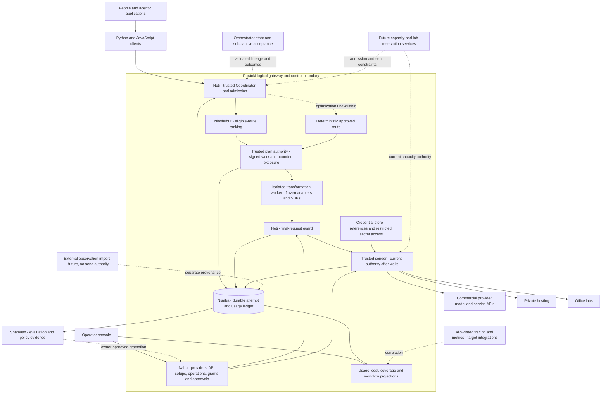

# Duranki — Model & AI-Service Routing, Metering and Control — Architecture

**Version:** v1.2 Correction 01 + Erratum 01  
**Status:** Corrected normative review draft; not adopted; no implementation or activation authorization  
**Date:** 25 October 2026  
**Owner:** Larry Mitchell  
**Predecessor:** v1.1 adopted baseline; submitted v1.2 and Dispositions 01–02 preserved as source history

**Read with:** [Assurance register](DURANKI-v1.2-C01-ASSURANCE-REGISTER.md) · [Development roadmap](DURANKI-v1.2-C01-ROADMAP.md) · [Review and research map](DURANKI-v1.2-C01-REVIEW-AND-RESEARCH-MAP.md). Erratum 01 is documented in [the delta note](DURANKI-v1.2-C01-ERRATUM-01.md); its document-only checks are in `DURANKI-v1.2-C01-E01-DOCUMENT-VALIDATION.json` and `MANIFEST.sha256`. The reviewed Correction 01 bytes are preserved under `predecessor/`.

Top-level sections 0–20 and test subjects T-01–T-76 are retained. T-77–T-87 cover the reconciled addendum subjects, with **T-84 a retired alias of T-49**, not another scored test. Source keys are defined in §20; all dates and implementation standings belong to their cited evidence, not to an implied current runtime.

## 0. Baseline status

### 0.1 Authority and interpretation

**v1.2 Correction 01 is a corrected review draft, not owner adoption or an implementation commission.** It consolidates the submitted v1.2, Dispositions 01–02, Addendum A and Claude Review 02. Their original files remain unchanged. The finding-to-clause and research maps identify every substantive correction and deliberate departure. [D1, D2, A, H, R2, P1]

The adopted predecessor remains v1.1 together with WP-A/A2's bounded wire `0.2`, canonical projection `duranki-work-v0.2` and profile `initial_1a@1` until an applicable successor is adopted. Preserve their strict parsers, canonical bytes, work keys and historical vectors. The operation-aware successor described here is separately versioned; it does not expand wire `0.2`. [S1, S2]

**Standalone-first:** develop Duranki while Larry finishes his prerequisite Vega work. No Vega/Proto instrumentation or integration is authorized by this document. Standalone contracts, schema design, installed clients and synthetic producers can progress independently. Production topology, provider activation, credentials, paid amounts, owner-profile migration and Git actions require their own scope.

**Production ledger engine: PostgreSQL.** The 23 October owner decision is recovered in the supplied reconciliation handoff. Managed hosting, topology and migration remain separate decisions; standalone SQLite remains supported within its qualified scope. The assurance register records the quotation-based provenance rather than claiming a newly inspected transcript. [H §4]

### 0.2 Document responsibilities

This document defines obligations and applicability. The dated **assurance register** records source, controlled-target, deployment, commercial and integration evidence separately. The **roadmap** defines implementation order and the bounded DEV-12 proposal. A `DEV-XX` slice is not an architecture phase. Requirements become gates at the first profile that relies on them, not merely at the historical phase heading under which they were written.

### 0.3 Organizing invariants

An isolated call need not be safe; a valid response need not be correct; a permitted destination need not authorize the next attempt. Ownership expiry does not release financial or capacity exposure. Discovery, permission, execution support, quality approval and health are separate. Intent, final commitment, first write, provider receipt, usage and settlement are separate facts. Unknown is not zero. Observed external work is not controlled work; attribution views are not additional charges.

---

## 1. Purpose and objective

Reduce the cost of useful work performed by people and collaborating agents without degrading accepted task quality, by:

1. **Metering** each in-scope model or AI-service attempt in its native units, preserving the evidence behind its cost, and attributing it to the authenticated principal, executing agent, initiating person, charging owner and task.
2. **Controlling execution** through explicit source-level permissions, user/service grants, typed operation contracts and bounded financial authority.
3. **Routing** eligible work among approved, semantically compatible configurations across commercial APIs, private installations and office labs when the appropriate routing phase is enabled.
4. **Explaining** where money and elapsed time go, including retries, delegated work, cache-related billing and incomplete measurements.

LLM text is the first implemented provider-shaped operation, not the universal request or billing schema. Adjacent services may be accounted for without pretending they are language models. Duranki is not intended to become a general enterprise API-management platform.

### Three distinct deliverables

**Engineering assurance** establishes the guarantees of a named controlled profile. **Observed spending** records what an authorized account export or provider observation supports at its actual granularity. **Accepted-task efficiency** additionally needs complete comparable task cohorts and acceptance evidence. Neither synthetic arithmetic nor account totals alone provide the latter. The Phase 0 taxonomy trigger remains not evaluable until its required evidence exists; it is not waived.

### Governing metric

**Cost per accepted task** for a task class:

  M = E[C_task] / P(task accepted)

over complete task cohorts, including failed and abandoned tasks.

### Objective

Over eligible joint policies π = (routing policy, recovery policy), jointly versioned:

  minimize M(π)

subject to, per task class:

- **Quality (relative):** non-inferior to the incumbent within margin δ_class (§11.3)
- **Quality (absolute):** acceptance ≥ the class's fixed quality floor
- **Latency:** P(T_task ≤ D_class) ≥ 1 − ε

This specifies what the system must achieve, not an optimizer to build. The cost decision rules (§6.2, §6.4) are working heuristics inside an approved envelope.

### Non-goals

- Rebuilding a general-purpose model server, vendor SDK ecosystem or observability stack. Duranki does own the minimal trusted admission, final guard/sender and accounting controls needed to enforce its contracts; integration code remains separate from off-the-shelf worker code.
- Sophisticated routing models before contracts, accounting and evaluation are trustworthy.
- A full online contextual-bandit framework at launch.
- Training or fine-tuning models; operating a model-hosting control product.
- An arbitrary enterprise API proxy, provider marketplace/reseller, general identity-provider administration, agent planner/tool orchestrator, or replacement for provider invoicing.

- Automatic access to newly discovered models or operations.
- Building a generic external response/semantic cache before evidence justifies it.
- Editing Vega or requiring live Vega traffic for the next standalone development additions.
- Treating a local allowance as an account-wide invoice ceiling or making production-saving claims from scripted data.

---

## 2. Summary

Duranki is the controlled crossing between people/agentic applications and qualified model or AI-service operations. Its trusted Coordinator authenticates work, establishes permissions and financial scope, and issues a signed plan. An isolated adapter worker prepares a request. The independent final guard checks its actual bytes and controls; the trusted sender owns the first-write fence and provider credentials. Nisaba records durable attempt and financial evidence independently of sampled tracing.

Neti enforces admission and sending; Ninshubur ranks eligible candidates before plan issuance; Nabu records owner-approved configurations; Shamash evaluates quality and efficiency. The caller/orchestrator retains planning, substantive acceptance, checkpoints, semantic recovery and application side effects.

Typed contracts cover text, retrieval, audio, media, search and later sessions without pretending they share a universal token tariff. Standalone engineering assurance, externally observed spending and accepted-task efficiency are distinct deliverables. A future Valhalla relationship adds verified commission and activation authority only after its integration is qualified; the common metadata envelope is designed with the next operation contract, not postponed until integration.

---

## 3. Design principles

1. **The gateway is the only door for controlled work.** Provider credentials are confined to the trusted credential/sender boundary, not the transformation worker or caller. Network policy prevents controlled consumers from bypassing it. Model, classifier, verifier, judge, evaluation and replay operations are governed alike. External observations are labelled separately until transport control exists; full-platform coverage is not claimed before integration.
2. **Admission is mandatory; optimization is optional.** Rules can short-circuit ranking, never admission.
3. **One final-dispatch contract for every controlled path**, including the emergency gateway and any future lab replica. A successful pre-queue check does not replace the current-authority check at the trusted first-write boundary.
4. **Availability never trumps policy.** If optimization fails, use a deterministic, approved, compliant route; if none exists, queue or fail explicitly.
5. **Plans authorize specific work**, are signed, and expire.
6. **Isolated ≠ safe; valid ≠ correct; permitted ≠ authorized.**
7. **Ownership expiry ≠ exposure release.** Money and capacity that may already be committed stay held until settled or proven unused.
8. **Derived data inherits source handling.** A boolean, category or score is not non-sensitive merely because of its representation.
9. **Quality is a constraint measured at the task level.** Structural signals are guards and features, never training rewards.
10. **Meter what matters**: queue depth, KV-cache occupancy, TTFT and predicted wait, not GPU utilization.
11. **Three separate affinities**: model affinity (behaviour), replica/cache affinity (placement), conversation state (recoverable independently of both).
12. **Extend, don't fork.**
13. **State what can be audited, reconstructed and re-executed**, and for how long (§13.1).

14. **Typed operations, native units.** Shared governance does not imply interchangeable request formats, billing units or output semantics.
15. **Discovery never grants authority.** Catalogue, access check, source permission, principal grant, qualification and health remain separate.
16. **Evidence is scoped.** Source inspection, synthetic proof, deployed observation, provider-reported usage and invoice reconciliation are distinguishable.
17. **Attribution is not another charge.** One attempt can be viewed by provider, agent, user and workflow without adding those views together.
18. **No invisible work.** Ordinary page loads, report refreshes and route previews do not trigger provider calls. Paid tests, discovery and external checks are explicit, scoped actions.

---

## 4. Architecture



**Diagram scope.** Responsibilities, not a deployment manifest. The worker has no provider/credential edge; the console uses authenticated APIs. Optional integrations follow their profile gates.

### 4.1 Components

| Component | Responsibility | Architectural choice / boundary |
|---|---|---|
| Trusted ingress | Authenticated human/service context; later office-origin evidence | Identity/edge integration independently qualified |
| Orchestrator | Work identity, checkpoints, substantive acceptance and side effects | Caller-owned durable state; Vega integration deferred |
| Coordinator and clients | Neti admission, strict API, query-first recovery | Python service; separate Python and plain CommonJS network clients |
| Preparation worker | Provider-specific request preparation | Isolated frozen SDK/LiteLLM or qualified Duranki adapter; no provider secrets or direct egress |
| Plan authority, final guard, trusted sender | Neti binding, durable commitment and first-write freshness | Duranki-owned trusted modules; common enforcement contract, protocol-specific qualification |
| Source/configuration registries | Nabu inventory, API setups, operation permissions, grants and approvals | Durable versioned management records |
| Route ranking | Ninshubur eligible-candidate ordering and explanations | Deterministic rules first; later qualified predictors |
| Ledger / financial authority | Nisaba immutable events, usage revisions, reservations and exposure | SQLite standalone; **PostgreSQL production ledger**; mutable operational state separated by privilege |
| Shared-state coordination | Replicated ownership/authority where introduced | Redis remains a target choice, not the ledger or independent spend authority |
| Console / reports | Configuration, controls, usage, outcomes and coverage | Authenticated Duranki API/UI; isolated demonstrations |
| Tracing / metrics | Correlation and diagnostics | Langfuse, OpenTelemetry Collector, Prometheus and Grafana remain target choices |
| Serving / scheduling | Model serving, cache-aware placement and capacity | vLLM/SGLang and orchestration selection remain open |
| Lab controls | Capacity leases, presence priority, reservation/drain | Separately qualified capability, §7 |
| Evaluation | Shamash datasets, outcome checks and promotion evidence | Offline/workbench jobs; Jev remains a candidate |
| Credential custody | Write-only setup and restricted sender secret resolution | Local test profile distinct from production secrets-system selection |
| External observations | Offline spending import and later independent observations | No provider-send or budget authority conferred by import |

The two preparation lanes share the same trusted plan/guard/sender obligations. A different protocol may require another qualified sender, not a hook-based bypass. Target product choices do not require installation during a synthetic extension. Dated component evidence is in the assurance register.

### 4.2 Duranki agents

The five names denote architectural roles, not autonomous permission to alter policy or money. Their Mesopotamian stories remain in *Components and Legends*.

| Role | Function | Limit |
|---|---|---|
| **Neti** | Admission, signed authority, final guard, sender freshness and capacity/lab checks | Enforces eligibility; does not optimize by relaxing it |
| **Ninshubur** | Rank the candidates admitted by Neti; explain rules and qualified recovery choices | Proposes an order **before** trusted plan issuance; cannot mint authority |
| **Nisaba** | Durable events, dispatch/usage evidence, financial exposure and projections | Accounting evidence does not grant access |
| **Shamash** | Evaluation, acceptance measurement and non-inferiority evidence | Supplies evidence; does not self-promote configurations |
| **Nabu** | Source, operation, grant and approved-configuration registries | Records approvals supported by evaluation and the named owner; never self-approves |

Several roles may run in one trusted service; their authority boundaries still apply.

### 4.3 LiteLLM verification and built-in routing

**Retained decision:** extend off-the-shelf preparation components; do not fork them. The supplied DEV-11 evidence uses the frozen LiteLLM `1.105.1` wheel and OpenAI SDK `2.54.0`. These are historical tested inputs, not a recommendation that an unreviewed current installation is safe or that they implement every provider feature. [S5]

The worker prepares a candidate request; the trusted guard independently checks its actual operation, destination, body and transport controls against the signed plan. The trusted sender alone has provider-send authority. A hook, logging callback, hostname allowlist or successful SDK transformation is not a substitute for this boundary. Every selected extension must demonstrate worker isolation, exact final binding, no hidden send, current-authority checking after waits and truthful outcome reporting. [S3]

**Built-in routing disabled.** Vendor auto-routing, model aliases that silently change execution, parameter dropping, SDK retries, implicit fallbacks, redirects and alternative client paths are disabled unless an explicitly versioned Duranki contract authorizes and accounts for their effects. A catalogue or discovery adapter is not an inference adapter. Capability exposure follows qualified operations, not the upstream library's advertised feature count.

**Contingency:** the earlier choice between a front-door guard and exclusive sender has been resolved for the bounded development paths in favour of the separated trusted sender. Future replacement of LiteLLM or a protocol adapter must preserve the Duranki authority and ledger interfaces. A source selection or a new library release is not qualification of that replacement. Production/multi-protocol qualification remains a separate gate.

### 4.4 Supply-chain protection

Supply-chain compromise remains a design threat. A pinned hash proves artifact identity, not absence of malicious behaviour. The worker is therefore treated as untrusted with respect to secrets, policy, ledger integrity and provider egress. These controls apply to each introduced dependency and service; selecting a reference architecture does not require installing every optional product at once.

1. **Pin and verify.** Exact versions, hashes and image identities; no floating versions or runtime `latest` pulls. Review the resolved dependency set and the actual distribution used (test 37).
2. **Controlled builds.** Build Duranki-owned images from reviewed source and explicitly approved frozen distributions, offline where supported. Record source, package, platform and image correspondence; do not describe an installed publisher wheel as a source-rebuilt dependency. Runtime startup does not acquire packages.
3. **Controlled adoption.** Record advisory review, artifact inspection, changes, tests and a soak decision; urgent vulnerability exceptions require a recorded owner decision (test 41). No upgrade is part of this architecture edit.
4. **Separate egress and authority.** The worker cannot open a provider path or read provider keys. The trusted sender permits only contract-bound endpoints and request bytes; telemetry services reach only approved stores. Host allowlisting alone cannot stop misuse of an allowed provider endpoint (test 38).
5. **Credential custody.** Production credentials belong in an approved secrets system, readable only by the trusted credential/sender runtime. Distinguish logical binding, authorization/account-scope revision and secret-material revision actually used. A future qualified same-scope rotation may resolve new secret material at send time only after endpoint/account/project/permission/handling equivalence is established and the used revision is safely recorded. Unknown equivalence, changed scope, compromise or revocation blocks/revalidates queued work. Until qualified, preserve the stricter existing revision checks. Local replacement and upstream revocation have separate evidence (T-39/T-45).
6. **Inventory and response.** Keep component/artifact inventories, security ownership and a tested disable/rollback procedure. On suspected exposure, pause affected paths, preserve evidence and assess reachable secrets; rotate potentially exposed credentials. A clean frozen-input check is not a host-wide forensic audit.
7. **No blind recovery.** Rollback does not re-enable revoked grants, reset unknown exposure, discard usage revisions or authorize a dependency version with an unresolved security disposition. No verified safe build means fail closed or use an independently qualified replacement.

This revises v1.1's broad assertion that an allowlisted gateway could not leak credentials: isolation, least authority and exact-send controls are all necessary. The historical incident references in §20 are context, not a fresh security audit.

### 4.5 Provider, account, deployment and operation model

**Provider** is the organization or service offering an API. **Publisher/model family** identifies the model's origin; it need not be the serving provider. **Private installation** and **office lab** are source types, not model families. **API setup** is one configured access context: provider/installation, account/project or tenant, endpoint/region, protocol adapter and credential binding. It is not a live socket and does not necessarily equal one API key.

| Entity | Required meaning and relationship |
|---|---|
| Source | Commercial provider, private installation or office lab; stable ID, display name, owner and source type |
| Account / API setup | Source-specific access context, account/project scope where applicable, endpoint/port, region, protocol/version, TLS policy and credential-reference revision |
| Credential binding | Write-only secret input or approved authentication mechanism; safe metadata and status only in ordinary reads; never the primary user/agent attribution identity |
| Model / service catalogue entry | Published or declared identity and documented capabilities; explicitly reference-only until discovered/declared for a setup |
| Deployment / service endpoint | Exact execution target within an API setup, including model version/quantization or service version where relevant |
| Operation contract | Typed action and versioned request/response/usage/bound/lifecycle rules (§5.7) |
| Source permission | Administrator's explicit allow/disallow for the deployment and operation under an API setup; initial deny |
| Principal grant | User/service authority over permitted deployment/operation combinations, constrained by purpose/task/financial scope and delegation |
| Quality approval | Separate task-class/operation qualification for a configuration; neither credentials nor source permission supplies it |

Effective permission is the intersection of current source/account status, explicit source-operation permission, authenticated principal and delegated authority, operation capability, handling rules, quality scope and applicable financial controls. Administration is not an implicit generation grant. A per-provider default may narrow all accounts but cannot implicitly authorize another account's deployments.

**Discovery.** Explicit discovery retrieves the inventory visible through one selected setup and adapter. Store its timestamp, API/account scope, pagination completion and completeness/partial/error status. “Complete” means complete within that returned account/endpoint/API scope, not every model a vendor might offer. Manual inventories for private/lab sources record their provenance. Unsupported discovery is shown as such. Refresh never creates grants, enables a route, republishes prices or revives archived/disallowed records; disappearance and partial failure are not silently treated as deletion.

**Protocol specificity.** Provider APIs may require different paths, versions, headers, project identifiers, service-account authentication or SDK transformations. Setup uses a supported adapter with typed parameters, not arbitrary executable connection strings. “Add provider” may create a reference/draft source, but an unqualified protocol remains unavailable for execution. Private/lab endpoints require explicit network-destination approval; arbitrary URL input, redirects, DNS changes and credential forwarding must not create an unintended outbound capability. Private networks are allowed only where deliberately registered and qualified, not inferred safe because they are local.

### 4.6 Operator console and human-facing contracts

The console organizes work around **Providers**, **Private Hosting**, **Office Labs**, **Users & Access**, **All Models**, **Usage & Costs** and operational diagnostics. “All Models” remains the cross-source model view; adjacent non-model services are identified separately rather than fabricated as models. A service/operation filter or a dedicated service subsection may expose them without replacing the provider hierarchy.

**Setup journey:** Add provider/installation → name API setup/account → enter credential locally → explicitly check access → explicitly discover/declare inventory → allow selected operations/models → grant user/service access → review applicable price and finite test limits → deliberately submit a test. Saving, checking, discovery, approval and generation are different actions. Navigation and local Refresh do not contact providers.

Provider rows show **Not configured**, **Key saved — not checked**, **Access verified at [time]**, **Access check failed**, or **Check out of date**, as appropriate; execution readiness and permitted-model counts are separate. Multi-account summaries show names and verified/total setup counts with drill-down, not an unexplained number of “connections.” An access check reports what it actually exercised; model-list success does not prove generation permission or adequate quota.

A provider detail page owns its account setup and credentials controls, discovered inventory and per-operation Allow/Disallow actions. Source-scoped grant choices contain only currently permitted deployments, with blocked existing grants visible and explained. Readiness separates credential evidence, API support, permission, qualification, rate eligibility and health. Registration never provisions real people or access from a demonstration fixture.

**Commercial pricing.** Show source titles as clickable reference links, rates with units/currency/conditions, observation date and any independently established effective dates. “Update provider price” means import or record a reviewed immutable publication, not change the vendor's price. A negotiated account rate is a distinct approved schedule; a private/lab internal tariff is separately labelled. No free-form edit silently changes a published commercial schedule. Price-history charts plot recorded snapshots only, distinguish observation from effective time, separate incomparable rate bands, show gaps and have an exact accessible table. One observation is one point, not invented historical history.

**Actions and language.** Use “Change history” for registry/audit history and “Available endpoints” or “Where this model runs” for deployments. Edit must open a permitted edit action, or be disabled with a reason. Disable/archive/revoke preserve historical references; destructive removal of referenced authority or financial evidence is not a cosmetic delete. Mutations use authenticated role checks, current revisions, audit records and browser protections. Secret registration is write-only, with explicit replace/revoke rather than secret reveal. Reports and exports apply the same authorization as the underlying records.

**Usage presentation.** Lead with understandable names, amounts, dates, operations and outcome/coverage; exact IDs are secondary. Provide searchable selectors rather than mandatory opaque-ID entry, a visible timezone, period filters and separate revision cutoffs. The inspector shows workflow/agent lineage, operation, decision reason, attempt stages, usage evidence, cost and outstanding exposure. Timeline lanes, summaries, ticks, cursors and cost plots share the same origin and scale. Keyboard operation, responsive layout and clear empty/error states are acceptance requirements.

Demo records carry an unmistakable scripted/simulated banner, isolated storage and exports. Replay/seek/filter actions reveal existing records only. Demo amounts never enter operational totals or serve as agent-efficiency evidence.

### 4.7 Selected commercial-router patterns

Retain the useful patterns identified in the supplied comparison: governed source catalogues and scoped keys; capability filters; budget scopes and alerts; named versioned policy drafts/preview/rollback; operation-level health/cooldowns; workflow inspection; application-specific evaluation. Their provenance remains in the preserved v1.2 §20.3; this correction does not reverify commercial products.

Duranki's adoption conditions govern each pattern: discovery does not grant access; unsupported parameters are preserved or rejected; alerts do not replace financial reservations; preview does not send; cooldown never widens permissions; trace sampling does not remove ledger obligations; evaluation cannot self-publish a policy. External caching, arbitrary plugins, an elaborate policy programming language and general prompt management remain deferred.

---

### 4.8 Independent state dimensions

Each dimension changes only on its own authorized event/evidence; none is a single “ready” state implying all others.

| Dimension | States / transition rule |
|---|---|
| Source/setup lifecycle | Draft → enabled by explicit approved management action; disable/archive through revisioned action. Re-enable requires current checks, not page refresh. |
| Credential evidence | Saved/unchecked → verified or failed by explicit scoped check; time, material rotation or scope change makes prior evidence stale. Saved is not verified. |
| Inventory coverage | Not discovered → complete-within-declared-scope, partial or failed by explicit discovery; retain last evidence/time and current completeness separately. |
| Permission / quality | Explicit allow/revoke and approved/withdrawn configuration are independent versioned authorities. A credential success does not change either. |
| Attempt observations | Admission/intent → final commitment → possible first write → response/failure/unknown, only as observed. Durable no-send proof must also exclude delayed release. Later receiver evidence is append-only, not invented from a local write. |
| Cancellation | Requested → confirmed/unresolved only on contract-qualified evidence; local closure cannot imply provider stop. |
| Usage / settlement | Immutable field evidence and usage revisions (§10.2); sufficient complete evidence permits once-only financial adjustment. Unknown/partial evidence retains relevant exposure. Later correction replaces the effective revision, not the historical row. |
| Attribution coverage | Registered, source-identified, instrumented and observed-active are independent evidence facts. Period-specific idle requires known coverage; absence of activity without coverage remains not measured/unknown. |

Reclassification, late observations and corrections append facts with their own time and provenance. Read paths select an authorized cutoff without modifying execution or financial state.

---

## 5. Request lifecycle and contracts

```text
validate identity, delegation, purpose and financial attribution
  → resolve supported operation contract and handling policy
  → establish eligible source/deployment set and applicable limits
  → optional future response-cache lookup (disabled now; §5.6)
  → rank, or retain the fixed approved destination
  → atomically reserve bounded exposure where required by the profile
  → issue signed plan: canonical work + operation + candidate specifications
  → prepare candidate in isolated worker
  → independently validate actual final request and current authority
  → persist final-request/dispatch commitment before release
  → after lower waits: trusted sender rechecks current authority at first write
  → observe transport/result/usage separately → append settlement revisions
```

Preparation/admission intent and the final-request commitment are durable facts before sending, not evidence that a request reached a provider. A failure at any point is classified by the last established fact rather than by a generic “dispatched” flag.

### 5.1 Mandatory admission

#### Admission profiles

Admission is mandatory in every phase. **What each control enforces depends on the phase's admission profile**, which states explicitly which guarantees are active. The inherited phase profiles below are target assurance levels, not a summary of which development slices have run.

**Standalone assurance profile.** A declared single-authority local deployment with installed supported clients, authenticated service, isolated worker, trusted guard/sender, durable SQLite accounting and explicitly qualified synchronous operations. Its threat boundary includes untrusted callers and arbitrary preparation-worker behavior, but not a compromised trusted host/kernel or a distributed authority service. The profile manifest names operation, schema, adapter, lifecycle, transport and build. Unknown/new operations reject. §15.2 defines its exit; production phase gates remain separate.

**Bounded personal-test extension.** One exact qualified recipe/price/usage contract, finite count/expiry/concurrency and atomic monetary reservations with unknown-exposure handling. Paid eligibility is separately activated and does not cover unrelated account spend. Synthetic retrieval does not inherit commercial eligibility from bounded text. [S5]

| Control | Phase 1a profile | Full profile (1b onward) |
|---|---|---|
| Identity, purpose, destination permission, classification, retention | Enforced | Enforced |
| Quality approval | Fixed requested configuration appears in an explicitly approved versioned record; original file or its controlled persistent-registry successor | Approved-configuration registry with operation/task-class scope |
| Budget | Per-principal spend limits and alerts; **no hard concurrent ceiling guarantee** | Atomic reservation with exposure tracking (§10.4); fail closed |
| Destinations | Fixed requested destination and supported operation; no model substitution | Ranked eligible set only for separately qualified routing capabilities |
| Eligible workloads | Those not requiring hard concurrent ceilings; bounded personal campaigns follow their separate contract | Only workloads with the required operation, quality, lifecycle and financial guarantees |

#### Controls

1. **Identity.** Principal and task ownership derived or validated from authenticated context. Background work runs under a named service principal with a charging owner. Caller-supplied tags are validated, never trusted.
2. **Attribution** per §9. **Migration mode** admits agents with explicitly identified *accounting or analytical metadata gaps* (e.g. missing subtask labels) under their authenticated principal, flagged non-compliant and ineligible for optimization. Migration mode **never** bypasses identity, destination authorization, purpose validation, source classification or retention restrictions.
3. **Classification.**
   - The **orchestrator** performs monotonic taint tracking: every tool result, retrieved document and attachment carries its source's sensitivity and client-specific restrictions; a context's handling policy combines all of them and never weakens.
   - The **gateway** enforces structural guards: PII and secret scanning, rejection of untagged tool results and content blocks, payload validation.
   - Classification is a **deterministic, locally evaluable rules engine** (label inheritance, patterns, allowlists) with a named owner, a labelled test corpus, and minimum bars on false negatives (missed sensitive content) and false positives. Model-based signals are auxiliary only.
   - **Handling policy is the combination of applicable restrictions**, not only the maximum sensitivity level. Search queries disclose content and intent. Audio relies on qualified source labels and operation-specific classification; unavailable scanning does not waive a required check.
   - **Opaque provider-side compaction inherits the union of all input taints and restrictions and the strictest applicable retention.** Loss of inspectable text, encryption or a provider reference does not declassify the content. Unsupported handling fails closed; this is a present handling rule, not a deferred experiment.
4. **Purpose.** Trusted purpose on every request: `execution`, `feature_extraction`, `verification`, `judging`, `evaluation`, `replay`. Supporting purposes follow fixed policies: no recursive optimization, no cascades.
5. **Derived-call inheritance.** Requests derived from another (verifier, judge, feature extraction including Jev, distillation, summarization) inherit the source's handling policy combined with their own. Feature-extraction and judge templates are reviewed as **policy artifacts**.
6. **Destination and operation permission** per source, account/API setup, service endpoint, operation, inference profile, model and processing geography. Explicit source permission and a current principal/delegation grant are both required; neither replaces quality approval. Above public sensitivity, marketplace inference profiles must be region-pinned. Residency, export-control and per-client attributes are part of this record.
7. **Capability compatibility**, demonstrated by tests for the exact operation/protocol/version. Publisher capability, account visibility, implemented adapter support and enabled profile support are different. Unsupported modalities, parameters or output contracts reject before sending.
8. **Quality approval.** A destination is eligible only as part of an approved configuration for the task class (§5.5). Canaries use separately authorized experimental scope.
9. **Pinned-model mode.** The plan has no fallbacks; unavailability or ineligibility produces explicit failure to the orchestrator. Only the orchestrator may relax a pin.
10. **Budget authorization** per the admission profile. Under the full or bounded-personal profile: atomically reserve the reviewed maximum for the admitted operation domain; enforce all applicable monetary/count/concurrency/expiry controls. Fail closed when required budget state or a finite bound is unavailable (§10.4); no configured exceptions.
11. **Per-client retention and handling terms** are principal/task attributes evaluated here, flowing into the plan's `retention_class`.

12. **Operation semantics.** Bind the action and versioned contract independently of model identity. A grant for text generation cannot authorize embedding, transcription, image generation, a hosted tool or index creation. Supporting local processing and externally observed work do not acquire execution authority by appearing in a report.

Output: the eligible set. If empty, reject or queue with an explicit reason.

### 5.2 Optimization (ranking)

May be skipped (Phase 1a, which uses fixed destinations) or fail without affecting admission.

1. Deterministic rules by agent role and step type (versioned).
2. Lab preference (§7).
3. Learned predictor (§6.5) for ready step types.

Decisions record a propensity; deterministic decisions record 1.0. Routing logic reads only the **avoidable incremental** cost view (§10.5). Named policy versions and read-only explanation are specified in §6.9. Rules may filter or order only compatible, permitted, qualified candidates; unavailable capability or unknown required financial bounds cannot be traded away for a lower estimated price.

### 5.3 Execution plan

Neti's trusted plan authority validates any proposed candidate order and signs admitted work. The isolated worker holds neither the signing secret nor provider credentials. Binding has two levels: server-authoritative canonical work, then independently validated final prepared bytes/transport controls for each allowed candidate.

**Plan-signing key custody (G-02).** Production plan-signing keys reside in a managed key service, identified by `key_id` and `key_version`. Only Neti's trusted plan authority may invoke signing, and only for validated admitted plans. Guard and sender roles hold verification material only; the isolated worker, optimization/ranking component and clients have no signing capability. Rotate signing keys on a documented schedule. Compromise revokes the affected key version: FDC check 1 and first-write freshness reject unsent plans under that version, even if their signatures remain mathematically valid. Fresh trusted authorization may issue a replacement plan only while preserving work identity, send ownership and existing exposure. Re-signing never authorizes replay of a possibly sent attempt. Historical signatures remain auditable without making a revoked key eligible for execution. A declared isolated-test profile may use a scoped synthetic key; that is not evidence of production managed-key custody. The successor restates the signer as the **trusted plan authority**, replacing the historical WP-A phrase 'optimization layer'.

**Successor binding decision (M-06/F-01).** The next operation contract includes the common envelope in §9.4 in the **same** versioned change as operation type/version and native usage. It is not an unscheduled later metadata profile. Exact serialization/schema identifiers and golden vectors are entry work for DEV-12; they cannot be invented by silently extending wire `0.2`.

| Data | Binding location and rule |
|---|---|
| Authenticated principal, task/step/revision/execution generation, charging owner and validated current actor | Canonical work in their trusted namespace; assertions must match the chosen authentication/binding profile |
| Operation `{type, version}`, request schema, ordered payload, purpose, settings, limits, compatibility references | Canonical work; operation-domain-separated digest; exact supported fields only |
| Caller-asserted commission reference and caller-declared reason, including explicit omission under the schema | Canonical shared envelope; preserve submitted meaning without inserting a lookup-derived value or server judgment; changed assertions under the same WorkKey conflict |
| Caller-asserted ordered delegation links and caller-declared reasons | Canonical shared envelope as assertions, not implicit authority; existing lifetime-stable trusted endpoint identity remains mandatory under the selected authentication profile |
| Server-assessed commission status, delegation verification/coverage and server-assigned absence reasons | Immutable signed admission snapshot, bound to the work digest inline or by an immutable content digest in the signed plan; outside canonical work and deduplication identity |
| Activation epoch and its absence reason | Signed execution-context envelope in the plan, **not** the logical-work/deduplication key; scoped to the current actor/activation and rechecked when enforcement is enabled |
| Logical-effect reference | Derived from the full authenticated work namespace (§8.2), or a separately qualified non-step identity contract; no bare global generation string |
| Policy, recovery, registry, source permission, grant/delegation, credential-scope, price/usage contract references | Signed plan/immutable trusted references; the named revision vector and live checks govern first write (§5.4) |
| Trace IDs, diagnostic timestamps, later verification events and actual secret-material revision | Correlated evidence outside canonical work; retained under policy; later events never rewrite the admitted snapshot |

**Why activation is separate:** fencing an old activation must not automatically create another logical effect or release old exposure. A new activation context requires fresh trusted authority, and can never replay work whose transmission is possible or unknown. The successor includes this signed field from its first version, so later activation enforcement need not change the work identity. No new execution is authorized merely by reconnecting.

**Stable work; changing assessments (G-01).** Keep server assessments separate from submitted assertions. Commission status, chain coverage and server-assigned reasons such as `unavailable`, `not_yet_issued` and `caller_omitted` do not enter canonical work. Caller-declared reasons remain bound as caller content; they never establish verified authority. Trusted identity values may enter canonical work only when their contract keeps them stable for the authorized work's lifetime. Later verification cannot insert newly resolved endpoints into an existing work identity.

The signed admission snapshot is immutable and tied to the admitted work digest. Later assessments append linked evidence with their own time and source. With the same WorkKey and unchanged canonical assertions, a resubmission resolves to the original submission/attempt despite changed server assessments; it creates no extra attempt, reservation or send. Current authorization and retention still govern access to that result and any unsent work: deduplication is not a stale-authority exception. Changed caller assertions under the same WorkKey remain a conflict. A newly required commission cannot be bypassed by recovering an old work key. Any authorized replacement admission/dispatch context preserves logical identity, original evidence, durable no-repeat ownership and exposure.

**Settings.** Bind applicable reasoning effort/thinking mode, service tier and provider context-management/compaction configuration, with explicit resolved defaults. Record requested and effective values separately; unexpected semantic/tier substitution is rejected or becomes an explicit discrepancy under the selected contract. Explicit cache TTL/key/content-reference controls, when enabled, are signed semantic controls with complete pricing/handling semantics. DEV-11 remains implicit-only.

**References and preparation.** Immutable references bind identity and content version/digest; mutable references must be materialized or resolved by a qualified versioned rule before binding. The candidate adapter is a versioned transformation of the admitted request. Independent final validation occurs after all callbacks. Silent semantic parameter dropping is prohibited.

The signed plan additionally includes plan ID, signature/expiry, exact source/account/deployment/model or service version and processing geography, candidate adapter map, capability and quality-approval references, failure/retry/escalation policy, deadline and per-attempt timeouts, all operation bounds, budget account/reservation and authorized financial scope, capacity lease where applicable, cancellation linkage, retention class, lifecycle profile and decision record. Pinned work has no model alternatives; spine rules remain §6.6. Classification snapshots are audit evidence; final checks use current restrictions.

Operation type, operation-contract version, execution attempt and administrative command/idempotency identity are distinct. Inspect the existing registry field before selecting an additive management-field rename; no legacy field is repurposed by this architecture.

### 5.4 Final-dispatch check and authorization point

**Final-dispatch check (FDC).** Before every attempt on every path (first dispatch, retry, fallback, deterministic route, emergency gateway, any future lab gateway replica), in order:

1. Plan signature valid under an execution-eligible key ID/version; plan unexpired and neither plan nor signing-key version revoked.
2. `policy_version`, `recovery_policy_version` and `registry_version` match current, else replan.
3. Candidate prepared request, after all adapters and callbacks, matches canonical work, operation contract, candidate adapter version and the exact endpoint/transport controls; unknown or silently dropped semantic fields reject.
4. **Current** classification and combined handling policy are within the destination's permission.
5. Source/API setup, deployment and operation remain permitted, qualified and supported; principal/delegation, credential and grant revisions remain current.
6. Current reservation state, admission class and a valid capacity lease (lab and pools).
7. Financial authorization covers the attempt's maximum exposure.
8. Deadline sufficient.

Any failure → replan via the orchestrator, or explicit failure.

**Authorization point and Choice B first-write fence.** Persist the final dispatch commitment after a passing FDC. The selected standalone serialization point is the trusted sender's **Choice B first-write fence**, not an earlier hook or a revision comparison alone. Publication of the sender's authoritative in-memory view and first application-request release pass through the same trusted local gate. Complete durable persistence, signature verification and potentially blocking preparation outside the gate. After all resource/readiness waits, the sender enters it, checks the coherent current in-memory authority/key-status view, deadline, unused send ownership and coverage of the durable reservation, then performs the qualified nonblocking first-write operation without a later unguarded wait. A would-block/no-acceptance result releases the gate, waits outside it and repeats freshness checks. Positive partial acceptance consumes first-send authority; only the unsent suffix of that same attempt may continue under its qualified in-flight semantics. Choice B supplies the local fence precedent; the durable publication ordering below is a successor requirement, not a new historical execution claim. [S3]

**Authority-update ordering (N-01).** First atomically commit the authority change and corresponding named revisions durably, outside the first-write fence. Next publish a coherent, non-regressing authoritative view to the sender under that fence. Only then acknowledge effectiveness. Serialize or order competing publications so an older committed view cannot overwrite a newer one. Local revocation becomes effective at the fence-protected publication, not at receipt of the management request or at an earlier database commit; record these distinct stages. The interval before publication is not reported as effective revocation. No database I/O, key-service call, connection wait, response wait or drain wait runs under the first-write lock.

A failed or uncertain commit/publication withholds success and closes affected admission/release until consistency is recovered. On restart, reload and validate durable authority before enabling any send. A crash between durable commit and publication cannot revive the old authority view; a crash after a possible send preserves uncertainty and exposure. Absence of a later write receipt cannot justify replay. Qualification must exercise the commit-to-publication interval, update failure, out-of-order publication and restart behavior as part of the §5.4/T-24 boundary; historical queue-revocation evidence alone does not prove this full successor protocol.

**Authority revision vector.** This is a coherent snapshot of the existing applicable named revisions—policy, recovery policy, registry/configuration, source permission, principal/grant/delegation, credential authorization/account scope, and price/usage-contract eligibility—not an additional master counter. Qualified commission and activation inputs join when enabled. A vector comparison can identify invalidation, but does not replace the fence, expiry, remaining balance, capacity or single-send ownership checks. Preserve implementation-private legacy counters and current strict checks until their explicit successor is tested. Publication, rotation and effective revocation follow their own contracts; rollback cannot resurrect revoked authority.

This local Choice B mechanism is the concrete standalone boundary. A PostgreSQL/replicated authority must separately qualify an equivalent end-to-end release fence, coherent revisions, atomic reservations and ownership recovery. A per-process lock or a shared version store alone is not the distributed proof.

An effective revocation before first transmission blocks queued unsent work even when a commitment exists; the qualified sender defines and records the local authority-ordering boundary. A revocation after transmission does not recall bytes already accepted by the transport; cancellation is best-effort under the qualified lifecycle and exposure remains until justified settlement. TLS handshake traffic, local acceptance of application bytes, remote receipt and billed execution must not be conflated. A new protocol needs an equally explicit boundary and evidence; the plaintext/TLS development observations do not automatically qualify HTTP/2, WebSockets, multiplexing or asynchronous jobs.

Reports distinguish **intent persisted**, **final request committed**, **first write observed**, **explicit no first write**, **write evidence unknown**, **independent receiver arrival** (when available), and **usage/cost state**. Absence of a write record alone is not proof of no send. A local positive write is not proof of provider receipt.

| Failure | Behaviour |
|---|---|
| Optimization error or timeout | Deterministic **approved** route from the eligible set |
| Predictor or feature extractor unavailable | Rules-only ranking, reported as such |
| Destination fails before transmission | Another attempt only if non-transmission is established, its route/operation is explicitly allowed and current financial/recovery authority permits it; otherwise return an explicit result |
| Gateway replica failure | Qualified recovery transfers ownership, not permission to replay ambiguous work; exposure and prior attempt identity are retained |
| All replicas unhealthy | Emergency gateway preserving **all of §5.1 and the FDC** (no optimization); rules-engine classification lets it operate |
| Shared-dependency outage (Redis, policy store) | Budget or policy state unavailable ⇒ fail closed |
| Ledger primary unavailable | Replica-local durable WAL for a bounded window (§10.1); WAL unavailable ⇒ fail closed |
| No compliant route | Queue (if deadline allows) or explicit failure |

### 5.5 Approved-configuration registry

An **approved configuration** = source/API setup + deployment/model/service version + operation contract + applicable quantization/pool + request/output adapter + reasoning effort/thinking mode + service tier + context-management/compaction configuration + verifier + recovery policy + consumption/compatibility contract, approved for a task class. Inapplicable settings are explicit; applicable defaults are resolved. Requested/effective tier and effort remain distinguishable. A changed model/effort/adapter/compaction combination does not inherit quality approval from its display name. Price and usage references are financial eligibility dependencies; tier also affects the qualified lifecycle and latency.

| Lifecycle step | Rule |
|---|---|
| Phase 1a / existing registry successor | Explicit approved incumbent records scoped to the onboarding cohort; the persistent registry may succeed the original file without implicitly approving new configurations |
| Addition | Requires confirmation-set evidence (§11) or, for incumbents, explicit owner approval |
| Approver | Named registry owner |
| Revocation | Immediate; increments `registry_version`, which revokes outstanding plans at the FDC |
| Canary | Separately authorized experimental scope, never ordinary eligibility |
| Changes | Any change to a configuration's semantic components is a new configuration subject to §12.4; credential/permission/price revisions also invalidate affected queued authority as specified by their contracts |

### 5.6 Gateway response cache

**Deferred; not a prerequisite for the next tranche.** The supplied caching assessment recommended fixing accounting rather than adding an external cache; DEV-11 addresses a bounded part of that accounting need and does not establish cache-performance savings. [S5, S6]

Keep three mechanisms distinct: provider-native prompt/cache billing; serving-layer prefix/KV reuse; and gateway answer/response reuse. A reported cache read proves only the usage evidence stated by its provider contract, not physical cache residency, semantic equivalence, a deletion deadline or a latency benefit. No Redis, semantic cache or new response store is commissioned here.

If gateway response caching is later justified, lookup must follow mandatory admission, current authorization and operation compatibility. Keys must bind security domain, combined handling policy, qualified configuration, operation/schema, model/prompt versions and relevant corpus/tool-state versions. Sensitive content and derived embeddings retain their handling restrictions. Cached delivery is recorded as cache delivery, not a new provider send; its own cost, source attempt and any explicit allocation remain distinguishable. Semantically similar prompts are not automatically interchangeable. Current authority and retention govern whether a prior result can be delivered.

Adoption requires representative repeatability, quality, freshness, privacy and measured net-cost evidence, including invalidation and storage overhead. Preserve test 25 as the gate for that optional capability; Phase 2 does not require building a cache merely to complete a roadmap box.

### 5.7 Versioned operation contracts

An **operation type** identifies an action, not a model family, purpose or unique execution. Illustrative types are `text.generate`, `embedding.create`, `rerank`, `vision.describe`, `audio.transcribe`, `audio.synthesize`, `image.generate`, `responses.search` and `voice.realtime`. These are design vocabulary, not new accepted API values. Research family IDs `MS-01`–`MS-15` remain source traceability IDs, not wire identifiers.

Every enabled contract must specify:

| Contract area | Required content |
|---|---|
| Identity and version | Operation/type version; request/response schema; adapter and usage-semantics versions; supported execution profile |
| Request meaning | Typed inputs, ordering, role (for example document/query), model/service and supported parameters; preserved or explicitly rejected semantics |
| Domain limits | Byte/item/context/output/duration/session bounds as applicable; which are local handling limits and which prove billable exposure |
| Result | Shape, identity matching, item order, dimensions/formats, errors and structural validity; separate substantive acceptance |
| Compatibility | Corpus/vector-space profile, score interpretation, media format, state/session assumptions or other operation-specific constraints |
| Permission | Source setup/deployment/operation scope, principal/delegation authority, purpose, task class and handling restrictions |
| Usage | Native reported fields, field presence, overlap/partition rules, known-zero/not-applicable conditions, revision identity and completeness checks |
| Pricing | Immutable exact-decimal function, units/currency, rounding/minima/tiers/modifiers, source/effective dates and complete admitted domain |
| Exposure | Conservative bound for all enabled billable components and uncertainty; rejection when a required bound is not established |
| Lifecycle | Synchronous, stream, chunk, job or session behaviour; first-send boundary, timeouts, cancellation, status recovery, retries and duplicate semantics |
| Artifact handling | Payload/version binding, byte custody, permitted storage/access, expiry and safe retrieval where relevant |
| Qualification | Independent positive/negative evidence through actual selected adapter/guard/sender, plus regression and acceptance scope |

The reusable core supplies identity, permissions, binding, reservations, ledger revisions and projections. An adapter supplies protocol preparation and normalization under one reviewed contract. It cannot assign authority, make missing measurements zero, create an unrecorded extra request or erase unsupported fields to obtain a response.

**Legacy and DEV-11 compatibility.** Retain the strict adopted wire/projection/profile unchanged, including caller-owned tool-cycle semantics; do not map every historical request to plain `text.generate@1`. Preserve the exact DEV-11 implicit-cache contract [S5] as a narrow eligible text recipe, with its four rates, disjointness/completeness rules, highest-input-rate context bound and no enabled explicit cache controls, tools, fallback or retry. A commercial model outside that contract remains ineligible. New operations use the reviewed successor, not a permissive legacy wrapper.

### 5.8 Operation coverage and extension disposition

The source recce identifies fifteen families, not fifteen enabled adapters. The roadmap retains their individual coverage and priority. The contract framework covers text/tool generation, embeddings, reranking, vision, transcription, synthesis, realtime voice, image generation and hosted search. Adjacent search and opaque external execution require separate observation/control contracts. Local vector retrieval, parsing and heuristic work are not fabricated as paid model calls.

The first synthetic extension is embedding plus reranking because it exercises typed non-text output, independent permissions, index compatibility and shared-ingestion accounting without media/session machinery. This is an engineering sequence, not a measured spend ranking. Discovery of an API or source call does not enable its execution.

### 5.9 Retrieval compatibility and operation-specific boundaries

**Embeddings.** Bind batch identity, ordered items, document/query role, reviewed input handling and the complete embedding profile: model/version, dimensions, normalization and other parameters affecting the vector space. Matching dimensions alone does not establish compatibility. Results must preserve index-to-input correspondence, vector count, dimensions and finite values. Do not silently truncate, reorder or drop items. A new vector space requires an explicit corpus/index migration or a separately built/validated index. Duranki records and enforces references; the application remains owner of indexing side effects.

**Reranking.** Bind query, ordered candidate IDs/versions, requested count and the ranking contract. Validate returned indices, duplicate/out-of-range entries and score/order semantics. A ranker failure may produce an explicitly reported baseline/cosine result only when the consuming application permits that degradation. It does not make the paid attempt disappear or authorize another paid ranker. Quality of the final retrieval workflow remains a separate gate.

**Shared ingestion.** Document indexing is its own workflow and charge. A later query embedding and rerank are new work; reading an existing corpus does not recreate all historical ingestion charges. An explicit allocation view may distribute corpus expense without changing the underlying charge ledger (§10.8).

**Audio/vision/search.** Audio duration observed locally, provider-reported duration and billable rounded quantity are different facts. Vision input shape and size must be bound without retaining prohibited pixels for accounting. Hosted search may introduce fee components beyond model tokens; an incomplete fee observation leaves that component unknown. Contract design selects the appropriate native quantities from evidence, not from an assumption that all services charge per token.

**Media/session boundaries.** Generation, retrieval, persistence, delivery and substantive acceptance are separate. Reconnect is not proof that a previous session stopped; a cancelled session may have incurred charges. These require later lifecycle profiles (§8.6), not exceptions to the text contract.

---

## 6. Routing policy

The original routing taxonomy and quality/cascade rules below remain the target for task-oriented model decisions. They are not enabled by the operation-ledger extension. Any operation substitution must first satisfy §5.7–§5.9 compatibility; the existing pinned/spine restrictions remain. Native-operation quality (for example retrieval relevance or transcription fidelity) is evaluated within the complete parent task, not reduced to structural schema success.

### 6.1 Step taxonomy

**Verifiable** means a **registered checker evaluates the substantive acceptance condition** within a documented scope, with measured false-acceptance and false-rejection rates. Structural guards never by themselves qualify a step, unless the requirement is purely structural. **Adding or changing a verifier changes a step's classification and is a policy change** subject to §12.4.

| | **Verifiable** | **Trajectory** |
|---|---|---|
| **Spine** | Cascade within spine deployment where possible | Stays on approved spine model; cheap routing not permitted |
| **Leaf** | Cheap-first cascade (default) | Split further (§6.3) |

**Leaf validation.** The orchestrator constructs each leaf from a **registered step definition** and records a **construction manifest**: selected inputs (by message-block lineage ID), declared dependencies and source labels. The gateway validates the manifest, the source labels and the payload binding. It does not infer semantic dependencies from text. Verifiability labels are spot-audited.

**Context isolation** is a Phase 2 prerequisite for leaf routing.

### 6.2 Verifiable steps: two-tier cascades

- **Tier 1 (gateway):** structural checks named in `verifier_spec`. On failure, the gateway may retry the same deployment, or use permitted fallbacks **for leaf steps only**. On a spine step, any change of model identity returns an escalation request to the orchestrator.
- **Tier 2 (orchestrator):** substantive verification. The gateway's return to the orchestrator is **candidate delivery**, not acceptance. On rejection the orchestrator authorizes a new **execution generation** with `originating_step_id` and `minimum_tier`, from the last known-good state. Acceptance follows a passing verification, via the single-winner transition (§8.4).
- **Escalation allowance:** at most one escalation per step initially, separate from the failure-retry budget. When exhausted, the step returns to the orchestrator for a decision (fail the step or abandon the task); the failure-retry budget is not consumed.
- **Non-streaming** for internal steps.

**Cascade cost:**

  E[C_cascade] = c_w + c_v + q · E[C_escalation | escalation]

with `q` the escalation probability (§11.1). Compare against the complete expected cost of the approved direct route. A tail-adjusted version (90th–95th percentile or CVaR of escalation cost) may be used as a conservative **decision score**.

### 6.3 Trajectory steps

- Recovery cost for trajectory steps is a **hyperparameter per task class**, tuned on development cohorts (§11.4).
- Leaf trajectory steps split into **compressions/transformations** (summarize, translate, cluster, draft; cheap routing may be permitted) and **state-altering decisions** (filter, select, sub-plan; not cheap by default).
- Cheap routing of any leaf trajectory step requires an explicit **consumption contract** (independent verification, advisory-only use, retained citations, or approval before consequential action) **and** a passing quality gate for the complete parent–leaf policy. Isolation alone does not establish safety; accepted residual risk is stated.
- **Data-readiness threshold:** ~500 labelled outcomes per step type before learned routing is considered. A readiness threshold, not an approval.

#### Compaction classes

| Class | Treatment |
|---|---|
| Deterministic masking/clearing | Transformation only where required reasoning/actions remain verbatim and the original payload remains retrievable under lineage and access policy; batched/thresholded changes are versioned |
| Spine-history summary | State-altering; orchestrator-owned with explicit recovery, acceptance and approved configuration |
| Inter-agent handoff summary | State-altering unless a qualified structured/citation-preserving consumption contract establishes the needed guarantees |
| Provider context management | Configuration component with supported controls, usage, handling and lifecycle semantics |

All retain source restrictions, especially opaque compaction (§5.1/§13). Record attributable compaction work and whole-task consequences; adding a purpose value requires a versioned contract, never silent wire-0.2 expansion. Prefer original retained evidence over recursively summarizing lossy summaries. **Deliberate departure from P1 item 10:** recursive compaction is prohibited by default, not universally; an exception requires its own reviewed transformation, provenance/retrievability, handling and parent-task quality evidence. No exception is enabled by this correction.

### 6.4 Cost decision rule

For a direct choice between a cheaper and a stronger approved configuration, route cheaper when:

  c_w + (1 − p) · R < c_s  ⇔  p > 1 − (c_s − c_w) / R

- `p` is keyed by **deployment**.
- This simplified form omits the stronger option's own failure and recovery terms. It is used **only where those terms are empirically immaterial**; otherwise compare the complete expected costs of both approved execution policies.
- Costs use the avoidable incremental view, including whole-leaf/whole-session turns, verification/recovery, cache-state and switching/re-warming effects counted **once**. Candidate quantities that already include re-warming must not receive the same surcharge again.

**Prediction inputs** include qualified model/adapter/effort/tier/context-management identity, native rate function, observed cache-domain scope, prefix/version change, elapsed gaps, serving telemetry where available, evidence age and uncertainty. A cache-state estimator is a prediction component, not authority over a provider's physical cache. Unsupported or stale inputs remain uncertain; no guessed cache hit reduces the proven reservation.

Keep three outputs separate: `predicted_cost` for ranking; `maximum_exposure` for admission; and `observed/calculated/reconciled_cost` for settlement/reporting. An expected or percentile cost score is never a hard maximum. Predictions are evaluated against complete comparable tasks before routing promotion.

### 6.5 Feature extraction and learned predictor

**Bake-off (Phase 3)**, on development cohorts and confirmed on the confirmation set:

| Candidate | Establishes |
|---|---|
| A. Deterministic rules | Minimum-complexity baseline |
| B. Metadata-only model | How much structure alone explains |
| C. Local embedding classifier + head | Whether cheap local semantics suffice |
| D. Jev features + head | Whether Jev adds decision value |
| E. Jev offline as teacher → distilled local classifier; Jev online only for rare step types | Hybrid; offline labelling cost amortized into per-call cost |
| F. Simple k-nearest-neighbour baseline | Later comparison candidate; no new dependency or online activation in DEV-12 |

**Selection:** screen all candidates for the required non-inferiority and absolute floor first; then compare cost per accepted task, latency, overhead and stability. Jev is not adopted online without incremental value after its own costs. Its outputs are features or identified teacher signals, never task-success labels. The original five candidates remain, with the simple kNN baseline added for comparison.

**Jev rules:** called only through the gateway with `purpose = feature_extraction`; subject to admission and inheritance; its outputs inherit source retention (§13.1); not in the synchronous path by default; if online, at subtask boundaries, cached while input is unchanged, skipped when deadline is insufficient.

**Fallback predictor:** own trained and validated head, own version, same promotion gate (§12.4). Fallback paths are exercised on a schedule.

**Latency budget:** admission + rules + local prediction ≤ 20 ms at p99.

### 6.6 Affinity and model identity

- **Model affinity:** pinned within a coherent subtask; reconsidered at explicit subtask boundaries.
- **Spine fallbacks at the gateway are same-deployment only.** Any model-identity change returns to the orchestrator, which restarts the subtask from known-good state.
- **Eligibility can shrink mid-spine** as tainted content arrives: forced re-route, orchestrator notified, cache loss accepted.
- **Cross-family migration** requires transcript normalization in adapters; fault-tested.
- **Replica/cache affinity** belongs to the serving layer's prefix-cache-aware scheduler.
- Define a versioned **cache-domain identity** from the qualified serving provider/account/isolation scope, endpoint/region, model/configuration/adapter, security domain and supported cache-control semantics. Only include attributes whose meaning the selected contract establishes. Affinity is a placement preference, not a promise of residency or cross-domain reuse.
- Preserve an eligible incumbent deployment/adapter on replanning where possible. Deferring a non-security publication to a subtask boundary requires a qualified version policy; it never defers effective revocation or relaxes current DEV-10/11 checks.

### 6.7 Capacity, leases and overflow

- **Cloud self-hosted pool** (when it exists) sized for base load; **bursts go directly to the cheaper frontier tier**.
- **Overflow chain:** lab (if eligible) → cloud self-hosted (if headroom) → cheaper frontier → expensive frontier (if approved and permitted).
- **Admission by load below a threshold**, estimated from uncached input work, expected output work, active decode load, KV-cache occupancy and TTFT, against a defined per-pool capacity denominator that accounts for long-lived spine sessions. GPU utilization is diagnostic only. Hysteresis initially 80% stop / 60% resume.
- **Leases:** acquired at admission and renewed per attempt while server-confirmed work is active. **Lease ownership may expire; capacity is reclaimed only on server-confirmed completion or confirmed cancellation**, never on failover alone.
- **Stale telemetry** stops new admission to that pool. Cache residency estimates carry age and uncertainty; capacity still requires physical resource evidence. CPU-KV tiering and preemption by recompute cost are deferred to a selected serving stack; they do not change T-33 by assumption.

### 6.8 Recovery policy

A **recovery policy** is a versioned artifact (`recovery_policy_version`) defining, per task class:

- failure-retry budget per task and per-attempt timeouts
- escalation allowance and exhaustion behaviour
- permitted fallback rules (leaf vs spine)
- known-good checkpoint rules
- outcome-unknown handling (timeout and grace period)
- consumption contracts for cheap trajectory leaves

Owner: orchestrator team, jointly with the routing policy owner. It is versioned with the routing policy as a joint policy (§1), included in approved configurations, and changes follow §12.4.

### 6.9 Named routing policies and read-only explanation

A policy is a named, immutable version with owner, applicable operation/task/purpose scope, allowed setup/deployment set, compatibility requirements, ordered rules, deadline and financial constraints, and a linked recovery policy. Its lifecycle is **draft → validated → reviewed/published → retired**, with an explicit active-version pointer and rollback to a previously approved version. Publication never supplies grants or qualification that do not exist.

The initial interface is a rule table plus **Explain access / Preview route**. Preview evaluates a snapshot and returns candidate inclusion/exclusion reasons, effective restrictions, chosen ordering, policy/registry versions, rate eligibility and a possible reservation bound where supported. It creates no execution plan usable for sending, no reservation and no model/paid-service request. An actual invocation re-evaluates all current authority. Diagnostic receipts do not become execution credentials.

A policy-edit comparison shows affected sources, operations and principal scopes. Publication requires the appropriate quality/recovery gate; even deterministic live substitution remains gated by Phase 4. Standalone synthetic evaluation and shadow explanation may be developed earlier without enabling it. Rollback cannot restore a revoked credential, grant or financial balance. Arbitrary expressions/code execution are outside the initial policy editor.

### 6.10 Health, cooldowns and controlled alternatives

Maintain separate observations for public provider status, reachability/TLS, credential/access checks, operation-level success, quota/rate-limit response and capacity. Each carries source, scope, time and freshness; an untested or stale endpoint is not displayed as healthy. Private/lab health adapters are explicitly registered, not discovered by a network scan.

Initial checks are explicit operator actions or observations from authorized work. Any later periodic probe needs its own approved schedule, payload, frequency, cost/credential scope and retention. Page loads are not probes. A circuit breaker may temporarily remove a failing setup/operation from eligibility, with recorded reason, cooldown and bounded recovery checks. It never widens another source's permissions.

Selection among qualified candidates before the first send is distinct from retry/fallback after a send. Each permitted additional attempt has its own identity, current final checks and financial authority. An ambiguous post-send failure does not become a cheap retry by switching providers; prior exposure remains held. Provider request rate limits, local concurrency and monetary limits are separately enforced. Cancellation, stream restart and artifact download recovery use their own reviewed lifecycle semantics.

---

## 7. Office lab policy

**Target capability, not near-term integration.** Registration of a private installation or office lab records its access context; it does not prove model availability, office presence, serving capacity, permission to load/download models or readiness for production routing. The presence/priority, lease and drain rules below remain later gates. They do not make Vega instrumentation a dependency of the next standalone tranche.

### 7.1 Presence

**Presence is a property of the person, not of where the agent runs, and is a session-admission priority signal, not a continuous physical-presence guarantee.**

- The **first trusted edge facing the human** observes the client's network origin through the trusted network path (corporate edge or zero-trust tunnel), never from client-supplied forwarding headers.
- If the origin is an office LAN subnet, the agent framework ingress issues a **signed office-origin attribute** bound to issuer, gateway audience, authenticated principal and `session_id`, valid for 8–12 hours. VPN address pools and lab-hosted orchestrator addresses never confer presence.
- Where a web backend proxies to the agent framework, the web tier's edge observes and signs origin, and the attribute propagates. Where no trusted edge faces the human, presence is **unavailable** (a stated limitation).
- The gateway trusts only valid signed attributes for the session they were issued to. They are never carried in OpenTelemetry baggage.
- **Key management:** signing keys held in a managed key service, rotated on a schedule, minting restricted to the ingress; gateway components hold verification keys only. *Required at first reliance on office-origin priority; the standalone profile has no such production claim.*

| Class | Who | Admission |
|---|---|---|
| **Priority** | Interactive sessions with a valid office-origin attribute | Up to the standard high-water mark |
| **Background** | Everything else (remote, batch, evaluation, replay) | Below a lower threshold (initial 50%); preemptible by cancelling in-flight requests on a lease-service signal |

Sessions stay sticky after their owner leaves, up to the attribute's validity.

### 7.2 Reservations

Explicit reservations, set by owners, override both classes.

### 7.3 Drain contract

| Step | Initial value |
|---|---|
| Destination-capacity precondition | T − 15 min; if insufficient, owner notified, in-flight work finishes on lab where possible |
| Stop new sessions | T − 15 min |
| Stop new requests incl. sticky continuations; reroute queued requests | T − 10 min |
| Maximum in-flight duration | 5 min; longer requests cancelled |
| Re-dispatch | Conditional on cancellation outcome, deadline, budget exposure, pinned mode and a currently permitted fallback; otherwise queue or explicit failure |
| Migration | Staggered across the window |
| Handover complete | No active requests; demo model loaded and health-checked |
| Emergency drain | Manual "drain now" with the same in-flight treatment |

Timings validated against measured cancellation, model-preparation and health-check durations.

**Spine admission rule:** a spine is admitted to the lab only if expected to finish before the next reservation, or a cross-family migration path for its model has been tested.

### 7.4 Quality gating

Approval per model **and** quantization; a quantized lab deployment is a distinct configuration.

### 7.5 Cache isolation

Per-security-domain cache salting; cache state never assumed portable across a drain.

### 7.6 Security

The lab is production infrastructure: the same access control, segmentation, logging and patching as the cloud pool. Network policy prevents any agent, including lab orchestrators, from reaching lab model servers except through the gateway.

---

## 8. Retry, recovery and completion contract

### 8.1 Ownership

- **Gateway:** only explicitly enabled transport retries, Tier 1 structural checks and dispatch within the plan. The current selected provider-shaped text path has retries/fallbacks disabled; target retry ownership is not an activation.
- **Orchestrator:** substantive verification, step acceptance, known-good checkpoints, semantic escalation, model-identity changes, external side effects.

### 8.2 Identity levels

| Identity | Owner and meaning |
|---|---|
| Principal/task/step/revision | Authenticated namespace of logical work and caller-owned acceptance |
| Execution generation | A particular authorized invocation; escalation creates a new generation |
| `WorkKey` | `(principal_id, task_id, step_id, step_revision, execution_generation)`; canonical-work equality additionally required for deduplication |
| Attempt ID | Gateway identity of one permitted provider dispatch; each retry/fallback, when enabled, is separately accounted |
| Provider request ID | Provider correlation/reconciliation evidence, not caller authority |
| Activation epoch | Scoped worker/actor activation fence; signed execution context, not a new work key |
| Authority revision vector | The named authority revisions in §5.4; not another execution identity or standalone master counter |
| Connection sequence | Session-scoped transport incarnation; no automatic retry, new effect or budget |

Identical submissions under the same authenticated work key deduplicate; conflicting bound work rejects. Authorized escalation is new work, not deduplicated into a rejected result. A future logical-effect ID represents the **full** scoped key or a separately qualified non-step call identity. Speech and search may belong to steps; modality does not determine identity ownership.

Operation type/version, contract identity and administrative-command idempotency are separate from execution identities. Session/turn/chunk/batch/job references link to work and attempts under their lifecycle contracts. One realtime session may contain several attempts and connections; grouping does not erase their liabilities. An activation or connection change alone never authorizes a repeat send.

### 8.3 Budgets

- **Failure-retry budget** per task, shared across layers, decremented atomically against a single qualified authority; Redis is a target coordination implementation, not current independent financial authority.
- **Escalation allowance**, separate and bounded (§6.2).
- Cancellation and remaining deadline are propagated.

### 8.4 Attempt states

| State | Required behaviour |
|---|---|
| Failed before transmission | Proven no-send may release unused exposure once no deferred send can occur; another attempt still requires current authorization, budget and duplicate/side-effect checks |
| Dispatched, outcome unknown | Uncertainty preserved; usage unknown; **financial exposure and capacity remain held**. After `per_attempt_total_timeout` + grace (initial 60 s), the orchestrator receives an explicit outcome-unknown signal |
| Owner lease expired (replica crash) | Ownership transfers. Financial exposure stays held until justified settlement, proof of non-execution or explicitly labelled conservative accounting at the authorized maximum. Capacity remains held until server-confirmed completion/cancellation; a financial accounting decision cannot prove physical capacity free |
| Cancellation requested | Not proof of stop; exposure and capacity held |
| Cancellation confirmed | Confirmed stop can release capacity; already incurred charges remain, and only exposure proven unused is released. Cancellation acknowledgement alone is insufficient |
| Partial output exposed | Never splice; any restart is a newly authorized generation under recovery policy, deadline and available financial authority; prior exposure is preserved |
| Superseded by escalation | Output discarded; tokens billed and counted toward step cost and realized recovery cost |
| Candidate delivered, verifier rejected | New execution generation from known-good state, charged to the escalation allowance |
| Output accepted, side effects not committed | Orchestrator recovers from checkpoint |
| External side effect committed | No replay without deduplication, reconciliation or compensation |

### 8.5 Single-winner acceptance

Acceptance is a compare-and-swap in the **orchestrator state store**, owned by the orchestrator team, keyed by `step_id` + revision: the first verified result from the currently authorized generation wins. Late or superseded results are recorded and billed but cannot advance the task. The store's availability is independent of the gateway's.

### 8.6 Additional lifecycle profiles (future, individually gated)

| Profile | Required distinction before activation |
|---|---|
| Batch embedding/rerank | One provider attempt versus its ordered items; partial response and item mismatch do not erase a possible whole-batch charge |
| Chunked transcription | Stable session/chunk/attempt links; duplicate chunk submission, changed chunk content and an authorized retry are distinct |
| Streamed text/audio | Pre-send limits, partial output, incomplete usage and final closure; no result splicing; no assumption that client disconnect stopped provider work |
| Hosted-tool operation | Provider-internal tool work is represented as usage/fee components of the owning attempt unless evidence establishes separate requests; no fabricated sends |
| Image/TTS media | Generation success versus download, persistence and delivery; failed retrieval may retry only the authorized retrieval, not generation |
| Asynchronous job | Submitted job ID, controlled status/cancel actions, terminal evidence and outstanding exposure; status operations may have their own metering semantics |
| Realtime session | Explicit session/turn limits, connection sequences, partial usage, cancel/barge-in and reconnect; finite enforced bounds before a hard-ceiling claim |
| Opaque external execution | Imported observations with original provenance; no invented guard, first-write, authorization or budget-enforcement result |

Every additional outbound action that can incur cost or disclose data belongs to a qualified operation or management contract. Hard-ceiling sessions require either a finite full-session maximum or proof-qualified increments covering all further billable work, already committed/in-flight work, reporting delay and stop/cancellation uncertainty. A local duration limit alone is not a provider billing bound.

Failed extensions or revocation prevent further unauthorized release under the qualified lifecycle and initiate stop handling. Local closure, provider-confirmed stop, observed usage and settlement remain separate. Preserve uncertain liability and confirmed incurred charges. An unbounded operation is ineligible for hard-ceiling admission; approved observation-only collection makes no enforcement claim.

---

## 9. Agent instrumentation contract

Named owner. Phase 1a requires authentication and attribution to a principal; full compliance remains a Phase 2 exit criterion for the integrated cohort. **Vega implementation is deferred.** The contract and standalone test producers can be developed now, with real integration commissioned separately. The system does not infer historical agent relationships from display names or claim a synthetic fixture is platform telemetry.

| Field / behaviour | Requirement |
|---|---|
| Trace context | OpenTelemetry trace/span context with parent spans; span links across independently rooted traces |
| Identity | Authenticated principal; service principal + charging owner for background work; signed office-origin attribute where present (not in baggage) |
| `task_id`, `subtask_id`, `session_id`, `task_class` | Explicit subtask boundaries |
| `step_id` + revision, `execution_generation` | Per §8.2 |
| `purpose` | Per §5.1, control 4 |
| `step_type`, `step_class` | Validated via construction manifest (§6.1) |
| Message blocks | Lineage IDs on every block |
| Taint | Source sensitivity and client restrictions on every tool result, document and attachment |
| Construction manifest | For leaf steps (§6.1) |
| Lineage | Retries, escalations and re-executions linked to the originating step |
| Outcome signals | Three levels (§11.1); terminal acceptance not copied onto preceding steps |
| Pinned-model flag | Where model identity is required |

### 9.1 People, agents, delegation and charging

| Identity / relationship | Meaning and authority |
|---|---|
| Authenticated principal | User/service credential actually admitted by Duranki; security identity |
| Executing agent and version | Registered agent responsible for the operation; asserted by a trusted issuer or verified binding, not a free-text label |
| Initiating person | Person who started the root workflow, when established; distinct from a shared service credential's creator |
| Delegator and parent run | Immediate delegating actor/run; validated lineage that cannot widen authorization or create cycles |
| Root workflow/task and run | Context for inclusive cost/outcome roll-up; preserved through child work and retries |
| Charging owner / project / team | Explicit authorized financial owner and budget scope; not automatically the initiating person |
| Invocation mode | Direct human use, agent on behalf of a person, or autonomous/scheduled service work |

Direct human use has no invented agent. Autonomous work may have no initiating person but must have an authenticated service principal and charging owner. Unknown initiating person is distinct from proven autonomous work. Acting “under a user's account” retains the executing agent as well as the authorized person/delegation context. Changing a name or credential does not rewrite historical lineage.

A supplied agent label, trace span or cost centre is not authority. Prefer a distinct authenticated service principal per agent, or an explicitly trusted and versioned agent-to-principal binding. Validate issuer, audience, expiry, current actor and scope through the selected profile. An optional delegation-token representation does not make nested historical actor claims authoritative or require new OAuth infrastructure in DEV-12. Validate charging ownership and workflow lineage separately. [D1 N-06]

Where attribution affects access or money it is validated and bound. A reported initiating human need not be the authenticated service principal. Intermediate chain links remain attributed assertions until verified; length, cycle and endpoint checks do not establish missing delegation authority. Metadata-only gaps may use bounded migration treatment; authorization and handling gaps may not.

### 9.2 Coverage states and external observations

Maintain roster evidence and measurement coverage separately: **registered**, **source-identified**, **instrumented** and **observed active** are not interchangeable. For a report period, distinguish **controlled and measured**, **externally reported**, **no activity recorded within known coverage**, **not instrumented/not measured** and **unknown**. A zero total without coverage is not evidence that an agent did no work.

Source roster evidence and demonstrations remain dated entries in the assurance register; neither creates identities, grants or measured activity in the operational registry.

External observations use their own immutable observation identity, source/issuer, source timestamp and ingestion timestamp, external request/turn IDs, measurement method and correction chain. They must not fabricate a Duranki attempt, grant or send. If later matched to a controlled attempt, record an explicit linkage/reconciliation so the same charge is not counted twice. Importing a label does not authorize a transport or a cost allocation.

### 9.3 Trace and ledger correlation

Trace/span context supports inspection; it is not the work identity, authorization token or financial ledger key. One attempt can have many diagnostic spans and one trace can include several attempts. Sampled/export-failed tracing must leave attempts, usage revisions and exposure intact. Timeline and export projections retain the same time window, revision cutoff and environment filter. Event occurrence, usage observation and later correction times are separately recorded so a late usage report does not pretend a model ran again.

---

### 9.4 Shared metadata envelope — required in the DEV-12 successor

The same successor-contract delta that introduces typed operations also defines and persists these fields. They are common to successor work, not postponed to a later integration version. [R2 F-01]

| Logical field | Standalone meaning | Later authority / binding |
|---|---|---|
| Commission reference | No fabricated commission; caller omission or an explicitly asserted/synthetic reference | Caller assertion and caller-declared reason are canonical; server-resolved status/reason is a separate signed admission assessment; verified enforcement only after its integration |
| Commission status | Server-assessed `absent`, `asserted`, `verified`, with evidence scope; fixtures do not prove production verification | Immutable signed admission snapshot outside canonical work; later validation appends evidence without changing deduplication identity |
| Delegation chain | Ordered caller-asserted links and separately evidenced trusted endpoints; no fabricated person or intermediate agent | Asserted links/reasons and contractually lifetime-stable trusted identity are canonical; server verification and coverage are separately signed |
| Delegation chain status | Server-assessed coverage such as partial/complete, separately qualified by link evidence | Signed admission snapshot outside canonical work; complete-looking syntax does not prove trusted links |
| Activation epoch | Empty with a valid reason or a tagged fixture value until the activation authority exists | Signed execution context in §5.3; current activation check at admission/first write when enabled |
| Absence reasons | Per-field closed reasons: `not_yet_issued`, `not_applicable`, `caller_omitted`, `unavailable`; record who asserted or assessed the reason | Caller-declared reasons bind as caller content; server-assigned reasons belong in the signed admission snapshot; identical omitted caller input stays omitted for deduplication; reasons never waive mandatory authority |

The contract defines valid combinations, size/depth/length bounds, source attribution and event applicability. Direct humans, delegated agents and autonomous principals have distinct fixtures. An autonomous request has a service principal and charging owner, not an invented human. Before commission enforcement, asserted references are record-only; valid assertions neither grant nor deny execution by commission authority, while syntax/handling rules still apply.

**Three independent axes:** metadata absence reason; commission/link assertion or verification evidence; provider-field evidence (`absent`, `null`, `known`, `invalid`). A missing usage counter must never be explained away as `not_yet_issued` commission metadata. These axes cannot substitute for each other.

**Ledger change in the same tranche:** add logical columns/typed storage that distinguish the canonical assertion envelope from the signed admission assessment: envelope version, asserted commission reference/delegation links/caller reasons, server-assessed status/coverage/reasons, activation context, work digest, admission-snapshot digest/signature linkage and linked later verification evidence. Storage normalization is resolved in the bounded schema delta; there must be a lossless queryable representation in standalone SQLite as well as a migration contract for PostgreSQL. Preserve strict legacy records without invented backfill. Pre-admission rejection rows can be recorded without fabricated attempts or complete identities; applicability is part of the event schema. Later verifications are append-only linked records with evidence/time.

### 9.5 Integration relationships and measurement extensions

Preserve Addendum A's proposed relationship: Duranki supplies the model/AI-service enforcement and ledger boundary; verified commissions, Trimorphus policy consultation and Norns budget authority are future integration contracts. From qualified activation integration, admission/final write check activation freshness and the orchestrator fences acceptance. The actual Valhalla/Proto clause correspondence remains unverified until their originals are inspected. [A §§2–7, D2 R15–R16]

Caller-owned instrumentation may later record segment categories, UTF-8 bytes, content-version/lineage changes, cache-related usage and compaction/handoff events under an approved retained schema. Distinguish exact provider quantities from estimated per-segment allocations; providers need not expose per-block billing. A metadata-only prompt-layout/prefix-churn lint may report issues but cannot rewrite admitted prompts or weaken retention. Vega producers remain later work.

---

## 10. Metering and accounting

### 10.1 Ledger

- **Append-only financial evidence**, durable and deduplicated; usage/settlement/reconciliation append linked revisions. Decision records live here. Production engine is PostgreSQL; standalone uses its qualified SQLite store.
- Separate immutable event privileges from mutable reservation/registry operational state. Runtime roles have only the operations each store needs; a blanket insert-only rule must not disable required atomic state transitions. Partition retention, hash chaining/anchors, hosting and HA are separately reviewed designs, not consequences of selecting PostgreSQL.
- **Dispatch intent and final commitment precede transmission** under §5.4; neither alone is a receiver observation.
- **Availability:** managed highly available database as primary. During brief primary outages, replicas may persist dispatch intent to a **replica-local write-ahead log on a persistent volume**, for a bounded window, flushed asynchronously. If the WAL is unavailable, dispatch fails closed.
- **Phase 1a fallback:** if the full ledger slips, a simpler append-only log with the same interface is acceptable; reconciliation may follow. WAL availability does not create independent replica-local budget authority: a profile requiring atomic reservations still fails closed if its authoritative budget state is unavailable.
- Independent of trace sampling.

### 10.2 Usage capture

- Preserve bounded, allowlisted provider usage evidence and its provenance, not an unrestricted raw response. A protected digest/reference may support an audit when retention allows it. Counter presence and original units survive parsing and normalization.
- Version normalization by **operation contract**, **usage semantics**, **adapter** and **price function**. Equivalent-looking fields in different APIs are not presumed equivalent.
- Normalize chargeable components into disjoint quantities where the contract establishes disjointness. Preserve totals and overlapping diagnostic subsets separately; do not add the same reasoning, cache-write or hosted-tool quantity twice.
- Usage field evidence distinguishes `absent`, `null`, `known` (including explicit zero) and `invalid`. Normalized categories also distinguish `unknown` and contract-proven `not_applicable`. Missing required evidence never defaults to zero or another charge category.
- Cost evidence has independent facts for provider-reported, locally calculated, separately estimated and invoice-reconciled amounts, each with method and revision. Multiple facts may coexist; a reporting view declares its basis and unknown components. An estimate is not an automatic stage on a path to settlement.
- Successor usage components are keyed by **attempt and usage revision**, with component identity, native unit, exact quantity where known, field-evidence state, normalization semantics and immutable price reference. Totals and diagnostic subsets are distinct from chargeable components. A report cutoff selects one effective revision per attempt, never sums all revisions as charges. Schema/price functions allowlist units and fees.
- Raw evidence is immutable: later complete evidence appends a replacement revision; it does not mutate an earlier missing/null/invalid observation. A settlement transition requires the active contract's sufficient evidence and an atomic once-only financial adjustment.
- Provider-reported processing region is logged where available; an observed region is not proof that all hidden downstream processing used it.

### 10.3 Coverage

All controlled model/AI-service operations, feature extraction, verification, judging, evaluation and replay; failed/superseded attempts; future cache deliveries; and approved external observations in a separate provenance class. Local processing is not fabricated as a model charge. **Routing overhead** is reported separately (above ~5% of cost per task, the learned stage must justify itself). Evaluation volume is a standing cost line. Report measured coverage and unknown costs, not an unsupported platform-wide total.

### 10.4 Budgets and exposure (full profile and bounded test profiles)

- Atomic concurrent reservation against the **authorized total charge** in `financial_scope`. Request types whose maximum exposure cannot be bounded are excluded from hard-ceiling workloads.
- **Reservation owners** hold renewable leases (initial 5 min). **Owner expiry transfers ownership; it does not release exposure.** Exposure for dispatched or outcome-unknown attempts remains counted against budget until settlement, proof of non-execution, or conservative accounting at the authorized maximum.
- Undispatched reservations are reclaimed only after durable proof of no send **and** exclusion of any deferred future send under the old ownership; a missing write observation alone is insufficient.
- **Recovered budget state** (e.g. Redis rebuilt from the ledger) includes all outstanding exposure **before admission resumes**.
- Fail closed when budget state is unavailable. Loop detection and kill switch.
- Financial scope names a validated **budget account** as well as all applicable overlapping caps. A future transfer to Norns is a fenced cutover: exactly one authority can authorize against an available balance; outstanding reservations, delayed settlements/corrections, child envelopes and recovery state have explicit ownership. No duplicate parent/child allocation or reset-to-free is permitted. Transfer implementation is not DEV-12 scope.

### 10.5 Cost views

| View | Used for |
|---|---|
| Avoidable incremental | Routing decisions only |
| Allocated | Reporting under an explicit allocation rule/version (for example measured GPU-seconds); shared ingestion/cache expense is allocated only where the rule and usage evidence support it; idle remains separate |
| Full operating | Capacity and procurement |

### 10.6 Reconciliation

Target: monthly reconciliation against provider invoices, with the predecessor's initial tolerance ±1% per provider subject to confirmation. Match account, currency, period and billing components; retain credits, discounts, taxes and adjustments separately where supplied. Provider-reported usage and local arithmetic are not invoice reconciliation. A price page alone is not an invoice.

A provider/account discrepancy is tracked and adjudicated by a named owner, not automatically a stop-the-world event. A particular active contract calculating above its reserved bound, or losing required usage evidence, does pause that affected campaign/scope and preserve exposure. Reconciliation appends a linked correction and applies its delta once; it never resends provider work or overwrites predecessor facts. The development evidence does not establish commercial reconciliation. [S5]

#### Offline spending observations

Owner-supplied usage/cost exports can establish an observed spend baseline without Vega changes. Retain source identity/hash, account/project/key scope where provided, currency, covered period, observation/import time, granularity, reported components, correction lineage and overlap/linkage to controlled attempts. Aggregates remain observations, not synthetic individual attempts. Unknown agent, operation, task or charging-owner attribution remains unknown.

Ingesting the same file twice is idempotent. Different overlapping files require explicit replacement/disjointness/linkage semantics; ambiguous overlap is quarantined from additive totals. Never add a provider aggregate to already counted matching controlled charges or infer unsupported request-level attribution. Provider-export, locally calculated and invoice-reconciled totals stay separate. The roadmap places this importer immediately after DEV-12; real source data remains a separate owner input.

### 10.7 Reports

Reports support provider, API setup, model/service, operation, agent/version, initiating person, project/team/charging owner, task/workflow, environment and time period. Each displays known subtotal, separately estimated amounts, unknown-cost attempts/components, coverage and outstanding exposure. Different currencies are not silently summed; any reporting conversion names its rate, time and method.

Efficiency reports retain cost per accepted task over complete comparable cohorts, including failed and abandoned work; task class, quality evidence, outcome coverage, retries and latency are visible. Cheap tokens or low total spend do not by themselves identify an efficient agent. Agents with no qualified outcome cohort show **insufficient evidence**, not an efficiency rank.

Diagnostics include spend share by taxonomy quadrant, re-sent context, steps/loops, cache-related billed categories, routing/evaluation overhead, unattributed/non-compliant traffic and native operation quantities. Physical cache hit rate or savings is shown only where supported by appropriate evidence; a billed cached-token share is labelled as such. Technical intent/commit/write counts remain separate from financial and business summaries. Add reservation/settlement ratio (undefined for unknown/zero denominator), held exposure, reservation-caused admission rejections, release latency and age of unknown exposure. Explain the declared reservation bound separately from predictions; low apparent utilization does not authorize weakening the bound.

### 10.8 Native price functions, reservations and allocation

**Price function.** Each enabled operation binds an immutable schedule identifying currency, applicable account/model/service/operation, rate units and denominators, required quantities, tiers, rounding/minima, surcharges, bundled/excluded components, validity conditions, source title/URL, observation date and supported effective dates. A later publication creates a new version; it does not recalculate historical attempts silently. Unknown or unsupported rate conditions remain visible reference data and are not activated as a flat price.

A cost is `C = f_price_version(q, admitted_conditions)`, evaluated with exact decimal/fixed-point arithmetic. Native quantities may include tokens, provider-defined audio units, characters, images, requests or compute time **only when the selected contract establishes their meaning**. Locally measured duration, output count or returned search hits need not equal billed quantity. Request fees and token fees can coexist; bundled fees must not be charged twice.

**Reservation.** For a bounded admitted domain `D`, reserve a conservatively rounded upper bound `R ≥ sup(q in D) f(q, conditions)`, including every enabled billable component. Unsupported tiers, unbounded session duration, unknown hosted-tool multiplicity or an unproved input ceiling make the operation ineligible for a hard-ceiling profile. A byte cap is a handling restriction, not by itself a token bound. A request-specific successor bound may be qualified only over actual final preparation, transformations, framing/special tokens, repeated inputs/tool rendering, provider additions and enabled modalities. An empirical byte/token ratio, arbitrary hidden margin or untrusted worker estimate is not proof. Where both bounds are independently valid for the **same complete billable domain**, use the smaller of the enforced provider ceiling and the proven request-specific bound. Do not assume a cache hit. Preserve DEV-11 until an alternative is explicitly qualified.

Release proven excess via one atomic, revision-safe adjustment when sufficient evidence establishes remaining liability; partial usage does not make unresolved components zero. Streams use §8.6's full-session or proof-qualified incremental bounds. A synthetic bound qualifies only its own synthetic domain.

DEV-11's preserved special case is:

```text
R = ceil_nano(input_ceiling × max(ordinary_rate, read_rate, write_30m_rate) / 1,000,000
              + output_limit × output_rate / 1,000,000)
ordinary_input = total_input − cached_read − cache_write_30m
C = round_half_even_nano((ordinary_input × ordinary_rate
                         + cached_read × read_rate
                         + cache_write_30m × write_30m_rate
                         + total_output × output_rate) / 1,000,000)
```

This requires the exact DEV-11 disjointness, completeness and single-tier domain. Aggregate writes are a consistency check, and reasoning is a subset of output, not another charge. Missing/null required writes or conflicting quantities remain unknown; exposure stays held and the campaign pauses. A positive amount rounded to zero is not silently certified free. An actual calculated amount above the reservation is retained as an over-bound discrepancy, not clamped to the reserved maximum. [S5]

**Scoped budgets.** Team/project/user/service/agent or personal-campaign constraints may overlap; the implementation must atomically account for every applicable authoritative scope before a send, or explicitly limit the supported scope. Scope attribution is authenticated. Alerts do not confer authority, retries consume their own reservations and calendar resets must not drop outstanding exposure. Personal and company credentials, charges and allowances remain distinguishable. A local cap covers only the qualified work and charge categories controlled by Duranki, not unrelated account usage, unknown provider terms or an entire invoice.

**Additive views.** Direct cost is the sum of each actor's unique attributable attempts. Delegated cost covers descendants; inclusive cost is the union of direct and descendant attempts. The user's root-workflow view and provider/model views are alternative views of the same attempts, not additional spending. Overlapping descendants/shared work require explicit ownership/allocation, not repeated inclusion in an additive total. Inclusive columns and nested inclusive rows are not summable across the tree.

**Shared corpus/resource cost.** Record ingestion/indexing once against its owning workflow. Query embedding, retrieval resource use and reranking are distinct operations/observations. Optional amortization is a versioned reporting allocation with a declared denominator and period, never a fabricated repeat provider charge. Each additive allocation reconciles to the allocated source amount; alternative allocations are not summed. No measured infrastructure rate means **not measured**, not free. Keep avoidable incremental, allocated and full operating views distinct.

---

## 11. Quality and evaluation

### 11.1 Outcome levels and cascade quality

| Level | Meaning |
|---|---|
| Execution success | Call completed; output structurally usable |
| Step correctness | Output met the step's substantive requirement |
| Task acceptance | Completed task met acceptance criteria |

Execution signals are guards and features only. Predictors train on step correctness (verifiable steps) and task acceptance (trajectory policies).

For a simple cascade with cheap-output correctness `p_w`, escalation probability `f` when the cheap output is correct (false rejection), `d` when it is incorrect (detection), and final correctness `r` after escalation:

  q = p_w · f + (1 − p_w) · d
  P(correct final) = p_w · (1 − f) + q · r

False rejection matters: an unnecessary escalation can replace a correct answer with an incorrect one. Here `r` means correctness **conditional on escalation**, with the actual false-rejection/detected-failure mixture. Later evaluation separately records `r_f` and `r_d`, independent false-acceptance audits and generator-dependent verifier qualification; the aggregate equation is valid only with that correctly conditioned mixture.

### 11.2 Acceptance measurement

- Automated where a qualifying checker exists.
- Otherwise a rubric judge: for each comparison, a **common judge** (or balanced assignment) with a frozen rubric and normalization procedure, drawn from a model family different from **all** candidates in that comparison. Outputs are format-normalized before judging. Judge–human agreement (Cohen's kappa) is tracked monthly.

### 11.3 Non-inferiority, floors and power

For Δ = P(accepted | candidate) − P(accepted | baseline), a candidate passes when the **one-sided 95% lower confidence bound** satisfies L₉₅(Δ) > −δ_class, **and** acceptance is at or above the class's absolute quality floor.

- **Analysis matched to design:** paired risk-difference methods for paired replay comparisons; two-arm, cluster-aware methods for task-randomized live cohorts. Both account for missing outcomes.
- **Power:** sample-size requirements apply to the **confirmation set**. Illustratively, 90% acceptance, δ = 2 points, one-sided α = 0.05, 80% power: ≈ 2,780 tasks per arm unpaired; ≈ (z_α + z_β)² · p_disc / δ² pairs when paired (≈ 1,240 at 8% discordance). Pairing's benefit depends on observed discordance.
- **Sequential monitoring** (mixture SPRT or confidence sequences) for early stopping on harm.
- **Pooling:** small classes may be grouped into **predeclared, substantively justified** macro-tiers. The level at which approval is established is stated; an underpowered absence of detected harm is **not** per-class qualification. Unsupported classes stay on the baseline.
- **Frozen baseline** per study; a baseline version change restarts it.
- **High-consequence classes (δ ≈ 0)** are excluded from cheap routing **as a risk policy**. (δ = 0 would require demonstrating superiority.)
- **Latency:** deadline compliance P(T ≤ D_class) tested with its own **separately justified** sample size.

**Open decision:** δ per class, quality floors, high-consequence classes, grouping.

### 11.4 Data splits

Split **by originating task**: training; development/selection (hyperparameters, bake-off); confirmation (promotion only, separately controlled). A **minimal acceptance protocol and baseline cohort** exist from Phase 0.

### 11.5 Operation-specific evaluation and agent efficiency

An embedding route is evaluated on retrieval behaviour with a compatible frozen corpus/index; a reranking route on relevance/order within the consuming workflow; transcription on the task's transcript requirements; synthesis/image operations on the relevant quality/format acceptance; search on evidence usefulness and provenance. These are evaluation-design requirements, not selected commercial benchmarks or universal acceptance thresholds.

Compare agents only within a stated task class, role/version and comparable quality/latency scope. Include delegated, retry, verification and failed-work costs without double-counting. Show sample count, outcome coverage and cost coverage. Do not rank an uninstrumented agent as free or an unfinished task as efficient. Synthetic demonstrations validate presentation/arithmetic and may illustrate the metric; they do not qualify an agent or establish savings.

The standalone evaluation workbench can be developed before Vega integration using curated, explicitly labelled fixtures and controlled operation adapters. Actual acceptance criteria, cohorts and production claims remain gated by the existing §§11.2–11.4 protocol.

---

## 12. Learning loop

### 12.1 Evidence sources

**Overnight counterfactual replay** (evaluation-only pool until Phase 4):

- Valid single-step leaf replay/repricing is the initial scope. Recorded tool responses are valid only where candidate actions and relevant state match; otherwise exclude or use a controlled environment with fresh authorized actions.
- **Deliberate departure from P1 item 11's single-step-only wording:** separately qualified whole-task/branched experiments are allowed with control forks, versioned common environments, action divergence handling, own cost/usage, non-determinism/quantization noise treatment and task-level acceptance. No such experiment is activated here, and uncontrolled log replay cannot establish a counterfactual.
- k ≈ 4 samples per (prompt, candidate).
- Labels **deployment-specific**.
- **Coverage** measured per step type against live share; low-coverage types stay rules-only.
- Costs recomputed from a **cache-state model**; idle-lab latency never used as production evidence.
- Re-baselined when spine routing policy changes.
- Paired validity under a mutating retrieval corpus requires a controlled common environment or recorded responses.
- **Reported separately from live evidence** and cross-checked against cohorts before promotion.

**Randomized cohorts** for trajectory policies, randomized at the **task level**.

**Live exploration**, restricted to approved, recoverable, verifiable workloads: a sampled slice (initially 1%) randomized among **explicitly approved experimental actions**; uncertainty-driven rates (up to 10–20%) only where a Tier 2 verifier stands behind the step. The off-policy target is therefore restricted to the approved experimental action set (a stated limitation). Unsafe destinations are never explored.

Shadow decision logs are not counterfactual evidence.

### 12.2 Logged per decision

Eligible candidate set; scores; propensity; full execution chain; permitted feature snapshots; extractor, predictor, routing- and recovery-policy and registry versions.

### 12.3 Off-policy evaluation

IPW/doubly robust estimates claimed only where positivity holds. Delayed and censored outcomes handled explicitly. Whole-task claims rest on cohorts.

### 12.4 Change control

**Triggers:** any semantic change to model/service version, quantization, operation/request/output contract, embedding profile/corpus compatibility, prompt adapter, feature extractor, primary or fallback predictor, substantive verifier, recovery or escalation rules, routing thresholds, reasoning effort/thinking mode, service tier, context-management/compaction settings, consumption contracts, or acceptance measurement (judge/rubric; these require a measurement review). Price/usage/account/credential changes separately require financial, access and binding review even when no quality recalibration is needed.

**Sequence:**
1. Canary under authorized experimental scope, against the incumbent.
2. On regression → affected step types run rules-only on approved configurations.
3. On pass → recalibrate → confirmation-set evaluation → promotion via the registry (§5.5). Rollback is proven.

The fallback predictor follows the same sequence.

### 12.5 Observation-to-policy progression

The long-term sequence remains **collect reliable records → characterize comparable work → propose rules → evaluate → publish a versioned policy → monitor and roll back**. During standalone development, fixture data exercises this machinery but does not stand in for representative usage. After separately approved Vega integration, begin with explicit limited cohorts and report coverage gaps before widening scope.

Passive cost/relationship logs can reveal expensive workflows and suggest rules. They do not identify the outcome of routes never taken. Preserve the difference between an observed baseline, a shadow recommendation, a valid controlled replay and a randomized comparison. No model recommendation, automatic discovery event or apparent cost saving can self-publish a policy or broaden an approved action set.

---

## 13. Data handling and retention

### 13.1 Capabilities and windows

| Capability | Requires | Window |
|---|---|---|
| **Accounting audit** | Ledger rows: attribution, usage, cost, settlement, versions, decision records, propensities, outcomes (no content) | ~13 months |
| **Decision reconstruction** | Feature snapshots permitted by their handling policy + executable policy versions | Per §13.2 |
| **Model re-execution / replay** | Full content + execution environment | Per content tier |

### 13.2 Retention rules

| Data | Retention |
|---|---|
| Low/internal prompts and responses | 30 days rolling |
| Confidential | 7–14 days; sampled (1–5%) or per-agent opt-in; restricted access |
| Highest sensitivity | Not stored; hashes and metadata only |
| **Derived features** (Jev answers, scores, embeddings, summaries) | **Inherit the source's handling and retention**, unless an **approved feature schema** establishes that the retained representation is permitted for longer under the applicable classification and client terms |
| Eval and replay sets | Long-lived, by explicit curation with review only |

Consequences: re-execution only within content windows; highest-sensitivity workloads are outside replay coverage and rely on synthetic or sanitized tasks; the effective retraining window for content-derived features equals their inherited window.

**Every persistence boundary** enforces `retention_class`: primary content store, ledger, traces, exception logs, exporter queues, feature caches, response cache, evaluation stores. From Phase 1a, telemetry uses an **allowlisted schema** with redaction, so prohibited content never enters the export pipeline.

Content is stored separately from the ledger, encrypted, with role-based access for a small group and all access logged. Per-client terms are enforced via `retention_class`.

### 13.3 Residency

The v1.1 planning assumption was no general residency requirement and eligibility of US regions. Retain it only as an explicit planning assumption, not a continuing legal/client-data determination. Per-client, task and operation handling restrictions remain active eligibility inputs; private/lab or marketplace routes do not inherit permission from geography alone.

### 13.4 Export control

If any agent work touches export-controlled technical data (ITAR/EAR), it becomes its own classification level constraining vendors, regions, the office lab and potentially personnel. **To be confirmed applicable or not applicable.**

### 13.5 Operation payloads, media and observation records

Embeddings, audio, images, transcripts, candidate passages, generated media and their derived features are content. Their shape does not exempt them from source restrictions. An opaque provider compaction item inherits the union of input taints/restrictions and the strictest applicable retention; a hidden representation or encrypted reference cannot silently weaken handling. Transcripts inherit the source audio's handling. Hashes, identifiers and metadata also require an approved retained schema; “metadata-only” is not a blanket declassification.

The ledger retains permitted bounded accounting and correspondence evidence. Bulk vectors, binary payloads and arbitrary provider envelopes belong outside it, in explicitly authorized content/artifact storage or live-only delivery. Input references are immutable/version-bound or materialized under policy before admission. Generated artifacts have a receipt recording owner, generating attempt, permitted location, type/size/digest where allowed, custody state and expiry; artifact receipt is not an acceptance verdict.

Artifact retrieval is a separate outbound boundary. Provider-returned URLs do not authorize arbitrary fetches, redirects or credential forwarding. Bind/validate destination, content type, maximum bytes and retention under the retrieval contract. A successful generation with failed persistence remains a possibly charged generation; recovery must not silently repeat it. Temporary signed URLs and credentials must not leak into ordinary logs/exports.

No-store live delivery retains the adopted tradeoff: a result may incur a charge and become unavailable after its allowed delivery window without being persisted or replayed. [S2] Future session/media profiles must specify an equivalent handling policy explicitly rather than weakening it for convenience.

---

## 14. Hosting

### 14.1 Topology and staging

Target topology remains hybrid: cloud control/ledger/telemetry, cloud/lab orchestrators, office lab serving, optional cloud self-hosted capacity and commercial endpoints. Production ledger engine is PostgreSQL. Replication/HA and shared-state consistency require their own evidence; local SQLite does not establish them. Lab and cloud pools remain independently operable under shared policy. Implementation and integration order is in the roadmap, not implied by the topology.

### 14.2 Lab-hosted orchestrators

Lab orchestrators call the cloud gateway; lab-to-lab traffic hairpins through the cloud, which is acceptable for text payloads. A future **lab gateway replica** runs the **identical admission and FDC**, shares policy and state, and fails closed when its connection to shared state is lost.

### 14.3 Region and cloud

Cloud/region and managed PostgreSQL hosting remain open. Addendum A's GCP/Cloud SQL and planned AWS/RDS move is attributed planning context, not a new infrastructure selection. Evaluate current commitments, operation availability, latency/cost and handling restrictions at the eventual hosting decision.

### 14.4 Frontier access paths

Direct vendor and marketplace paths are separately qualified account/endpoint/operation configurations. Neither is assumed to provide feature, region, handling or price equivalence. Marketplace profiles above public sensitivity must be region-pinned under §5.1. Commercial conditions are verified at qualification, not inferred from the target topology.

### 14.5 Operational notes

Replicated stateless gateways, Redis coordination, async telemetry and any spot/preemptible inference are **target capabilities**, not deployed-state declarations. Each introduced component needs exact provenance, authority/financial consistency, failure recovery and handling proof. Hairpinning/large-payload placement and voice latency remain selected-operation engineering questions.

### 14.6 Compatibility, deployment and evidence custody

Additive evolution preserves stable principal/work/attempt references, immutable price/usage history, source permissions and outstanding exposure. Historical records without the new operation or actor fields remain explicitly legacy/unknown unless an evidence-backed migration can establish a value; never infer an actor, price or billed zero to make a chart complete. Retrospective display-name improvements do not rewrite authorization history.

Before changing a running profile: record its actual build and relevant metadata counts/revisions, create a consistent recoverable backup, verify the new artifacts, build before stopping the old profile, perform the preserving restart/migration and check readback/no unintended sends. Qualification of source, controlled target, owner deployment, paid provider behaviour and integration are separate milestones. Rollback must account for schema and financial-state compatibility; restoring an old database must not erase later dispatch liabilities.

Keep active build inputs, governing results and one-use collision/replay-prevention records accessible. Historical evidence can leave the active tree only with an exact retrieval manifest and fixed archive identity; do not delete a receipt used by a runner merely because its development tranche is old. Git history is not a backup for excluded wheels, archives, credentials or runtime data. Off-machine custody and restore tests require their own evidence. [S8]

---

## 15. Phased plan

### 15.1 Assurance phases retained from v1.1

Phases are guarantees and promotion gates, not `DEV-XX` delivery numbers. Preserve the production gates while allowing a bounded standalone exit. The Phase 0 spend-share trigger is evaluated only with qualified taxonomy/cohort evidence; neither exports lacking that attribution nor synthetic traffic satisfy it.

| Phase | Scope | Exit criteria |
|---|---|---|
| **0 — Instrument and baseline** | Representative task cohorts; token breakdown; minimal acceptance protocol; baseline cohort; spend share by taxonomy quadrant | Baseline cost per accepted task by class; savings ceiling estimated. **Consequence:** if trajectory-spine exceeds ~50% of spend, Phase 3–5 targets are re-scoped before Phase 3 begins |
| **1a — Door and ledger** | Phase 1a admission profile (§5.1); qualified replicated logical gateway; keys confined to trusted credential/sender boundary + network policy; identity, purpose, attribution (bounded migration mode); rules-engine classification with owner, corpus and bars; signed plans; FDC incl. policy-version check; approved-configuration records; supply-chain controls (§4.4) and LiteLLM built-in routing disabled (§4.3); append-only ledger with dispatch intent (or interface-compatible fallback); allowlisted telemetry; origin-attribute signing keys where office-origin claims are relied on; LiteLLM verification with pre-decided contingency | **Binary:** all traffic in the eligible onboarding cohort authenticated and attributed to a principal; non-compliant share reported; Phase 1a acceptance tests pass; basic reconciliation within tolerance |
| **1b — Budgets, recovery, faults** | Full admission profile; atomic reservations with exposure tracking; recovered-state safety; crash recovery; execution generations and single-winner acceptance; reconciliation under faults | Hard-ceiling workloads onboarded; Phase 1b tests pass |
| **2 — Quick wins** | Context discipline and leaf isolation; cache-aware measurement and justified optimizations; optional response cache only under §5.6; loop guards | Cost per accepted task reduced within the quality/latency envelope; cache diagnostics reported, not a substitute gate; **full instrumentation-contract compliance for the integrated cohort** |
| **3 — Evaluation and bake-off** | Eval sets with splits; acceptance judging; registry service; overnight replay (evaluation-only); baseline/predictor bake-off | Candidates compared on development cohorts, confirmed on confirmation set; predictor selected |
| **4 — Rules, cascades and lab live** | Deterministic rules; two-tier cascades; leaf manifests; lab production admission (presence attribute, classes, leases, reservations, drain) | Non-inferior and above floor; drain and cross-family migration demonstrated; lab savings measured |
| **5 — Learned routing** | Selected predictor for ready step types; gradual rollout | Beats rules and simpler predictors on cost per accepted task after overhead and recovery; rollback proven |
| **6 — Closed loop** | Approved exploration scope; propensities; delayed outcomes; drift detection; gated promotion | Quality stable or improving across version changes |

### 15.2 Standalone assurance exit

The standalone profile is complete only for its explicit supported-operation/transport/threat manifest when evidence establishes: installed Python/CommonJS parity; authenticated service and scoped access; worker egress/credential exclusion; canonical and final-request binding; Choice B first-write freshness and no-repeat ownership; durable usage/financial revisions; finite allowance controls where claimed; unknown exposure surviving restart; preserving migration/readback; and the corresponding usable operator journeys/exports. Each applicable subcase in the assurance register must be evidenced for that subject or explicitly excluded from the declared profile.

This exit does not include production replication/HA, office-origin issuance, representative Vega telemetry, statistical model substitution, physical lab capacity, commercial invoices or Valhalla enforcement. Replication enters production gateway qualification; office-origin proof enters the first profile relying on it; provider billing enters commercial qualification and reconciliation. The stronger production guarantees are not marked complete by a standalone pass.

### 15.3 Next bounded addition

The proposed DEV-12 operation-aware retrieval slice includes the **M-06 common successor plus §9.4 shared envelope and additive standalone ledger fields**, synthetic embedding/rerank contracts, non-token tariffs and applicable T-77/T-78/T-79 cases. Exact entry/exit, tariff boundaries and test mapping are in the roadmap. It does not include Vega edits, PostgreSQL deployment, provider activation, realtime transport, external caching or learned routing.

### 15.4 Adoption and implementation entry

Independently review this corrected architecture, assurance register, roadmap and incorporation map; record owner adoption of the applicable delta; then settle exact successor schemas/projection identifiers/canonical vectors and issue the bounded implementation brief. The logical envelope and binding location are decided in this draft, not deferred to an unspecified later contract. Exact executable contracts still require review before product changes. Broader cloud or integration decisions need not block that work.

---

## 16. Fault and acceptance tests

**Rule:** each test is an entry or exit requirement for the **first profile/capability that relies on its guarantee**; later phases keep exercising it. The historical phase groupings below do not postpone final-write, duplicate or exposure tests when a bounded standalone capability relies on them earlier.

T-01–T-76 retain their subjects. The separate assurance register defines stable sub-IDs, applicability and evidence. A parent passes only when all subcases applicable to the declared profile pass; a bounded historical result cannot make an unqualified production parent green. T-84 is a non-scored alias of T-49; no historical receipt is renamed. Newly defined successor cases have no runtime pass from authoring.

**Phase 1a**
1. Invalid or missing identity → rejected
2. Forbidden fixed destination → rejected
3. Missing source taint on tool result → rejected (migration mode does not bypass)
4. Ledger primary unavailable → WAL path; WAL unavailable → fail closed
5. Prohibited content (incl. a sensitive derived feature) presented to telemetry → blocked by allowlist/redaction
6. Forged, unsigned, expired or wrong-session office-origin attribute → rejected
7. Plan with invalid signature, revoked signing-key version or stale policy version → rejected; T-07.a covers key-version revocation and preserves no-repeat ownership on re-signing.
8. Plan reused after payload mutation or revocation → rejected or replanned
9. Changed adapter output under an existing plan → detected at FDC

**Phase 1a — supply chain (added in v1.1; numbered after the v1.0 list so existing references stay valid)**

37. An introduced gateway/worker, Redis, Langfuse or collector image lacks reviewed source/frozen-distribution provenance, exact hashes or approved build correspondence → deployment refused
38. Gateway, Langfuse or collector connects outside its egress allowlist → blocked and alerted; the isolated worker also cannot send directly to an otherwise allowed provider or acquire sender authority
39. Credential isolation, qualified same-scope rotation, local revocation, compromise/scope change and separate upstream revocation → tested independently; preserve conservative queued-plan invalidation until a successor rotation contract is qualified.
40. LiteLLM built-in routing enabled, or a dispatch to a deployment the signed plan does not name → startup check fails / rejected at FDC
41. Release adopted before its soak period ends or without a recorded review (no vulnerability exception) → deployment pipeline refuses

**Phase 1b**

10. Reservation-owner expiry while the provider request is still running → exposure remains held; no overspend
11. Concurrent budget exhaustion → no overspend
12. Budget state rebuilt from ledger → outstanding exposure counted before admission resumes
13. Replica fails after dispatch; original and replacement both return → single winner, both billed
14. Duplicate submission of the same execution generation → deduplicated; authorized escalation (new generation) → not deduplicated. T-14.a covers identical assertions across changing server assessments, with current access controls and no additional attempt, reservation or send.
15. Delayed cancellation acknowledgement → exposure and capacity held until confirmed
16. Outcome-unknown timeout → explicit signal to orchestrator
17. Partial-stream failure → no splicing; usage unknown
18. Missing required provider usage → unknown cost/exposure preserved; any estimate is separate; later evidence reconciles through an appended revision applied once
19. Shared-state outage (Redis, policy store) → fail closed
20. All replicas unhealthy → emergency gateway enforces §5.1 and the FDC
21. Supporting calls (classifier, verifier, judge) → no recursion; inheritance enforced
22. Nested sub-agent roll-up under concurrent retries → correct attribution; atomic retry budget holds
23. Tainted tool result mid-task makes pinned/spine model ineligible → explicit return to orchestrator
24. Revocation after FDC/commit while queued below the guard → no first application-request write or receiver arrival; positive/write-uncertain cases remain distinct under §5.4

**Phase 2**

25. Identical prompt from a different security domain → no cross-domain response-cache hit

**Phase 3**

26. Confirmation-set isolation → enforced; evaluation-data reuse rejected
27. Verifier or recovery-policy change → treated as new configuration; promotion gate applies

**Phase 4**

28. Stale lab metrics → lab admission stops
29. Reservation drain during long session; queued requests at T−10; emergency drain
30. Mid-spine cross-family migration on drain → transcript normalized, no provider errors
31. Schema-valid but substantively wrong leaf → caught at the real acceptance boundary
32. Leaf with invalid construction manifest → rejected
33. Background preemption under priority burst → KV cache freed; work re-queued idempotently
34. Lease ownership expiry during a long generation → capacity not reallocated until confirmed

**Phase 5**

35. Primary or fallback predictor / feature-extractor version change → §12.4 sequence

**Ongoing**

36. Scheduled exercise of every fallback path

### 16.1 Operation-foundation and retrieval tests (v1.2 additions)

42. Unsupported or mismatched operation/contract/schema → rejected before provider transmission; old text profile never silently accepts a new action.
43. Saving a credential, browsing, local refresh or route preview → no provider action; explicit access/discovery actions are separately scoped and recorded.
44. Partial/paginated/failed discovery → honest completeness state; no automatic allow/grant/rate publication or revival of archived records.
45. Permissions are source/account/operation scoped; source disallow, grant/delegation revoke, credential-scope change and required revision mismatch block queued unsent work at the Choice B boundary. Rotation behavior follows the explicitly qualified contract, never an assumed exception.
46. Operation, ordered input, compatibility reference, canonical commission/delegation assertions, signed admission assessment, price, financial owner or signed activation context mutation after admission → detected by the appropriate canonical binding, signature and current checks; a later linked assessment is not mutation of the original snapshot.
47. Python/JavaScript successor-envelope parity, domain-separated binding and legacy compatibility → preserved adopted semantics and historical digests, strict unknown-field/version rejection, no automatic plain-text relabelling of tool-cycle history.
48. Native-unit pricing → independently recomputed exact-decimal totals and conservative bounds across the full synthetic domain, including minimums, unit ceilings, a tier boundary, currency precision/half-even settlement and upward-rounded reservation; fixtures and subcases in the roadmap/register.
49. Missing/null/zero/invalid quantities → distinct retained evidence; unknown required usage never becomes free, ordinary input or invented complete cost.
50. Concurrent reservations, duplicate submissions, restart and corrections → no extra send, no exposure loss, no double-applied financial delta; over-bound evidence pauses the affected scope.
51. Embedding batches → correct ordered correspondence, document/query role and bounds; wrong count/dimension, non-finite vectors or silent truncation cannot pass.
52. Same dimension but different/unapproved vector space or index profile → incompatible, not routed/substituted; explicit compatible positive control succeeds.
53. Rerank output → candidate identity/index/order validated; malformed, duplicate or out-of-range results fail structurally without inventing no-charge status.
54. Rerank failure → separately recorded usage/cost uncertainty; any allowed baseline result is labelled as degradation; no hidden second model call or erased first attempt.
55. Shared ingestion/query workflow → indexing recorded once, query embedding and reranking separate, and any reporting allocation reconciles without a repeated provider charge.

### 16.2 Operator, attribution and policy tests (v1.2 additions)

56. Provider setup distinguishes saved key, checked access, discovered inventory, permission, qualified operation/rate and health; unsupported adapters never appear executable.
57. Commercial reference prices → immutable version/source link and honest history; editing a local label cannot change a provider bill or retroactively rewrite charges.
58. Draft/published/rolled-back policy and preview → versions/audit retained, no sends or reservations from preview, no revoked authority restored by rollback.
59. Health/cooldown tests → account/operation scope and freshness retained; a failing setup does not disable unrelated setups or widen eligibility.
60. Human direct, delegated agent and autonomous work → correct distinct identities; forged agent/owner/delegation and cyclic ancestry rejected where authority-bearing.
61. Direct/delegated/inclusive, provider and initiating-person views → same unique attempt set, no double charge; unknown versus uninstrumented versus idle is visible.
62. Filters, timezone, revision cutoff, timeline and CSV/JSON exports → reconcile to the same authorized records; no cross-principal report leakage.
63. Efficient-agent comparison without comparable class/quality/outcome coverage → insufficient-evidence label; demo values cannot be promoted to measured efficiency.
64. Keyboard, narrow layout, error states and management actions → usable controls with clear reasons; edit works or is disabled explicitly; no secret disclosure.
65. Scripted preview/playback/seek/replay → isolated synthetic records, no operational ledger mutation, no provider request and no duplicate generation.
66. Additive migration/backup/readback → existing work IDs, price/usage revisions, grants and unknown exposure preserved; no inferred legacy measurements or repeated one-use runs.

### 16.3 Later operation/lifecycle tests (v1.2 additions)

67. Transcription chunks → stable identity/replay behaviour, native duration/usage evidence, explicit incomplete usage and no unapproved chunk retransmission.
68. Vision/media input → size/type/source handling enforced before send; prohibited bytes do not enter ledger/traces; structurally valid response is not substantive acceptance.
69. Model-hosted search → tokens and tool/service fees reconcile without overlap; missing fee evidence remains unknown.
70. Image/TTS generation succeeds but artifact retrieval/persistence fails → generation liability retained; only separately authorized retrieval recovery, no automatic regeneration.
71. Provider-returned URL/redirect or changed private endpoint/DNS → safe destination/credential policy enforced; no arbitrary fetch or cross-host secret forwarding.
72. Stream/session cancellation, reconnect or owner loss → partial results and usage preserved; no splicing, fabricated stop, unbounded hard-ceiling admission or lost exposure.
73. External/ACP observation later matched to a controlled attempt → provenance and correction linkage retained; no duplicate charge or invented send/enforcement claim.
74. Approved alternative after proven pre-send failure → fresh admitted attempt; after ambiguous send → retained prior exposure and no implicit retry/substitution.
75. Budget period reset or scope/credential change with outstanding work → exposure remains within the defined financial scope; no reset-to-free loophole.
76. Trace sampling/export failure → full durable accounting remains; multiple spans do not multiply attempts or charges.

### 16.4 Reconciled Addendum A tests

77. Shared metadata fields and closed absence reasons → valid new-profile combinations accepted; malformed/inconsistent shapes rejected; no reason code bypasses required authority; legacy rows remain historical.
78. Direct-human, delegated-agent and autonomous identities → validate authority-bearing endpoints/bindings, reject forged/cyclic chains, preserve intermediate assertions and actual coverage without invented humans or links.
79. Record-only commission references → captured with admission-time status and reason, bound against mutation, never used as commission execution authority before its enforcement profile exists; later verification appends evidence.
80. Integrated non-text egress → authorized positive path works; forbidden direct caller/worker paths fail and alert for the declared onboarded cohort.
81. Search-query labels and returned provenance → destination handling enforced before sending and inherited on returned external content.
82. Session reservation-extension failure → no further unauthorized release; stop evidence separate from closure; committed/in-flight unknown exposure retained.
83. Realtime telemetry → prohibited complete response content never reaches callbacks, logs, buffers or export sinks; permitted accounting remains available.
84. **Retired alias, not a scored requirement:** A-49's corrected missing-native-usage subject resolves to T-49 (text relationship: T-18). Preserve prior T-84 proposal references as redirects; never renumber T-85–T-87.
85. Verified-commission revocation before first write → queued unsent work is blocked at the same §5.4 fence; future commission-specific specialization of T-24.
86. Verified-commission revocation during a session → bounded stop/release behavior, retained liability and separate remote-stop/settlement evidence.
87. Stale activation at admission/first write and orchestrator acceptance → refused under the qualified activation profile; late usage retained and no new effect/budget from the epoch change alone.

A-42–A-48 map to T-77–T-83; A-49 maps to T-49; A-50–A-52 map to T-85–T-87. T-85 remains a separate future-integration requirement, cross-linked to T-24 rather than counted as another general boundary proof. Evidence applies only to the exercised profile; the assurance register keeps all other dimensions explicit.

---

## 17. Risks

| Risk | Governing mitigation |
|---|---|
| Stale authority or duplicate send | Signed bindings, named revision vector, Choice B first-write fence, persistent ownership; T-07–T-09/T-14/T-24/T-45–T-47 |
| Premature release or duplicated financial authority | Outstanding exposure survives cancellation/expiry/reset; atomic reservations and once-only corrections; fenced future budget cutover; T-10–T-19/T-50/T-75 |
| Worker/dependency compromise | Frozen reviewed inputs, no worker secrets/egress, independent final guard and trusted sender; T-37–T-41 |
| Derived-content leakage or false declassification | Combined restrictions at every boundary, opaque-compaction inheritance, approved retained schema; T-03/T-05/T-68/T-76/T-83 |
| Wrong native tariff or missing evidence treated as free | Complete domain/price contract, preserved presence states, exposure on unknown, bound discrepancies visible; T-18/T-48–T-50 |
| Discovery or health confused with permission | Separate readiness dimensions and source-operation/principal intersection; T-43–T-45/T-56/T-59 |
| Incompatible retrieval or repeated ingestion charges | Full vector/index compatibility and unique attempt/allocation accounting; T-51–T-55/T-61 |
| Agent comparisons reward cheap incomplete work | Complete comparable cohorts, outcome/cost coverage, relative and absolute quality gates; T-26–T-27/T-31/T-63 |
| Cache/switching cost erases apparent savings | Cost/quality/latency gate, explicit cache-state prediction and switching accounting; cache misses remain diagnostics, not an exit metric |
| Invalid replay, biased judging or self-promoted policy | Task splits, controlled forks, independent/common judging, positivity and confirmation; T-26/T-27/T-35 |
| Mislabelled spine work / unsafe leaf | Construction manifests, substantive checker and parent–leaf consumption/quality contract; T-23/T-31/T-32 |
| Lab drain, preemption or stale capacity evidence | Physical resource proof, conditional redispatch and no capacity release on ownership expiry; T-28–T-34 |
| Media generation mistaken for delivery, or unsafe URL fetch | Separate generation/retrieval/persistence states and destination authority; T-70–T-72 |
| Imported aggregate/lineage duplication | Observation provenance, overlap handling, linkage and independent views; T-61/T-62/T-73 |
| UI conceals setup scope, unsafe edits or data exposure | Guided setup, current authorization, usable controls and honest pricing/coverage; T-56–T-66 |
| Local proof presented as production acceptance | Profile-specific assurance axes; phase gates distinct from development slices |
| Provider/vendor change or outage | Replaceable qualified adapters, disable/rollback without authority resurrection, explicit no-compliant-route outcome |
| Savings ceiling below expectations / usage expansion | Measured Phase 0 taxonomy, cost per accepted task and budgets rather than token-price optimism |

---

## 18. Open decisions

1. **Quality:** δ per class, quality floors, high-consequence classes, grouping.
2. **Export control:** applicable or not.
3. **Cloud provider:** existing commitments or credits.
4. **Serving stack:** inference engine (vLLM vs SGLang) and orchestration (KServe + llm-d vs Ray Serve, vs GKE Inference Gateway on GCP).
5. **Lab hardware** and initial models and quantizations.
6. **Owners:** routing policy; recovery policy; approved-configuration registry; classification rules engine; instrumentation contract; orchestrator state store; ledger reconciliation; signing keys; retention and access; **supply chain** (pinned builds, advisories, soak reviews — §4.4).
7. **Gateway/adapter production qualification and replacement:** the bounded development path uses the separated trusted sender. Qualify additional protocols and any production replication; select a replacement preparation adapter/gateway only with preserved final-send and accounting contracts. The old pre-pool-versus-exclusive-sender question is not reopened for already demonstrated paths.
8. **Initial numeric defaults** (thresholds, timeouts, TTLs, drain timings, exploration rates, readiness threshold, retention periods, reconciliation tolerance): starting points to confirm.
9. **Soak period** for new releases of off-the-shelf parts (§4.4) and the vulnerability-exception process.
10. **Ledger engine decided: PostgreSQL** (owner decision recovered from 23 October, H §4). Hosting, HA/roles, partitions/retention, optional tamper evidence and migration remain separately scoped; SQLite standalone is not replaced by this decision.

11. **Successor exact contract identifiers:** the logical common envelope, typed operation union and shared-metadata binding locations are specified in §§5.3/5.7/9.4 and belong to DEV-12. Review exact public wire/profile/projection versions, field spelling, bounded schemas, management-field naming and canonical vectors before implementation; preserve legacy semantics.
12. **Per-operation commercial qualification:** exact provider/account/model, supported request domain, native usage/price function, maximum exposure and independent provider evidence. None is selected by this revision.
13. **Budget-scope authority and alerts:** supported team/project/user/agent scopes, reset-period treatment, thresholds, recipients and production atomicity boundary; no default monetary amount inferred.
14. **Corpus compatibility/allocation:** owner of versioned embedding profiles/index manifests, migration validation and any separately approved shared-cost allocation rule.
15. **Provider/API setup UX and security:** exact supported adapters/authentication methods, safe endpoint configuration, credential freshness policy and private/lab destination validation.
16. **Later lifecycle and observation contracts:** media/stream/session limits, external-source authenticity and deduplication, and evidence required before observation becomes enforcement.
17. **Vega integration release:** owner selects timing/cohort after prerequisite Vega work. This remains deferred, not a blocker to standalone development.

**Retained architectural directions:** cloud/lab orchestrators; human-origin-based office priority; source-level permission before principal grants; isolated preparation and trusted sending; no external response cache now; deterministic rules before learned promotion. The old no-general-residency requirement is a dated planning assumption (§13.3), not a new compliance determination. Open production/cloud decisions need not block the first synthetic operation slice.

---

## 19. Targeted verification

Review the correction by its finding-to-clause map, not by re-opening unrelated accepted development. Confirm especially: one trusted sending boundary; preserved legacy bytes/tool semantics; common shared envelope in the first successor; canonical versus signed execution-context fields; named first-write fence and revision vector; record-only versus verified authority; native tariffs including tier/rounding; no exposure release on local stream closure; separate spend/outcome evidence; and no premature Vega integration.

The assurance register must resolve every T-01–T-87 identifier, with T-84 an alias only, and record compound subcases without contradictory duplicate statuses. The roadmap must position the offline importer and make DEV-12's exit executable. The normative architecture must be shorter than the submitted v1.2 under the same stated counting convention, without deleting inherited safety/quality obligations. Documentation checks are not runtime acceptance.

---

## 20. Evidence and references

| Key | Supplied basis / role |
|---|---|
| S1 | v1.1 architecture and historical review record; adopted predecessor |
| S2 | WP-A/A2 adoption and WP-A v0.3 Correction 01 contract; legacy wire/work/result/usage semantics |
| S3 | DEV-04 Choice B first-write handoff and Run-11 independent review; concrete bounded sender precedent |
| S4 | 25 October model/service coverage report, inventory and gap matrix; static source only |
| S5 | DEV-11 contract, result and final target/browser receipts; exact text profile and controlled accounting |
| S6–S8 | Caching assessment, owner/development directions and retirement/custody record as identified in submitted v1.2 §20; preserved source references, not newly audited runtime |
| D1 | Claude review disposition 01; M-01–M-07, N-01–N-07 and research map |
| D2 | Addendum A reconciliation disposition 02; R1–R18 and corrected crosswalk |
| A / H | Addendum A draft 0.1 / reconciliation handoff; reconstructed addendum and recovered owner quotation |
| R2 | Claude review 02; F-01–F-05 and C-1–C-6 |
| P1 | *Token Efficiency in Agentic LLM Systems*, 22 October 2026, especially §§4–5, 7.2 and 8; supplied research, not independently reverified literature |

The packet retains exact input copies and hashes. The review/research map records qualifications and departures; the assurance register holds dated evidence and unresolved source correspondence. Commercial-router references remain in the preserved v1.2 §20.3 as historical pattern evidence, not refreshed product claims. Valhalla 0.4 and the Proto proposal/evidence report are not included or independently checked; their references remain attributed to A/H. No outside source is substituted for them.

**End of v1.2 Correction 01 review draft.**

