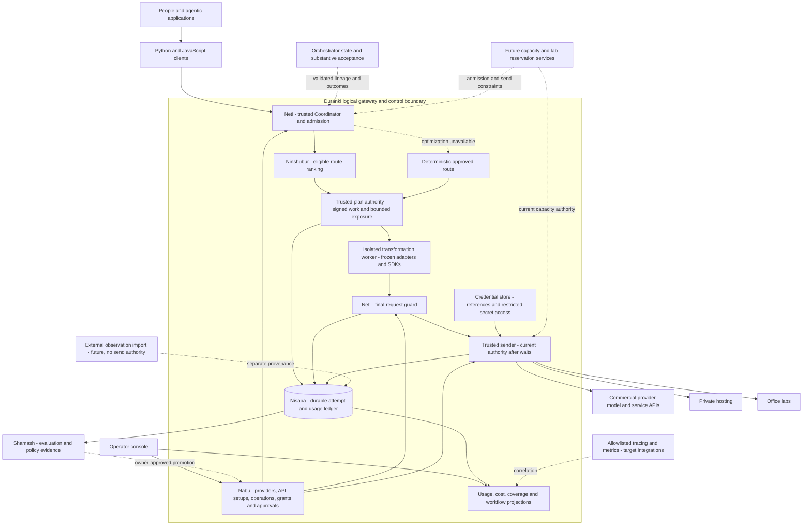

# Duranki — Model & AI-Service Routing, Metering and Control — Architecture

**Status:** v1.2 — integrated architecture review draft; not yet adopted  
**Date:** 25 October 2026  
**Owner:** Larry Mitchell  
**Predecessor:** *Duranki — LLM Routing & Metering Infrastructure — Architecture Baseline*, v1.1, 16 October 2026  
**History:** v0.1 → v0.2 → v0.3 → v1.0 → v1.1 → v1.2. The earlier external reviews apply to their reviewed versions, not to this revision.  
**Scope of this revision:** reconcile the target architecture with the bounded DEV-04–DEV-11 development evidence; incorporate the 25 October model/service reconnaissance, native-unit accounting, provider-centred administration and selected commercial-router patterns; define the next standalone extension before implementation.

**Companions and evidence:**
- `review-tracker.md` — historical review dispositions; unchanged by this revision.
- *Duranki — Components and Legends* — the five architectural roles and their names.
- *Duranki — Competitive Landscape* (16 October 2026) — historical context, not current capability evidence.
- `MODEL-SERVICE-COVERAGE-REPORT.md`, `MODEL-SERVICE-INVENTORY.json`, `DURANKI-COVERAGE-GAP-MATRIX.csv` — 25 October static source reconnaissance.
- `docs/contracts/WP-A-A2-ADOPTION-01.md` — adopted bounded client/work contract.
- `docs/development/dev-11/{RESULT.md,CACHE-ACCOUNTING-CONTRACT.md,REVIEW-HANDOFF.md}` — tested cache-aware text contract and its limits.
- `DURANKI-ARCHITECTURE-v1.2-CHANGE-NOTE-2026-10-25.md` — section-level change record and review focus accompanying this draft.

Companion paths are repository/source locators, not a claim that those files were modified or that all of them accompany this standalone document. Evidence keys and external references are in §20. Existing top-level section numbers 0–20 and acceptance-test identifiers 1–41 are retained; additional requirements have new subsections and test identifiers.

**Navigation:**

[0. Baseline status](#0-baseline-status) · [1. Purpose and objective](#1-purpose-and-objective) · [2. Summary](#2-summary) · [3. Design principles](#3-design-principles) · [4. Architecture](#4-architecture)

[5. Request lifecycle and contracts](#5-request-lifecycle-and-contracts) · [6. Routing policy](#6-routing-policy) · [7. Office lab policy](#7-office-lab-policy) · [8. Retry, recovery and completion contract](#8-retry-recovery-and-completion-contract) · [9. Agent instrumentation contract](#9-agent-instrumentation-contract)

[10. Metering and accounting](#10-metering-and-accounting) · [11. Quality and evaluation](#11-quality-and-evaluation) · [12. Learning loop](#12-learning-loop) · [13. Data handling and retention](#13-data-handling-and-retention) · [14. Hosting](#14-hosting)

[15. Phased plan](#15-phased-plan) · [16. Fault and acceptance tests](#16-fault-and-acceptance-tests) · [17. Risks](#17-risks) · [18. Open decisions](#18-open-decisions) · [19. Targeted verification](#19-targeted-verification) · [20. Evidence and references](#20-evidence-and-references)

---

## 0. Baseline status

### 0.1 Authority and interpretation

The v1.1 document remains the adopted architectural predecessor until this successor is explicitly adopted. The supplied WP-A/A2 record separately governs wire `0.2`, canonical work `duranki-work-v0.2` and capability profile `initial_1a@1`. This architecture update does not silently alter those identifiers, schemas, canonical bytes or client semantics. A new operation that cannot be expressed by the existing strict contract requires an explicit versioned extension before implementation. [S1, S2]

**This is an integrated target design, not a statement that every described component is deployed.** Requirements in the body apply when their capability/profile is introduced. An implementation claim must name its source and test scope; a deployment claim must name its running build; a commercial-billing claim requires provider evidence. An architecture phase is not the same thing as a `DEV-XX` development slice.

Authoring or adopting this revision does not itself authorize a new implementation tranche, provider call, credential import, amount of spend, operational migration, repository merge or Vega integration. It does not declare Phase 0, 1a or 1b complete. Existing accepted work remains accepted within its recorded scope; new work must satisfy the applicable gates rather than reopening unrelated completed slices.

**Current sequencing decision:** develop Duranki independently first. Vega instrumentation and integration are deferred until Larry's other Vega work is ready. Standalone clients, scripted agent/user demonstrations and controlled receivers are the development basis in the meantime. The eventual instrumentation contract remains in §9, but it is not an instruction to modify Vega now. [S7]

### 0.2 Evidence snapshot for this revision

| Area | Source-supported position as of the supplied records | Not established by that evidence |
|---|---|---|
| Trusted execution boundary | DEV-04 Choice B separated the model-transformation worker from the trusted sender; later DEV-10/11 records exercise bounded controlled TLS paths. [S3, S5] | Universal protocol, SDK, streaming, arbitrary-provider or production qualification |
| Current selected provider-shaped operation | The recce describes a bounded, nonstreaming OpenAI Responses text path with fixed admitted model, no tools and no automatic retry/fallback. Earlier synthetic tool-cycle work is a separate capability. [S4] | Broad chat, multimodal, hosted-search, realtime or model-substitution support |
| DEV-11 accounting | Source `86d1c8cb0d99c31660f8ef7ad7464e1b40e670f4`, fingerprint `e3157e9e235d8980d00ba6d264cca528e5beac5d09f981839221f9259b84e981`, passed five controlled cache cases and a normal authenticated browser journey using fictional rates. [S5] | Real cache reuse, commercial charges, invoice accuracy or an owner-profile deployment of DEV-11 |
| Running owner profile | The supplied DEV-11 result last observed the prior DEV-10 image, built from `2bb04ff7dd4c584d09bcbcce3fe3e4c0ce0d1ef9`; it explicitly did not query the current campaign/data state. [S5] | A fresh current-state claim about credentials, allowance or the running application |
| Broader platform demand | The 25 October static recce identifies 15 operation families, including adjacent services and local processing. Its platform snapshot is `e69a1fce53917603d110bdd386bde1547a82196d`; its Duranki inspection snapshot is `d990b78ca48b8e673c0cbd0260d3e141e45c7e48`. [S4] | Runtime frequency, current deployed model/account choices, actual spend or complete dynamic-plugin coverage |
| Registries, console and demonstration | The supplied development history describes persistent registry/admin surfaces, attribution reporting and isolated scripted demos. [S7] | Every target user journey in §4.6, live agent collaboration or representative production efficiency |

These are different evidence coordinates, not competing claims to a single current HEAD. The recce inspected a later repository snapshot than the DEV-11 tested product source. This document does not independently certify repository ancestry or the current remote/profile state.

### 0.3 Changes in v1.2

1. Broaden the architectural subject from LLM calls to **typed model and selected AI-service operations**, while keeping ordinary local processing outside model routing (§§1, 5.7–5.9).
2. Make **one logical gateway** mean Duranki's admission/control boundary, not a requirement to place secrets or final-send authority inside LiteLLM. Preserve the isolated worker and trusted sender (§4).
3. Separate provider, account/API setup, credential revision, deployment, operation, source permission, principal grant and quality approval (§§4.5, 5.5).
4. Specify guided setup, clear credential/readiness states, useful price provenance/history and scoped access administration (§4.6).
5. Add versioned operation contracts, native usage units, conservative reservation functions and immutable price semantics; retain DEV-11 as one narrow profile, not a universal parser (§§5.7, 10.2–10.8).
6. Make initiating person, executing agent, authenticated principal, delegation and charging owner distinct; keep direct and inclusive roll-ups from double-counting (§9).
7. Select useful router patterns: governed catalogues, scoped credentials, alerts, capability filters, policy drafts/rollback/preview, endpoint health and trace correlation (§§4.7, 6.9–6.10).
8. Defer external response caching, automatic model substitution, learned-policy promotion and Vega integration; preserve their separate gates (§§5.6, 12, 15).
9. Define a bounded synthetic operation-ledger plus embedding/reranking extension as the first proposed implementation addition (§15.2); add tests without renumbering the original set (§16).

### Organizing invariants

> An isolated call is not necessarily a safe call. A valid response is not necessarily a correct response. A permitted destination is not necessarily an authorized next attempt.
>
> An expired owner is not a cancelled request, and an expired reservation is not evidence that its financial exposure disappeared.

Additional v1.2 invariants:

> Discovery is not permission. Permission is not execution support. A saved credential is not proof of access.
>
> A committed request is not proof of transmission; a local first write is not proof of provider receipt. Unknown usage or cost is not zero.
>
> Observing an external service is not controlling it. Changing a route must not silently change an operation's meaning, index compatibility or billing contract.

The following version histories describe prior revisions; their original dates, review scope and resolved findings are preserved as history, not new implementation claims.

### Changes in v1.1

1. **Names.** The system is named **Duranki**, and its five agents are **Neti**, **Ninshubur**, **Nisaba**, **Shamash** and **Nabu** (§4.2). Names are labels only; every contract still refers to the component it names.
2. **Off-the-shelf parts made explicit.** §4.1 names each commercial off-the-shelf (COTS) product and marks it decided, candidate or open.
3. **Supply-chain protection** for every off-the-shelf part, added to Phase 1a with acceptance tests 37–41 (§4.4, §15, §16).
4. **LiteLLM's built-in routing disabled.** LiteLLM now ships its own Auto Router; only Duranki's optimization plugin may choose a route, and only within the signed plan (§4.3).
5. **Two new risks**: a compromised release of an off-the-shelf part, and a vendor acquisition or shutdown (§17). The LiteLLM contingency decision now covers both (§18).

The Phase 3 bake-off (§6.5) is unchanged: it compares ways of building Duranki's own predictor, not outside products.

### Changes in v1.0 (from v0.3)

1. **Financial and capacity exposure** survive owner-lease expiry (§6.7, §10.4). This is the most consequential runtime correction.
2. **Explicit admission profiles** per phase, including a Phase 1a profile (§5.1).
3. **Derived data inherits source handling and retention** unless an approved feature schema says otherwise; retention applies at every persistence boundary (§13).
4. **Two-level request binding**: canonical work plus each candidate's prepared request, with signed plans (§5.3).
5. **Three identity levels**: logical step, execution generation, provider attempt; idempotency keyed by execution generation (§8.2).
6. **Authorization point** defined; the final-dispatch check verifies signature, policy versions and the final prepared request (§5.4).
7. **Gateway response cache** placed after admission and salted by security domain (§5.6).
8. **Recovery policy** and **approved-configuration registry** defined as artifacts with lifecycles (§6.8, §5.5).
9. **Presence attribute** bound to issuer, audience, principal and session, with TTL and key management (§7.1).
10. **Leaf validation** by orchestrator construction manifest (§6.1).
11. **Statistical corrections**: generalized cascade quality, analysis matched to design, common judging, pooling scope, separately justified latency study (§11).
12. **Fault tests** gate the first phase that relies on each guarantee (§16).

### v0.3 errors corrected

| v0.3 error | Correction |
|---|---|
| Budget reservation TTLs released exposure of dispatched or outcome-unknown work | Owner expiry ≠ exposure release (§10.4) |
| Plan's lease "released on failover" contradicted §6.7 | Capacity released only on confirmed completion or cancellation (§6.7) |
| "Mandatory admission in every phase" contradicted the Phase 1a/1b budget split; registry mandatory but scheduled for Phase 3 | Phase admission profiles; 1a approved-configuration file (§5.1, §5.5) |
| Derived features (Jev answers, scores) exempted as non-content | Inheritance unless approved feature schema (§13.1) |
| `request_hash` covered adapter output while fallbacks use different adapters | Two-level binding (§5.3) |
| References treated as content-bound | Versioned or materialized (§5.3) |
| Gateway response cache not placed after admission | §5.6 |
| Per-step idempotency key would deduplicate an authorized escalation into the rejected result | Execution generation (§8.2) |
| Tier 1 "escalate within the plan" conflicted with orchestrator ownership of identity changes | §6.2 |
| "p_s ≈ 1 because baseline" | Removed (§6.4) |
| Cascade quality equation omitted false rejection | Generalized (§11.1) |
| Paired analysis required universally | Analysis matched to design (§11.3) |
| Latency study asserted smaller; δ≈0 called mathematically impossible | Corrected (§11.3) |
| Fault tests scheduled after the phases relying on them | §16 |
| Error table cited the wrong subsection for the budget clause | Corrected in tracker |

---

## 1. Purpose and objective

Reduce the cost of useful work performed by people and collaborating agents without degrading accepted task quality, by:

1. **Metering** each in-scope model or AI-service attempt in its native units, preserving the evidence behind its cost, and attributing it to the authenticated principal, executing agent, initiating person, charging owner and task.
2. **Controlling execution** through explicit source-level permissions, user/service grants, typed operation contracts and bounded financial authority.
3. **Routing** eligible work among approved, semantically compatible configurations across commercial APIs, private installations and office labs when the appropriate routing phase is enabled.
4. **Explaining** where money and elapsed time go, including retries, delegated work, cache-related billing and incomplete measurements.

LLM text is the first implemented provider-shaped operation, not the universal request or billing schema. Adjacent services may be accounted for without pretending they are language models. Duranki is not intended to become a general enterprise API-management platform.

### Governing metric

**Cost per accepted task** for a task class:

  M = E[C_task] / P(task accepted)

over complete task cohorts, including failed and abandoned tasks.

### Objective

Over eligible joint policies π = (routing policy, recovery policy), jointly versioned:

  minimize M(π)

subject to, per task class:

- **Quality (relative):** non-inferior to the incumbent within margin δ_class (§11.3)
- **Quality (absolute):** acceptance ≥ the class's fixed quality floor
- **Latency:** P(T_task ≤ D_class) ≥ 1 − ε

This specifies what the system must achieve, not an optimizer to build. The cost decision rules (§6.2, §6.4) are working heuristics inside an approved envelope.

### Non-goals

- Rebuilding a general-purpose model server, vendor SDK ecosystem or observability stack. Duranki does own the minimal trusted admission, final guard/sender and accounting controls needed to enforce its contracts; integration code remains separate from off-the-shelf worker code.
- Sophisticated routing models before contracts, accounting and evaluation are trustworthy.
- A full online contextual-bandit framework at launch.
- Training or fine-tuning models.

- Automatic access to newly discovered models or operations.
- Building a generic external response/semantic cache before evidence justifies it.
- Editing Vega or requiring live Vega traffic for the next standalone development additions.
- Treating a local allowance as an account-wide invoice ceiling or making production-saving claims from scripted data.

---

## 2. Summary

Duranki is the controlled crossing between people/agentic applications and the model or AI-service operations they invoke. Its **single logical gateway** authenticates and attributes requests, resolves source and operation permissions, checks capability and quality eligibility, establishes the admitted financial scope and issues a signed plan bound to the work. Optimization is a replaceable ranking stage, not an alternative authority.

The execution boundary consists of Duranki's trusted Coordinator, immutable registry decisions, final-request guard and trusted sender. A model-transformation worker may use a frozen LiteLLM/provider SDK to prepare requests, but it does not possess provider credentials, unrestricted provider egress or authority to select an unapproved destination. The trusted sender rechecks current authority after lower-layer waits and before the first application-request transmission. Durable intent, final-request commitment, local write observation, independent receiver evidence and settlement are distinct facts. [S3, S5]

Operation contracts describe request/response shapes, native usage, billing components, compatibility and lifecycle. Text, embedding, reranking, vision, transcription, speech synthesis, image generation, model-hosted search and realtime voice therefore share an enforcement/accounting framework without being flattened into one text interface. Adjacent search and storage/resource observations are separately classified; opaque external execution is not falsely presented as controlled routing. [S4]

The orchestrator continues to own task planning, substantive verification, acceptance, semantic recovery and application side effects. Nabu records approvals; Neti enforces them; Ninshubur ranks eligible candidates; Nisaba records usage and financial exposure; Shamash evaluates quality and efficiency. A durable ledger is independent of sampled tracing. Human-facing reports connect direct and delegated work without adding the same charge twice.

Development remains standalone. The next proposed slice proves operation-aware accounting with synthetic embedding/reranking workflows. Provider activation, operational deployment, Vega integration and learned routing each require their own scope and evidence. Later integration can gather representative task relationships and outcomes; those observations can inform policies, but observational logs alone do not prove that an alternative route would have been better.

---

## 3. Design principles

1. **The gateway is the only door for controlled work.** Provider credentials are confined to the trusted credential/sender boundary, not the transformation worker or caller. Network policy prevents controlled consumers from bypassing it. Model, classifier, verifier, judge, evaluation and replay operations are governed alike. External observations are labelled separately until transport control exists; full-platform coverage is not claimed before integration.
2. **Admission is mandatory; optimization is optional.** Rules can short-circuit ranking, never admission.
3. **One final-dispatch contract for every controlled path**, including the emergency gateway and any future lab replica. A successful pre-queue check does not replace the current-authority check at the trusted first-write boundary.
4. **Availability never trumps policy.** If optimization fails, use a deterministic, approved, compliant route; if none exists, queue or fail explicitly.
5. **Plans authorize specific work**, are signed, and expire.
6. **Isolated ≠ safe; valid ≠ correct; permitted ≠ authorized.**
7. **Ownership expiry ≠ exposure release.** Money and capacity that may already be committed stay held until settled or proven unused.
8. **Derived data inherits source handling.** A boolean, category or score is not non-sensitive merely because of its representation.
9. **Quality is a constraint measured at the task level.** Structural signals are guards and features, never training rewards.
10. **Meter what matters**: queue depth, KV-cache occupancy, TTFT and predicted wait, not GPU utilization.
11. **Three separate affinities**: model affinity (behaviour), replica/cache affinity (placement), conversation state (recoverable independently of both).
12. **Extend, don't fork.**
13. **State what can be audited, reconstructed and re-executed**, and for how long (§13.1).

14. **Typed operations, native units.** Shared governance does not imply interchangeable request formats, billing units or output semantics.
15. **Discovery never grants authority.** Catalogue, access check, source permission, principal grant, qualification and health remain separate.
16. **Evidence is scoped.** Source inspection, synthetic proof, deployed observation, provider-reported usage and invoice reconciliation are distinguishable.
17. **Attribution is not another charge.** One attempt can be viewed by provider, agent, user and workflow without adding those views together.
18. **No invisible work.** Ordinary page loads, report refreshes and route previews do not trigger provider calls. Paid tests, discovery and external checks are explicit, scoped actions.

---

## 4. Architecture



**Diagram scope.** This depicts responsibilities and target extension points, not a deployment manifest. Replication, Redis, production telemetry, capacity services, external observation ingestion and most non-text adapters remain separately gated. The optional future response cache is deliberately absent from the active path. The isolated worker has no direct edge to a provider or the credential store. Browser-originated management actions pass authenticated server APIs; the console does not directly write registry storage. [S3–S5]

### 4.1 Components

**Status key:** *Target choice retained* means selected by the predecessor architecture, not installed or qualified here. *Demonstrated bounded slice* means only the source/test scope in §0.2. *Candidate/Open* requires a further decision. *Build* means Duranki-owned code, which may be incomplete. This table reconciles target product choices with actual development rather than replacing those choices silently.

| Component | Role / architectural owner | Implementation or target choice | Status and boundary |
|---|---|---|---|
| First trusted edge and framework ingress | Neti: trusted person-origin/presence assertion | Corporate edge or zero-trust tunnel, identity provider and application ingress | Target integration; products and live integration not established here |
| Orchestrator state store | Caller-owned checkpoints, acceptance and side effects | Orchestrators' durable store | External responsibility; Vega changes deferred |
| Logical gateway / Coordinator | Neti: authentication, admission, work identity and control | Separate Python Duranki service | Demonstrated bounded slice; not equivalent to a replicated production gateway |
| Python and JavaScript clients | Transport, strict public contract, query-first recovery | Separate importable network clients; JavaScript remains plain CommonJS | Existing bounded clients; no credentials for direct provider execution [S2] |
| Transformation worker | Provider-specific preparation | Frozen LiteLLM and selected SDKs; future operation-specific adapters | Demonstrated isolated worker; no autonomous retries, routing, provider keys or direct egress |
| Plan authority, final guard and sender | Neti: signed binding, durable commitment and final-send control | Duranki-owned modules outside vendor packages | Demonstrated bounded paths; every new protocol/lifecycle needs its own proof |
| Provider and access registries | Nabu: source inventory, API setups, credentials metadata, deployments, operations, source permissions, grants, qualification | Durable versioned records with authenticated management APIs | Existing registry foundation; operation extension proposed |
| Optimization and policy versions | Ninshubur: rank only eligible candidates; explain selection | Duranki-owned deterministic policy module; later predictor | Target extension; trusted authority issues the signed plan |
| Local ledger and allowances | Nisaba: attempts, usage revisions, reservations and exposure | SQLite in the standalone development profile | Demonstrated bounded slice; not proof of multi-replica budget consistency |
| Production ledger / shared state | Nisaba and Neti: durable financial authority across replicas | Managed HA database remains open; Redis target choice retained | Target only. Shared caches cannot replace durable attempt/exposure authority |
| Operator console and reports | Nabu/Neti management; Nisaba projections | Duranki-owned UI and authenticated API | Existing screens plus target journeys in §4.6; demos remain separate |
| Tracing | Shamash evidence; diagnostics | Langfuse and OpenTelemetry Collector | Target choices retained, not a claim of deployed integrations |
| Capacity metrics | Ninshubur/Neti eligibility diagnostics | Prometheus and Grafana | Target choices retained |
| Model serving | Native serving and prefix caching | vLLM or SGLang | Open; not selected merely by a source catalogue label |
| Serving orchestration | Deployment and cache-aware placement | KServe + llm-d, Ray Serve, or GKE Inference Gateway on GCP | Open coherent-stack choice, §18 |
| Capacity lease / lab policy | Neti: capacity admission, presence, reservation and drain | Duranki-owned services | Target, §7; not inferred from office network reachability |
| Evaluation / predictor | Shamash: datasets, judgements, confirmation and promotion evidence | Offline jobs; Jev remains one bake-off candidate | Target, §§6.5, 11–12; no automatic learned-policy activation |
| Credential service | Neti: write-only registration, restricted runtime retrieval and rotation | Local personal-test custody; production secrets-manager product open | Keep local proof separate from production secret-management acceptance |
| Frontier and adjacent-service access | Commercial API or marketplace, exact account and protocol | Direct vendor APIs; Bedrock/Vertex where later qualified | Per-operation qualification; no blanket provider support |

Duranki-owned policy, signing, ledger and sender modules remain independent of LiteLLM. A selected operation may use another qualified adapter without forking a vendor package or weakening the same control boundary. No new dependency, infrastructure product or provider is selected merely by this table.

### 4.2 Duranki agents

The names come from one mythology, Mesopotamian, as the naming convention requires. *Duranki — Components and Legends* tells each myth in full.

| Agent | Legend | Component(s) | Limit |
|---|---|---|---|
| **Duranki** | "Bond of heaven and earth": the sacred precinct at Nippur | The whole system | — |
| **Neti** | Gatekeeper of the underworld, who admits Inanna through seven gates and takes something at each | Mandatory admission, signed plans, final-dispatch check, presence, leases, lab policy | Admits and checks; does not rank or choose |
| **Ninshubur** | Inanna's minister, who follows a pre-agreed list of gods to appeal to until one can help | Optimization plugin, cascades and escalation, feature extraction | Chooses only among destinations Neti admitted, in the plan's order |
| **Nisaba** | Goddess of grain, writing and accounting, given the measuring rod and line | Ledger, dispatch intent, cost views, reconciliation | Records; does not decide |
| **Shamash** | Sun god of justice who sees everything; gives Hammurabi the laws | Evaluation, acceptance judging, non-inferiority and floors, learning loop | Judges against the standard; does not approve or route |
| **Nabu** | Scribe god, keeper of the Tablet of Destinies | Approved-configuration registry | Records approvals Shamash's evidence and an owner support; never self-approves |

The five names denote architectural responsibilities, not permission for autonomous LLM agents to alter enforcement or financial records. Neti's deterministic authority validates and signs admitted work; Ninshubur supplies a bounded selection proposal. Nisaba's measurements do not confer authorization, and Shamash's evidence does not self-promote a configuration. The runtime can implement several roles in one trusted service while maintaining these ownership boundaries.

### 4.3 LiteLLM verification and built-in routing

**Retained decision:** extend off-the-shelf preparation components; do not fork them. The supplied DEV-11 evidence uses the frozen LiteLLM `1.105.1` wheel and OpenAI SDK `2.54.0`. These are historical tested inputs, not a recommendation that an unreviewed current installation is safe or that they implement every provider feature. [S5]

The worker prepares a candidate request; the trusted guard independently checks its actual operation, destination, body and transport controls against the signed plan. The trusted sender alone has provider-send authority. A hook, logging callback, hostname allowlist or successful SDK transformation is not a substitute for this boundary. Every selected extension must demonstrate worker isolation, exact final binding, no hidden send, current-authority checking after waits and truthful outcome reporting. [S3]

**Built-in routing disabled.** Vendor auto-routing, model aliases that silently change execution, parameter dropping, SDK retries, implicit fallbacks, redirects and alternative client paths are disabled unless an explicitly versioned Duranki contract authorizes and accounts for their effects. A catalogue or discovery adapter is not an inference adapter. Capability exposure follows qualified operations, not the upstream library's advertised feature count.

**Contingency:** the earlier choice between a front-door guard and exclusive sender has been resolved for the bounded development paths in favour of the separated trusted sender. Future replacement of LiteLLM or a protocol adapter must preserve the Duranki authority and ledger interfaces. A source selection or a new library release is not qualification of that replacement. Production/multi-protocol qualification remains a separate gate.

### 4.4 Supply-chain protection

Supply-chain compromise remains a design threat. A pinned hash proves artifact identity, not absence of malicious behaviour. The worker is therefore treated as untrusted with respect to secrets, policy, ledger integrity and provider egress. These controls apply to each introduced dependency and service; selecting a reference architecture does not require installing every optional product at once.

1. **Pin and verify.** Exact versions, hashes and image identities; no floating versions or runtime `latest` pulls. Review the resolved dependency set and the actual distribution used (test 37).
2. **Controlled builds.** Build Duranki-owned images from reviewed source and explicitly approved frozen distributions, offline where supported. Record source, package, platform and image correspondence; do not describe an installed publisher wheel as a source-rebuilt dependency. Runtime startup does not acquire packages.
3. **Controlled adoption.** Record advisory review, artifact inspection, changes, tests and a soak decision; urgent vulnerability exceptions require a recorded owner decision (test 41). No upgrade is part of this architecture edit.
4. **Separate egress and authority.** The worker cannot open a provider path or read provider keys. The trusted sender permits only contract-bound endpoints and request bytes; telemetry services reach only approved stores. Host allowlisting alone cannot stop misuse of an allowed provider endpoint (test 38).
5. **Credential custody.** Production credentials belong in an approved secrets system, readable only by the narrowly authorized trusted credential/sender runtime. Local personal-test custody remains a separately scoped profile. Rotate on an approved schedule and on suspected exposure; revoke old access under explicit lifecycle controls and invalidate dependent queued plans. Where upstream provider revocation is required, record its separate confirmation rather than assuming a local secret replacement revoked the provider key (test 39).
6. **Inventory and response.** Keep component/artifact inventories, security ownership and a tested disable/rollback procedure. On suspected exposure, pause affected paths, preserve evidence and assess reachable secrets; rotate potentially exposed credentials. A clean frozen-input check is not a host-wide forensic audit.
7. **No blind recovery.** Rollback does not re-enable revoked grants, reset unknown exposure, discard usage revisions or authorize a dependency version with an unresolved security disposition. No verified safe build means fail closed or use an independently qualified replacement.

This revises v1.1's broad assertion that an allowlisted gateway could not leak credentials: isolation, least authority and exact-send controls are all necessary. The historical incident references in §20 are context, not a fresh security audit.

### 4.5 Provider, account, deployment and operation model

**Provider** is the organization or service offering an API. **Publisher/model family** identifies the model's origin; it need not be the serving provider. **Private installation** and **office lab** are source types, not model families. **API setup** is one configured access context: provider/installation, account/project or tenant, endpoint/region, protocol adapter and credential binding. It is not a live socket and does not necessarily equal one API key.

| Entity | Required meaning and relationship |
|---|---|
| Source | Commercial provider, private installation or office lab; stable ID, display name, owner and source type |
| Account / API setup | Source-specific access context, account/project scope where applicable, endpoint/port, region, protocol/version, TLS policy and credential-reference revision |
| Credential binding | Write-only secret input or approved authentication mechanism; safe metadata and status only in ordinary reads; never the primary user/agent attribution identity |
| Model / service catalogue entry | Published or declared identity and documented capabilities; explicitly reference-only until discovered/declared for a setup |
| Deployment / service endpoint | Exact execution target within an API setup, including model version/quantization or service version where relevant |
| Operation contract | Typed action and versioned request/response/usage/bound/lifecycle rules (§5.7) |
| Source permission | Administrator's explicit allow/disallow for the deployment and operation under an API setup; initial deny |
| Principal grant | User/service authority over permitted deployment/operation combinations, constrained by purpose/task/financial scope and delegation |
| Quality approval | Separate task-class/operation qualification for a configuration; neither credentials nor source permission supplies it |

Effective permission is the intersection of current source/account status, explicit source-operation permission, authenticated principal and delegated authority, operation capability, handling rules, quality scope and applicable financial controls. Administration is not an implicit generation grant. A per-provider default may narrow all accounts but cannot implicitly authorize another account's deployments.

**Discovery.** Explicit discovery retrieves the inventory visible through one selected setup and adapter. Store its timestamp, API/account scope, pagination completion and completeness/partial/error status. “Complete” means complete within that returned account/endpoint/API scope, not every model a vendor might offer. Manual inventories for private/lab sources record their provenance. Unsupported discovery is shown as such. Refresh never creates grants, enables a route, republishes prices or revives archived/disallowed records; disappearance and partial failure are not silently treated as deletion.

**Protocol specificity.** Provider APIs may require different paths, versions, headers, project identifiers, service-account authentication or SDK transformations. Setup uses a supported adapter with typed parameters, not arbitrary executable connection strings. “Add provider” may create a reference/draft source, but an unqualified protocol remains unavailable for execution. Private/lab endpoints require explicit network-destination approval; arbitrary URL input, redirects, DNS changes and credential forwarding must not create an unintended outbound capability. Private networks are allowed only where deliberately registered and qualified, not inferred safe because they are local.

### 4.6 Operator console and human-facing contracts

The console organizes work around **Providers**, **Private Hosting**, **Office Labs**, **Users & Access**, **All Models**, **Usage & Costs** and operational diagnostics. “All Models” remains the cross-source model view; adjacent non-model services are identified separately rather than fabricated as models. A service/operation filter or a dedicated service subsection may expose them without replacing the provider hierarchy.

**Setup journey:** Add provider/installation → name API setup/account → enter credential locally → explicitly check access → explicitly discover/declare inventory → allow selected operations/models → grant user/service access → review applicable price and finite test limits → deliberately submit a test. Saving, checking, discovery, approval and generation are different actions. Navigation and local Refresh do not contact providers.

Provider rows show **Not configured**, **Key saved — not checked**, **Access verified at [time]**, **Access check failed**, or **Check out of date**, as appropriate; execution readiness and permitted-model counts are separate. Multi-account summaries show names and verified/total setup counts with drill-down, not an unexplained number of “connections.” An access check reports what it actually exercised; model-list success does not prove generation permission or adequate quota.

A provider detail page owns its account setup and credentials controls, discovered inventory and per-operation Allow/Disallow actions. Source-scoped grant choices contain only currently permitted deployments, with blocked existing grants visible and explained. Readiness separates credential evidence, API support, permission, qualification, rate eligibility and health. Registration never provisions real people or access from a demonstration fixture.

**Commercial pricing.** Show source titles as clickable reference links, rates with units/currency/conditions, observation date and any independently established effective dates. “Update provider price” means import or record a reviewed immutable publication, not change the vendor's price. A negotiated account rate is a distinct approved schedule; a private/lab internal tariff is separately labelled. No free-form edit silently changes a published commercial schedule. Price-history charts plot recorded snapshots only, distinguish observation from effective time, separate incomparable rate bands, show gaps and have an exact accessible table. One observation is one point, not invented historical history.

**Actions and language.** Use “Change history” for registry/audit history and “Available endpoints” or “Where this model runs” for deployments. Edit must open a permitted edit action, or be disabled with a reason. Disable/archive/revoke preserve historical references; destructive removal of referenced authority or financial evidence is not a cosmetic delete. Mutations use authenticated role checks, current revisions, audit records and browser protections. Secret registration is write-only, with explicit replace/revoke rather than secret reveal. Reports and exports apply the same authorization as the underlying records.

**Usage presentation.** Lead with understandable names, amounts, dates, operations and outcome/coverage; exact IDs are secondary. Provide searchable selectors rather than mandatory opaque-ID entry, a visible timezone, period filters and separate revision cutoffs. The inspector shows workflow/agent lineage, operation, decision reason, attempt stages, usage evidence, cost and outstanding exposure. Timeline lanes, summaries, ticks, cursors and cost plots share the same origin and scale. Keyboard operation, responsive layout and clear empty/error states are acceptance requirements.

Demo records carry an unmistakable scripted/simulated banner, isolated storage and exports. Replay/seek/filter actions reveal existing records only. Demo amounts never enter operational totals or serve as agent-efficiency evidence.

### 4.7 Selected commercial-router patterns

These are design patterns to adapt, not new product dependencies or declarations of implemented parity. Official documentation supports the examples in §20.3; Duranki's requirements and gates below are our design choices.

| Pattern / example source | Duranki adaptation | Gate / limitation |
|---|---|---|
| Governed provider/model catalogue — Portkey [E2] | Source-centred setup, account scope, credential status, inventory and explicit permissions | Discovery is not approval; no universal-protocol claim |
| Capability/provider filters — OpenRouter [E1] | Require operation, parameters, output and handling compatibility before ranking | Preserve-or-reject, never silent parameter removal |
| Scoped credentials and limits — LiteLLM [E3]; budget scopes/alerts — Vercel [E5] | Expiring application credentials, visible budget scopes and configurable alerts | Extend existing principals; local atomic exposure semantics are not replaced by soft-cap semantics |
| Versioned routes — Cloudflare [E4] | Named policy drafts, preview, reviewed publication, rollback and explanations | Preview does not execute or grant authority; live changes still meet §§11–12 |
| Health and cooldowns — LiteLLM [E3] | Per-setup/per-operation availability and circuit-breaker controls | No health bypass of permissions; separately qualified bounded fallback |
| Workflow inspection and trace correlation | Build on the existing Duranki timeline; retain the Langfuse/OpenTelemetry target choices | Sampling never removes ledger obligations; content handling unchanged |
| Application evaluation for routing — Not Diamond [E6] | Fixed datasets, candidate comparisons and an eventual evidence-driven predictor | No learned production promotion before confirmation and owner approval |

External response/semantic caching, an elaborate visual policy language, unrestricted plugin execution and a general prompt-management product are deferred. The named policy interface starts with a readable rule table and explicit versions, not a new programming platform.

---

## 5. Request lifecycle and contracts

```text
validate identity, delegation, purpose and financial attribution
  → resolve supported operation contract and handling policy
  → establish eligible source/deployment set and applicable limits
  → optional future response-cache lookup (disabled now; §5.6)
  → rank, or retain the fixed approved destination
  → atomically reserve bounded exposure where required by the profile
  → issue signed plan: canonical work + operation + candidate specifications
  → prepare candidate in isolated worker
  → independently validate actual final request and current authority
  → persist final-request/dispatch commitment before release
  → after lower waits: trusted sender rechecks current authority at first write
  → observe transport/result/usage separately → append settlement revisions
```

Preparation/admission intent and the final-request commitment are durable facts before sending, not evidence that a request reached a provider. A failure at any point is classified by the last established fact rather than by a generic “dispatched” flag.

### 5.1 Mandatory admission

#### Admission profiles

Admission is mandatory in every phase. **What each control enforces depends on the phase's admission profile**, which states explicitly which guarantees are active. The inherited phase profiles below are target assurance levels, not a summary of which development slices have run.

**Bounded personal-test profile.** DEV-10/11 demonstrate a narrower, separately gated allowance mechanism: one qualified request recipe, exact rate/usage contract, atomic per-attempt reservation, finite count/expiry/concurrency and unknown-exposure handling in the standalone deployment. That does not establish all Phase 1b obligations, a multi-replica guarantee or an account-wide provider cap. New operation types do not inherit paid eligibility from this text profile. [S5]

| Control | Phase 1a profile | Full profile (1b onward) |
|---|---|---|
| Identity, purpose, destination permission, classification, retention | Enforced | Enforced |
| Quality approval | Fixed requested configuration appears in an explicitly approved versioned record; original file or its controlled persistent-registry successor | Approved-configuration registry with operation/task-class scope |
| Budget | Per-principal spend limits and alerts; **no hard concurrent ceiling guarantee** | Atomic reservation with exposure tracking (§10.4); fail closed |
| Destinations | Fixed requested destination and supported operation; no model substitution | Ranked eligible set only for separately qualified routing capabilities |
| Eligible workloads | Those not requiring hard concurrent ceilings; bounded personal campaigns follow their separate contract | Only workloads with the required operation, quality, lifecycle and financial guarantees |

#### Controls

1. **Identity.** Principal and task ownership derived or validated from authenticated context. Background work runs under a named service principal with a charging owner. Caller-supplied tags are validated, never trusted.
2. **Attribution** per §9. **Migration mode** admits agents with explicitly identified *accounting or analytical metadata gaps* (e.g. missing subtask labels) under their authenticated principal, flagged non-compliant and ineligible for optimization. Migration mode **never** bypasses identity, destination authorization, purpose validation, source classification or retention restrictions.
3. **Classification.**
   - The **orchestrator** performs monotonic taint tracking: every tool result, retrieved document and attachment carries its source's sensitivity and client-specific restrictions; a context's handling policy combines all of them and never weakens.
   - The **gateway** enforces structural guards: PII and secret scanning, rejection of untagged tool results and content blocks, payload validation.
   - Classification is a **deterministic, locally evaluable rules engine** (label inheritance, patterns, allowlists) with a named owner, a labelled test corpus, and minimum bars on false negatives (missed sensitive content) and false positives. Model-based signals are auxiliary only.
   - **Handling policy is the combination of applicable restrictions**, not only the maximum sensitivity level.
4. **Purpose.** Trusted purpose on every request: `execution`, `feature_extraction`, `verification`, `judging`, `evaluation`, `replay`. Supporting purposes follow fixed policies: no recursive optimization, no cascades.
5. **Derived-call inheritance.** Requests derived from another (verifier, judge, feature extraction including Jev, distillation, summarization) inherit the source's handling policy combined with their own. Feature-extraction and judge templates are reviewed as **policy artifacts**.
6. **Destination and operation permission** per source, account/API setup, service endpoint, operation, inference profile, model and processing geography. Explicit source permission and a current principal/delegation grant are both required; neither replaces quality approval. Above public sensitivity, marketplace inference profiles must be region-pinned. Residency, export-control and per-client attributes are part of this record.
7. **Capability compatibility**, demonstrated by tests for the exact operation/protocol/version. Publisher capability, account visibility, implemented adapter support and enabled profile support are different. Unsupported modalities, parameters or output contracts reject before sending.
8. **Quality approval.** A destination is eligible only as part of an approved configuration for the task class (§5.5). Canaries use separately authorized experimental scope.
9. **Pinned-model mode.** The plan has no fallbacks; unavailability or ineligibility produces explicit failure to the orchestrator. Only the orchestrator may relax a pin.
10. **Budget authorization** per the admission profile. Under the full or bounded-personal profile: atomically reserve the reviewed maximum for the admitted operation domain; enforce all applicable monetary/count/concurrency/expiry controls. Fail closed when required budget state or a finite bound is unavailable (§10.4); no configured exceptions.
11. **Per-client retention and handling terms** are principal/task attributes evaluated here, flowing into the plan's `retention_class`.

12. **Operation semantics.** Bind the action and versioned contract independently of model identity. A grant for text generation cannot authorize embedding, transcription, image generation, a hosted tool or index creation. Supporting local processing and externally observed work do not acquire execution authority by appearing in a report.

Output: the eligible set. If empty, reject or queue with an explicit reason.

### 5.2 Optimization (ranking)

May be skipped (Phase 1a, which uses fixed destinations) or fail without affecting admission.

1. Deterministic rules by agent role and step type (versioned).
2. Lab preference (§7).
3. Learned predictor (§6.5) for ready step types.

Decisions record a propensity; deterministic decisions record 1.0. Routing logic reads only the **avoidable incremental** cost view (§10.5). Named policy versions and read-only explanation are specified in §6.9. Rules may filter or order only compatible, permitted, qualified candidates; unavailable capability or unknown required financial bounds cannot be traded away for a lower estimated price.

### 5.3 Execution plan

The plan is **signed by the trusted plan authority** within Neti's control boundary and authorizes only the admitted work. Ninshubur may propose an eligible ordering but cannot mint new authority, change admitted work or hold the signing secret in the isolated worker. The authority validates the selected policy result and issues the plan even when optimization is skipped. This makes the signing responsibility explicit; it does not change adopted signature/wire formats by itself.

**Binding (two levels):**

- **Canonical-work binding:** authenticated principal, purpose, `task_id`, `step_id` + revision, `execution_generation`, and the **canonical pre-adapter request** under its explicit schema. The operation-aware successor additionally binds operation type/version, authenticated delegation and charging context, selected account scope, typed payload/ordered inputs, constraints and required compatibility references. Text retains messages, tools, attachments and generation settings; vectors, audio and media use their own typed contracts. Non-semantic trace IDs and diagnostic timestamps are excluded, but safety-relevant expiry, billing-period or pricing conditions must be bound or resolved through signed references.
- **Compatibility:** these are architectural field requirements, not permission to add unknown fields to strict wire `0.2` or recompute historical hashes. A successor contract must specify exact projection/domain separation, client validation and migration tests. [S2]
- **Candidate preparation:** for each authorized deployment, the adapter version from `prompt_adapter_map`. The prepared request for a candidate is produced deterministically from the canonical work and its adapter, and validated by the final-dispatch check **after all preparation and callbacks**.
- **References:** a versioned reference is bound as reference plus content version; an unversioned reference must be materialized and hashed. Mutable provider-managed state requires an immutable version or a controlled resolution rule.

| Field | Purpose |
|---|---|
| `plan_id`, `signature`, `expires_at` | Identity, integrity, validity; policy or permission changes revoke the plan |
| Canonical-work binding | As above |
| `purpose`, `task_class`, `step_class` | Validated values that cannot drift between admission and dispatch |
| `classification_snapshot` | Level, combined restrictions, content hash, rules-engine version — **audit only**; the FDC uses current classification |
| `quality_approval_ref` | Approved configuration(s) in effect |
| `deployment` | Exact source/API setup and execution endpoint; model/service identity, version, pool and quantization where applicable |
| `permitted_fallbacks` | Ordered, each admitted; empty for pinned mode; same-deployment only for spine steps |
| `prompt_adapter_map` | Adapter version per candidate deployment |
| `capability_profile_version` | |
| `policy_version`, `recovery_policy_version`, `registry_version` | Checked at final dispatch |
| `predictor_version`, `feature_extractor_version` | If used |
| `failure_action_map` | Which failures permit transport retry, permitted fallback, return-to-orchestrator, or termination |
| `verifier_spec` | Tier 1 structural check the gateway may run |
| `originating_step_id`, `minimum_tier` | For escalation attempts |
| `per_attempt_ttft_timeout_ms`, `per_attempt_total_timeout_ms` | Prevent one hung attempt consuming the task deadline |
| `deadline` | Remaining task deadline |
| `retry_allowance`, `escalation_allowance` | Separate budgets (§8.3) |
| `max_output_tokens` / operation-specific limits | Text output cap or the qualified operation's bounded quantities, set before dispatch; no generic token coercion |
| `budget_reservation_id`, `financial_scope` | Authorized **total** charge (input, output, reasoning, cache writes and any other enabled billable component) for the attempts covered; when a fresh atomic reservation is required |
| `lease_token` | Capacity lease; ownership may expire, capacity released only per §6.7 |
| `cancellation_token` | |
| `cache_hint` | `session_id` and stable-prefix information for the serving layer |
| `retention_class` | What may be persisted for this attempt, at every persistence boundary |
| `streaming` / lifecycle profile | False for the current text path and internal cascade steps; any stream/session/async-job profile requires separate qualification |
| `decision_record` | Candidate set, scores, propensity, reason (stored in the ledger) |

**Additional successor-plan requirements:** operation contract/version; request and response schema identities; usage-semantics and price-function versions; exact source/account and source-permission revision; grant/delegation and credential-binding revisions; unit/resource bounds; index/artifact/session compatibility references; and the financial reservation scope. Names are provisional until the successor contract is reviewed. Do not reuse `attempt_id` as an operation type or treat a registry `operation_id` as a new provider attempt.

### 5.4 Final-dispatch check and authorization point

**Final-dispatch check (FDC).** Before every attempt on every path (first dispatch, retry, fallback, deterministic route, emergency gateway, any future lab gateway replica), in order:

1. Plan signature valid; plan unexpired and not revoked.
2. `policy_version`, `recovery_policy_version` and `registry_version` match current, else replan.
3. Candidate prepared request, after all adapters and callbacks, matches canonical work, operation contract, candidate adapter version and the exact endpoint/transport controls; unknown or silently dropped semantic fields reject.
4. **Current** classification and combined handling policy are within the destination's permission.
5. Source/API setup, deployment and operation remain permitted, qualified and supported; principal/delegation, credential and grant revisions remain current.
6. Current reservation state, admission class and a valid capacity lease (lab and pools).
7. Financial authorization covers the attempt's maximum exposure.
8. Deadline sufficient.

Any failure → replan via the orchestrator, or explicit failure.

**Authorization point and first-write boundary.** An attempt has durable dispatch authorization when its final commitment is persisted after a passing FDC. That commitment alone is not a send. If the request then waits for a pool, connection, socket or other lower resource, the trusted sender must recheck current authority after those waits and serialize the effective revocation/deadline check with its qualified first application-request write. A new wait or would-block result cannot carry stale permission into a later first write. The bounded Choice B evidence is the precedent for this requirement. [S3]

An effective revocation before first transmission blocks queued unsent work even when a commitment exists; the qualified sender defines and records the local authority-ordering boundary. A revocation after transmission does not recall bytes already accepted by the transport; cancellation is best-effort under the qualified lifecycle and exposure remains until justified settlement. TLS handshake traffic, local acceptance of application bytes, remote receipt and billed execution must not be conflated. A new protocol needs an equally explicit boundary and evidence; the plaintext/TLS development observations do not automatically qualify HTTP/2, WebSockets, multiplexing or asynchronous jobs.

Reports distinguish **intent persisted**, **final request committed**, **first write observed**, **explicit no first write**, **write evidence unknown**, **independent receiver arrival** (when available), and **usage/cost state**. Absence of a write record alone is not proof of no send. A local positive write is not proof of provider receipt.

| Failure | Behaviour |
|---|---|
| Optimization error or timeout | Deterministic **approved** route from the eligible set |
| Predictor or feature extractor unavailable | Rules-only ranking, reported as such |
| Destination fails before transmission | Another attempt only if non-transmission is established, its route/operation is explicitly allowed and current financial/recovery authority permits it; otherwise return an explicit result |
| Gateway replica failure | Qualified recovery transfers ownership, not permission to replay ambiguous work; exposure and prior attempt identity are retained |
| All replicas unhealthy | Emergency gateway preserving **all of §5.1 and the FDC** (no optimization); rules-engine classification lets it operate |
| Shared-dependency outage (Redis, policy store) | Budget or policy state unavailable ⇒ fail closed |
| Ledger primary unavailable | Replica-local durable WAL for a bounded window (§10.1); WAL unavailable ⇒ fail closed |
| No compliant route | Queue (if deadline allows) or explicit failure |

### 5.5 Approved-configuration registry

An **approved configuration** = source/API setup + deployment/model/service version + operation contract + applicable quantization/pool + request/output adapter + verifier + recovery policy + consumption/compatibility contract (where applicable), approved for a task class. Price and usage contracts are versioned financial eligibility dependencies; a price update does not itself supply quality approval.

| Lifecycle step | Rule |
|---|---|
| Phase 1a / existing registry successor | Explicit approved incumbent records scoped to the onboarding cohort; the persistent registry may succeed the original file without implicitly approving new configurations |
| Addition | Requires confirmation-set evidence (§11) or, for incumbents, explicit owner approval |
| Approver | Named registry owner |
| Revocation | Immediate; increments `registry_version`, which revokes outstanding plans at the FDC |
| Canary | Separately authorized experimental scope, never ordinary eligibility |
| Changes | Any change to a configuration's semantic components is a new configuration subject to §12.4; credential/permission/price revisions also invalidate affected queued authority as specified by their contracts |

### 5.6 Gateway response cache

**Deferred; not a prerequisite for the next tranche.** The supplied caching assessment recommended fixing accounting rather than adding an external cache; DEV-11 addresses a bounded part of that accounting need and does not establish cache-performance savings. [S5, S6]

Keep three mechanisms distinct: provider-native prompt/cache billing; serving-layer prefix/KV reuse; and gateway answer/response reuse. A reported cache read proves only the usage evidence stated by its provider contract, not physical cache residency, semantic equivalence, a deletion deadline or a latency benefit. No Redis, semantic cache or new response store is commissioned here.

If gateway response caching is later justified, lookup must follow mandatory admission, current authorization and operation compatibility. Keys must bind security domain, combined handling policy, qualified configuration, operation/schema, model/prompt versions and relevant corpus/tool-state versions. Sensitive content and derived embeddings retain their handling restrictions. Cached delivery is recorded as cache delivery, not a new provider send; its own cost, source attempt and any explicit allocation remain distinguishable. Semantically similar prompts are not automatically interchangeable. Current authority and retention govern whether a prior result can be delivered.

Adoption requires representative repeatability, quality, freshness, privacy and measured net-cost evidence, including invalidation and storage overhead. Preserve test 25 as the gate for that optional capability; Phase 2 does not require building a cache merely to complete a roadmap box.

### 5.7 Versioned operation contracts

An **operation type** identifies an action, not a model family, purpose or unique execution. Illustrative types are `text.generate`, `embedding.create`, `rerank`, `vision.describe`, `audio.transcribe`, `audio.synthesize`, `image.generate`, `responses.search` and `voice.realtime`. These are design vocabulary, not new accepted API values. Research family IDs `MS-01`–`MS-15` remain source traceability IDs, not wire identifiers.

Every enabled contract must specify:

| Contract area | Required content |
|---|---|
| Identity and version | Operation/type version; request/response schema; adapter and usage-semantics versions; supported execution profile |
| Request meaning | Typed inputs, ordering, role (for example document/query), model/service and supported parameters; preserved or explicitly rejected semantics |
| Domain limits | Byte/item/context/output/duration/session bounds as applicable; which are local handling limits and which prove billable exposure |
| Result | Shape, identity matching, item order, dimensions/formats, errors and structural validity; separate substantive acceptance |
| Compatibility | Corpus/vector-space profile, score interpretation, media format, state/session assumptions or other operation-specific constraints |
| Permission | Source setup/deployment/operation scope, principal/delegation authority, purpose, task class and handling restrictions |
| Usage | Native reported fields, field presence, overlap/partition rules, known-zero/not-applicable conditions, revision identity and completeness checks |
| Pricing | Immutable exact-decimal function, units/currency, rounding/minima/tiers/modifiers, source/effective dates and complete admitted domain |
| Exposure | Conservative bound for all enabled billable components and uncertainty; rejection when a required bound is not established |
| Lifecycle | Synchronous, stream, chunk, job or session behaviour; first-send boundary, timeouts, cancellation, status recovery, retries and duplicate semantics |
| Artifact handling | Payload/version binding, byte custody, permitted storage/access, expiry and safe retrieval where relevant |
| Qualification | Independent positive/negative evidence through actual selected adapter/guard/sender, plus regression and acceptance scope |

The reusable core supplies identity, permissions, binding, reservations, ledger revisions and projections. An adapter supplies protocol preparation and normalization under one reviewed contract. It cannot assign authority, make missing measurements zero, create an unrecorded extra request or erase unsupported fields to obtain a response.

**DEV-11 preserved profile.** `openai.responses.implicit-cache.v1` with usage semantics `openai.responses.text.cache.v2` admits only the documented bounded text recipe: exact requested/returned model, one reviewed price tier, provider-enforced context ceiling, bounded output, `temperature:0`, `store:false`, nonstreaming system/user text, implicit/default 30-minute cache assumptions, no enabled 12-hour writes, tools, explicit cache controls, retries or fallbacks. Its four rates and required field-presence checks are not general claims about all OpenAI models or other providers. A commercial model that cannot meet that contract remains ineligible; this revision does not loosen it to make a test run. [S5]

### 5.8 Operation coverage and extension disposition

The following reflects the **static** 25 October reconnaissance, not a live utilization census. Named vendors/models in source are configuration candidates, not selected execution targets or approved rates. [S4]

| Family | Source-observed operation | Architectural treatment / next scope |
|---|---|---|
| MS-01 | Text/chat, structured tools and LLM-based classifiers/coding | Extend selected nonstreaming adapters separately; streaming/tool cycles need lifecycle qualification. Current bounded Responses text is not full family support |
| MS-02 | Voyage document/query embeddings | First synthetic extension; typed batches, role, vector-space/dimension and corpus-version compatibility; native usage |
| MS-03 | Voyage reranking | First synthetic extension; separate attempt, candidate identities/order, ranking semantics and independent usage |
| MS-04 | Anthropic image understanding / extraction | Multimodal LLM operation; input constraints, source handling and text result; not evidence of a dedicated OCR service |
| MS-05 | Batch/chunk transcription via several APIs | Native audio/usage contract, stable chunk identity, duration and billing semantics, independent retries |
| MS-06 | Speech synthesis | Native usage and binary-artifact lifecycle; voice/version/format compatibility |
| MS-07 | Stateful realtime voice | Session/turn/chunk identity, reconnect, cancellation and partial-usage exposure before controlled execution |
| MS-08 | Image generation and media persistence | Separate generation charge and artifact retrieval/persistence outcome; never regenerate implicitly after download failure |
| MS-09 | Model-hosted web/X search | Model usage plus any separately charged hosted-tool components; citations and fee completeness |
| MS-10 | Academic search APIs | Adjacent service, not invented LLM identity; observation first until billing and exact request control are qualified |
| MS-11 | Vector retrieval and precomputed corpus | Local/database work and separate resource/allocation observations; previous ingestion not recharged as a fresh query attempt |
| MS-12 | Bud external executable/ACP | Observation-only until trusted upstream transport ownership and accounting are established; no finite-spend enforcement claim |
| MS-13 | Local PDF text extraction | No model route; optional local resource record; later model work is a separate operation |
| MS-14 | GIF/media search API | Deferred adjacent service pending billability and usage evidence |
| MS-15 | Pure local heuristics/scoring | No model route; do not classify as paid inference from its name |

The first slice is deliberately not all fifteen families. Dedicated moderation, standalone translation, image editing, video inference and active local model invocations were not found in the inspected scope; that is not proof of universal absence. Dynamic plugins and the external executable remain unresolved.

### 5.9 Retrieval compatibility and operation-specific boundaries

**Embeddings.** Bind batch identity, ordered items, document/query role, reviewed input handling and the complete embedding profile: model/version, dimensions, normalization and other parameters affecting the vector space. Matching dimensions alone does not establish compatibility. Results must preserve index-to-input correspondence, vector count, dimensions and finite values. Do not silently truncate, reorder or drop items. A new vector space requires an explicit corpus/index migration or a separately built/validated index. Duranki records and enforces references; the application remains owner of indexing side effects.

**Reranking.** Bind query, ordered candidate IDs/versions, requested count and the ranking contract. Validate returned indices, duplicate/out-of-range entries and score/order semantics. A ranker failure may produce an explicitly reported baseline/cosine result only when the consuming application permits that degradation. It does not make the paid attempt disappear or authorize another paid ranker. Quality of the final retrieval workflow remains a separate gate.

**Shared ingestion.** Document indexing is its own workflow and charge. A later query embedding and rerank are new work; reading an existing corpus does not recreate all historical ingestion charges. An explicit allocation view may distribute corpus expense without changing the underlying charge ledger (§10.8).

**Audio/vision/search.** Audio duration observed locally, provider-reported duration and billable rounded quantity are different facts. Vision input shape and size must be bound without retaining prohibited pixels for accounting. Hosted search may introduce fee components beyond model tokens; an incomplete fee observation leaves that component unknown. Contract design selects the appropriate native quantities from evidence, not from an assumption that all services charge per token.

**Media/session boundaries.** Generation, retrieval, persistence, delivery and substantive acceptance are separate. Reconnect is not proof that a previous session stopped; a cancelled session may have incurred charges. These require later lifecycle profiles (§8.6), not exceptions to the text contract.

---

## 6. Routing policy

The original routing taxonomy and quality/cascade rules below remain the target for task-oriented model decisions. They are not enabled by the operation-ledger extension. Any operation substitution must first satisfy §5.7–§5.9 compatibility; the existing pinned/spine restrictions remain. Native-operation quality (for example retrieval relevance or transcription fidelity) is evaluated within the complete parent task, not reduced to structural schema success.

### 6.1 Step taxonomy

**Verifiable** means a **registered checker evaluates the substantive acceptance condition** within a documented scope, with measured false-acceptance and false-rejection rates. Structural guards never by themselves qualify a step, unless the requirement is purely structural. **Adding or changing a verifier changes a step's classification and is a policy change** subject to §12.4.

| | **Verifiable** | **Trajectory** |
|---|---|---|
| **Spine** | Cascade within spine deployment where possible | Stays on approved spine model; cheap routing not permitted |
| **Leaf** | Cheap-first cascade (default) | Split further (§6.3) |

**Leaf validation.** The orchestrator constructs each leaf from a **registered step definition** and records a **construction manifest**: selected inputs (by message-block lineage ID), declared dependencies and source labels. The gateway validates the manifest, the source labels and the payload binding. It does not infer semantic dependencies from text. Verifiability labels are spot-audited.

**Context isolation** is a Phase 2 prerequisite for leaf routing.

### 6.2 Verifiable steps: two-tier cascades

- **Tier 1 (gateway):** structural checks named in `verifier_spec`. On failure, the gateway may retry the same deployment, or use permitted fallbacks **for leaf steps only**. On a spine step, any change of model identity returns an escalation request to the orchestrator.
- **Tier 2 (orchestrator):** substantive verification. The gateway's return to the orchestrator is **candidate delivery**, not acceptance. On rejection the orchestrator authorizes a new **execution generation** with `originating_step_id` and `minimum_tier`, from the last known-good state. Acceptance follows a passing verification, via the single-winner transition (§8.4).
- **Escalation allowance:** at most one escalation per step initially, separate from the failure-retry budget. When exhausted, the step returns to the orchestrator for a decision (fail the step or abandon the task); the failure-retry budget is not consumed.
- **Non-streaming** for internal steps.

**Cascade cost:**

  E[C_cascade] = c_w + c_v + q · E[C_escalation | escalation]

with `q` the escalation probability (§11.1). Compare against the complete expected cost of the approved direct route. A tail-adjusted version (90th–95th percentile or CVaR of escalation cost) may be used as a conservative **decision score**.

### 6.3 Trajectory steps

- Recovery cost for trajectory steps is a **hyperparameter per task class**, tuned on development cohorts (§11.4).
- Leaf trajectory steps split into **compressions/transformations** (summarize, translate, cluster, draft; cheap routing may be permitted) and **state-altering decisions** (filter, select, sub-plan; not cheap by default).
- Cheap routing of any leaf trajectory step requires an explicit **consumption contract** (independent verification, advisory-only use, retained citations, or approval before consequential action) **and** a passing quality gate for the complete parent–leaf policy. Isolation alone does not establish safety; accepted residual risk is stated.
- **Data-readiness threshold:** ~500 labelled outcomes per step type before learned routing is considered. A readiness threshold, not an approval.

### 6.4 Cost decision rule

For a direct choice between a cheaper and a stronger approved configuration, route cheaper when:

  c_w + (1 − p) · R < c_s  ⇔  p > 1 − (c_s − c_w) / R

- `p` is keyed by **deployment**.
- This simplified form omits the stronger option's own failure and recovery terms. It is used **only where those terms are empirically immaterial**; otherwise compare the complete expected costs of both approved execution policies.
- Costs use the avoidable incremental view, including cache state and switching cost.

### 6.5 Feature extraction and learned predictor

**Bake-off (Phase 3)**, on development cohorts and confirmed on the confirmation set:

| Candidate | Establishes |
|---|---|
| A. Deterministic rules | Minimum-complexity baseline |
| B. Metadata-only model | How much structure alone explains |
| C. Local embedding classifier + head | Whether cheap local semantics suffice |
| D. Jev features + head | Whether Jev adds decision value |
| E. Jev offline as teacher → distilled local classifier; Jev online only for rare step types | Hybrid; offline labelling cost amortized into per-call cost |

**Falsification:** Jev is not adopted online unless it improves cost per accepted task at equal quality and within the latency budget after its own cost and latency. Jev outputs are features or identified teacher signals, **never task-success labels**.

**Jev rules:** called only through the gateway with `purpose = feature_extraction`; subject to admission and inheritance; its outputs inherit source retention (§13.1); not in the synchronous path by default; if online, at subtask boundaries, cached while input is unchanged, skipped when deadline is insufficient.

**Fallback predictor:** own trained and validated head, own version, same promotion gate (§12.4). Fallback paths are exercised on a schedule.

**Latency budget:** admission + rules + local prediction ≤ 20 ms at p99.

### 6.6 Affinity and model identity

- **Model affinity:** pinned within a coherent subtask; reconsidered at explicit subtask boundaries.
- **Spine fallbacks at the gateway are same-deployment only.** Any model-identity change returns to the orchestrator, which restarts the subtask from known-good state.
- **Eligibility can shrink mid-spine** as tainted content arrives: forced re-route, orchestrator notified, cache loss accepted.
- **Cross-family migration** requires transcript normalization in adapters; fault-tested.
- **Replica/cache affinity** belongs to the serving layer's prefix-cache-aware scheduler.

### 6.7 Capacity, leases and overflow

- **Cloud self-hosted pool** (when it exists) sized for base load; **bursts go directly to the cheaper frontier tier**.
- **Overflow chain:** lab (if eligible) → cloud self-hosted (if headroom) → cheaper frontier → expensive frontier (if approved and permitted).
- **Admission by load below a threshold**, estimated from uncached input work, expected output work, active decode load, KV-cache occupancy and TTFT, against a defined per-pool capacity denominator that accounts for long-lived spine sessions. GPU utilization is diagnostic only. Hysteresis initially 80% stop / 60% resume.
- **Leases:** acquired at admission and renewed per attempt while server-confirmed work is active. **Lease ownership may expire; capacity is reclaimed only on server-confirmed completion or confirmed cancellation**, never on failover alone.
- **Stale telemetry** stops new admission to that pool.

### 6.8 Recovery policy

A **recovery policy** is a versioned artifact (`recovery_policy_version`) defining, per task class:

- failure-retry budget per task and per-attempt timeouts
- escalation allowance and exhaustion behaviour
- permitted fallback rules (leaf vs spine)
- known-good checkpoint rules
- outcome-unknown handling (timeout and grace period)
- consumption contracts for cheap trajectory leaves

Owner: orchestrator team, jointly with the routing policy owner. It is versioned with the routing policy as a joint policy (§1), included in approved configurations, and changes follow §12.4.

### 6.9 Named routing policies and read-only explanation

A policy is a named, immutable version with owner, applicable operation/task/purpose scope, allowed setup/deployment set, compatibility requirements, ordered rules, deadline and financial constraints, and a linked recovery policy. Its lifecycle is **draft → validated → reviewed/published → retired**, with an explicit active-version pointer and rollback to a previously approved version. Publication never supplies grants or qualification that do not exist.

The initial interface is a rule table plus **Explain access / Preview route**. Preview evaluates a snapshot and returns candidate inclusion/exclusion reasons, effective restrictions, chosen ordering, policy/registry versions, rate eligibility and a possible reservation bound where supported. It creates no execution plan usable for sending, no reservation and no model/paid-service request. An actual invocation re-evaluates all current authority. Diagnostic receipts do not become execution credentials.

A policy-edit comparison shows affected sources, operations and principal scopes. Publication requires the appropriate quality/recovery gate; even deterministic live substitution remains gated by Phase 4. Standalone synthetic evaluation and shadow explanation may be developed earlier without enabling it. Rollback cannot restore a revoked credential, grant or financial balance. Arbitrary expressions/code execution are outside the initial policy editor.

### 6.10 Health, cooldowns and controlled alternatives

Maintain separate observations for public provider status, reachability/TLS, credential/access checks, operation-level success, quota/rate-limit response and capacity. Each carries source, scope, time and freshness; an untested or stale endpoint is not displayed as healthy. Private/lab health adapters are explicitly registered, not discovered by a network scan.

Initial checks are explicit operator actions or observations from authorized work. Any later periodic probe needs its own approved schedule, payload, frequency, cost/credential scope and retention. Page loads are not probes. A circuit breaker may temporarily remove a failing setup/operation from eligibility, with recorded reason, cooldown and bounded recovery checks. It never widens another source's permissions.

Selection among qualified candidates before the first send is distinct from retry/fallback after a send. Each permitted additional attempt has its own identity, current final checks and financial authority. An ambiguous post-send failure does not become a cheap retry by switching providers; prior exposure remains held. Provider request rate limits, local concurrency and monetary limits are separately enforced. Cancellation, stream restart and artifact download recovery use their own reviewed lifecycle semantics.

---

## 7. Office lab policy

**Target capability, not near-term integration.** Registration of a private installation or office lab records its access context; it does not prove model availability, office presence, serving capacity, permission to load/download models or readiness for production routing. The presence/priority, lease and drain rules below remain later gates. They do not make Vega instrumentation a dependency of the next standalone tranche.

### 7.1 Presence

**Presence is a property of the person, not of where the agent runs, and is a session-admission priority signal, not a continuous physical-presence guarantee.**

- The **first trusted edge facing the human** observes the client's network origin through the trusted network path (corporate edge or zero-trust tunnel), never from client-supplied forwarding headers.
- If the origin is an office LAN subnet, the agent framework ingress issues a **signed office-origin attribute** bound to issuer, gateway audience, authenticated principal and `session_id`, valid for 8–12 hours. VPN address pools and lab-hosted orchestrator addresses never confer presence.
- Where a web backend proxies to the agent framework, the web tier's edge observes and signs origin, and the attribute propagates. Where no trusted edge faces the human, presence is **unavailable** (a stated limitation).
- The gateway trusts only valid signed attributes for the session they were issued to. They are never carried in OpenTelemetry baggage.
- **Key management:** signing keys held in a managed key service, rotated on a schedule, minting restricted to the ingress; gateway components hold verification keys only. *Phase 1a.*

| Class | Who | Admission |
|---|---|---|
| **Priority** | Interactive sessions with a valid office-origin attribute | Up to the standard high-water mark |
| **Background** | Everything else (remote, batch, evaluation, replay) | Below a lower threshold (initial 50%); preemptible by cancelling in-flight requests on a lease-service signal |

Sessions stay sticky after their owner leaves, up to the attribute's validity.

### 7.2 Reservations

Explicit reservations, set by owners, override both classes.

### 7.3 Drain contract

| Step | Initial value |
|---|---|
| Destination-capacity precondition | T − 15 min; if insufficient, owner notified, in-flight work finishes on lab where possible |
| Stop new sessions | T − 15 min |
| Stop new requests incl. sticky continuations; reroute queued requests | T − 10 min |
| Maximum in-flight duration | 5 min; longer requests cancelled |
| Re-dispatch | Conditional on cancellation outcome, deadline, budget exposure, pinned mode and a currently permitted fallback; otherwise queue or explicit failure |
| Migration | Staggered across the window |
| Handover complete | No active requests; demo model loaded and health-checked |
| Emergency drain | Manual "drain now" with the same in-flight treatment |

Timings validated against measured cancellation, model-preparation and health-check durations.

**Spine admission rule:** a spine is admitted to the lab only if expected to finish before the next reservation, or a cross-family migration path for its model has been tested.

### 7.4 Quality gating

Approval per model **and** quantization; a quantized lab deployment is a distinct configuration.

### 7.5 Cache isolation

Per-security-domain cache salting; cache state never assumed portable across a drain.

### 7.6 Security

The lab is production infrastructure: the same access control, segmentation, logging and patching as the cloud pool. Network policy prevents any agent, including lab orchestrators, from reaching lab model servers except through the gateway.

---

## 8. Retry, recovery and completion contract

### 8.1 Ownership

- **Gateway:** only explicitly enabled transport retries, Tier 1 structural checks and dispatch within the plan. The current selected provider-shaped text path has retries/fallbacks disabled; target retry ownership is not an activation.
- **Orchestrator:** substantive verification, step acceptance, known-good checkpoints, semantic escalation, model-identity changes, external side effects.

### 8.2 Identity levels

| Identity | Created by | Meaning |
|---|---|---|
| `step_id` + revision | Orchestrator | The logical work that may publish exactly one accepted result |
| `execution_generation` | Orchestrator | A particular authorized invocation; a new generation for each authorized escalation or orchestrator retry. **The idempotency key.** |
| `attempt_id` | Gateway | A particular provider dispatch within a generation |
| Provider request ID | Provider | Reconciliation |

A repeated submission of the same authenticated work key and execution generation with identical canonical work is deduplicated. Conflicting work under that key is rejected, not substituted. An authorized escalation is a new generation and is never deduplicated into the rejected result. Existing composite-key semantics remain authoritative; a bare generation string is not a cross-principal global key. [S2]

Operation type identifies **what** is requested; it is not an execution identity. Session, chunk, batch-item or asynchronous-job IDs are introduced only by the corresponding lifecycle contract and link to the work/generation/attempt hierarchy. Provider request IDs are correlation evidence, not client-supplied authority.

### 8.3 Budgets

- **Failure-retry budget** per task, shared across layers, decremented atomically against a single authority (Redis-backed, reconciled from the ledger).
- **Escalation allowance**, separate and bounded (§6.2).
- Cancellation and remaining deadline are propagated.

### 8.4 Attempt states

| State | Required behaviour |
|---|---|
| Failed before transmission | Proven no-send may release unused exposure once no deferred send can occur; another attempt still requires current authorization, budget and duplicate/side-effect checks |
| Dispatched, outcome unknown | Uncertainty preserved; usage unknown; **financial exposure and capacity remain held**. After `per_attempt_total_timeout` + grace (initial 60 s), the orchestrator receives an explicit outcome-unknown signal |
| Owner lease expired (replica crash) | Ownership transfers. Financial exposure stays held until justified settlement, proof of non-execution or explicitly labelled conservative accounting at the authorized maximum. Capacity remains held until server-confirmed completion/cancellation; a financial accounting decision cannot prove physical capacity free |
| Cancellation requested | Not proof of stop; exposure and capacity held |
| Cancellation confirmed | Confirmed stop can release capacity; already incurred charges remain, and only exposure proven unused is released. Cancellation acknowledgement alone is insufficient |
| Partial output exposed | Never splice; any restart is a newly authorized generation under recovery policy, deadline and available financial authority; prior exposure is preserved |
| Superseded by escalation | Output discarded; tokens billed and counted toward step cost and realized recovery cost |
| Candidate delivered, verifier rejected | New execution generation from known-good state, charged to the escalation allowance |
| Output accepted, side effects not committed | Orchestrator recovers from checkpoint |
| External side effect committed | No replay without deduplication, reconciliation or compensation |

### 8.5 Single-winner acceptance

Acceptance is a compare-and-swap in the **orchestrator state store**, owned by the orchestrator team, keyed by `step_id` + revision: the first verified result from the currently authorized generation wins. Late or superseded results are recorded and billed but cannot advance the task. The store's availability is independent of the gateway's.

### 8.6 Additional lifecycle profiles (future, individually gated)

| Profile | Required distinction before activation |
|---|---|
| Batch embedding/rerank | One provider attempt versus its ordered items; partial response and item mismatch do not erase a possible whole-batch charge |
| Chunked transcription | Stable session/chunk/attempt links; duplicate chunk submission, changed chunk content and an authorized retry are distinct |
| Streamed text/audio | Pre-send limits, partial output, incomplete usage and final closure; no result splicing; no assumption that client disconnect stopped provider work |
| Hosted-tool operation | Provider-internal tool work is represented as usage/fee components of the owning attempt unless evidence establishes separate requests; no fabricated sends |
| Image/TTS media | Generation success versus download, persistence and delivery; failed retrieval may retry only the authorized retrieval, not generation |
| Asynchronous job | Submitted job ID, controlled status/cancel actions, terminal evidence and outstanding exposure; status operations may have their own metering semantics |
| Realtime session | Explicit session/turn limits, connection epochs, partial usage, cancel/barge-in and reconnect; finite enforced bounds before a hard-ceiling claim |
| Opaque external execution | Imported observations with original provenance; no invented guard, first-write, authorization or budget-enforcement result |

Every additional outbound action that can incur cost or disclose data belongs to a qualified operation or management contract. An operation whose exposure cannot be bounded remains ineligible for hard-ceiling profiles. A separately approved observation-only path can collect evidence without pretending to enforce that ceiling.

---

## 9. Agent instrumentation contract

Named owner. Phase 1a requires authentication and attribution to a principal; full compliance remains a Phase 2 exit criterion for the integrated cohort. **Vega implementation is deferred.** The contract and standalone test producers can be developed now, with real integration commissioned separately. The system does not infer historical agent relationships from display names or claim a synthetic fixture is platform telemetry.

| Field / behaviour | Requirement |
|---|---|
| Trace context | OpenTelemetry trace/span context with parent spans; span links across independently rooted traces |
| Identity | Authenticated principal; service principal + charging owner for background work; signed office-origin attribute where present (not in baggage) |
| `task_id`, `subtask_id`, `session_id`, `task_class` | Explicit subtask boundaries |
| `step_id` + revision, `execution_generation` | Per §8.2 |
| `purpose` | Per §5.1, control 4 |
| `step_type`, `step_class` | Validated via construction manifest (§6.1) |
| Message blocks | Lineage IDs on every block |
| Taint | Source sensitivity and client restrictions on every tool result, document and attachment |
| Construction manifest | For leaf steps (§6.1) |
| Lineage | Retries, escalations and re-executions linked to the originating step |
| Outcome signals | Three levels (§11.1); terminal acceptance not copied onto preceding steps |
| Pinned-model flag | Where model identity is required |

### 9.1 People, agents, delegation and charging

| Identity / relationship | Meaning and authority |
|---|---|
| Authenticated principal | User/service credential actually admitted by Duranki; security identity |
| Executing agent and version | Registered agent responsible for the operation; asserted by a trusted issuer or verified binding, not a free-text label |
| Initiating person | Person who started the root workflow, when established; distinct from a shared service credential's creator |
| Delegator and parent run | Immediate delegating actor/run; validated lineage that cannot widen authorization or create cycles |
| Root workflow/task and run | Context for inclusive cost/outcome roll-up; preserved through child work and retries |
| Charging owner / project / team | Explicit authorized financial owner and budget scope; not automatically the initiating person |
| Invocation mode | Direct human use, agent on behalf of a person, or autonomous/scheduled service work |

Direct human use has no invented agent. Autonomous work may have no initiating person but must have an authenticated service principal and charging owner. Unknown initiating person is distinct from proven autonomous work. Acting “under a user's account” retains the executing agent as well as the authorized person/delegation context. Changing a name or credential does not rewrite historical lineage.

A supplied agent label, trace span or cost centre is not authority. When attribution or owner selection affects access or budget, it is validated and bound into the admitted work/decision. Metadata-only gaps may use the existing bounded migration treatment; authorization and handling gaps may not.

### 9.2 Coverage states and external observations

Maintain roster evidence and measurement coverage separately: **registered**, **source-identified**, **instrumented** and **observed active** are not interchangeable. For a report period, distinguish **controlled and measured**, **externally reported**, **no activity recorded within known coverage**, **not instrumented/not measured** and **unknown**. A zero total without coverage is not evidence that an agent did no work.

The static roster differs from the eleven-agent scripted demo: MyAssistant is source-declared; Turing and Orion remain unresolved as traced model consumers in the inspected scope. Preserve these as evidence-qualified records rather than deleting intended agents or silently declaring them active. [S4]

External observations use their own immutable observation identity, source/issuer, source timestamp and ingestion timestamp, external request/turn IDs, measurement method and correction chain. They must not fabricate a Duranki attempt, grant or send. If later matched to a controlled attempt, record an explicit linkage/reconciliation so the same charge is not counted twice. Importing a label does not authorize a transport or a cost allocation.

### 9.3 Trace and ledger correlation

Trace/span context supports inspection; it is not the work identity, authorization token or financial ledger key. One attempt can have many diagnostic spans and one trace can include several attempts. Sampled/export-failed tracing must leave attempts, usage revisions and exposure intact. Timeline and export projections retain the same time window, revision cutoff and environment filter. Event occurrence, usage observation and later correction times are separately recorded so a late usage report does not pretend a model ran again.

---

## 10. Metering and accounting

### 10.1 Ledger

- **Append-only**, durable, deduplicated per attempt; settlement and reconciliation append linked revisions. The `decision_record` lives here.
- **Dispatch intent is persisted before transmission** (the authorization point, §5.4).
- **Availability:** managed highly available database as primary. During brief primary outages, replicas may persist dispatch intent to a **replica-local write-ahead log on a persistent volume**, for a bounded window, flushed asynchronously. If the WAL is unavailable, dispatch fails closed.
- **Phase 1a fallback:** if the full ledger slips, a simpler append-only log with the same interface is acceptable; reconciliation may follow. WAL availability does not create independent replica-local budget authority: a profile requiring atomic reservations still fails closed if its authoritative budget state is unavailable.
- Independent of trace sampling.

### 10.2 Usage capture

- Preserve bounded, allowlisted provider usage evidence and its provenance, not an unrestricted raw response. A protected digest/reference may support an audit when retention allows it. Counter presence and original units survive parsing and normalization.
- Version normalization by **operation contract**, **usage semantics**, **adapter** and **price function**. Equivalent-looking fields in different APIs are not presumed equivalent.
- Normalize chargeable components into disjoint quantities where the contract establishes disjointness. Preserve totals and overlapping diagnostic subsets separately; do not add the same reasoning, cache-write or hosted-tool quantity twice.
- Usage field evidence distinguishes `absent`, `null`, `known` (including explicit zero) and `invalid`. Normalized categories also distinguish `unknown` and contract-proven `not_applicable`. Missing required evidence never defaults to zero or another charge category.
- Cost evidence is independently `unknown`, provider-`reported`, locally `calculated`, separately `estimated`, or invoice-`reconciled`, with method and revision. Estimates do not settle unknown exposure merely by appearing in a report.
- Provider-reported processing region is logged where available; an observed region is not proof that all hidden downstream processing used it.

### 10.3 Coverage

All controlled model/AI-service operations, feature extraction, verification, judging, evaluation and replay; failed/superseded attempts; future cache deliveries; and approved external observations in a separate provenance class. Local processing is not fabricated as a model charge. **Routing overhead** is reported separately (above ~5% of cost per task, the learned stage must justify itself). Evaluation volume is a standing cost line. Report measured coverage and unknown costs, not an unsupported platform-wide total.

### 10.4 Budgets and exposure (full profile and bounded test profiles)

- Atomic concurrent reservation against the **authorized total charge** in `financial_scope`. Request types whose maximum exposure cannot be bounded are excluded from hard-ceiling workloads.
- **Reservation owners** hold renewable leases (initial 5 min). **Owner expiry transfers ownership; it does not release exposure.** Exposure for dispatched or outcome-unknown attempts remains counted against budget until settlement, proof of non-execution, or conservative accounting at the authorized maximum.
- Undispatched reservations are reclaimed once the absence of dispatch is established from the ledger.
- **Recovered budget state** (e.g. Redis rebuilt from the ledger) includes all outstanding exposure **before admission resumes**.
- Fail closed when budget state is unavailable. Loop detection and kill switch.

### 10.5 Cost views

| View | Used for |
|---|---|
| Avoidable incremental | Routing decisions only |
| Allocated | Reporting under an explicit allocation rule/version (for example measured GPU-seconds); shared ingestion/cache expense is allocated only where the rule and usage evidence support it; idle remains separate |
| Full operating | Capacity and procurement |

### 10.6 Reconciliation

Target: monthly reconciliation against provider invoices, with the predecessor's initial tolerance ±1% per provider subject to confirmation. Match account, currency, period and billing components; retain credits, discounts, taxes and adjustments separately where supplied. Provider-reported usage and local arithmetic are not invoice reconciliation. A price page alone is not an invoice.

A provider/account discrepancy is tracked and adjudicated by a named owner, not automatically a stop-the-world event. A particular active contract calculating above its reserved bound, or losing required usage evidence, does pause that affected campaign/scope and preserve exposure. Reconciliation appends a linked correction and applies its delta once; it never resends provider work or overwrites predecessor facts. The development evidence does not establish commercial reconciliation. [S5]

### 10.7 Reports

Reports support provider, API setup, model/service, operation, agent/version, initiating person, project/team/charging owner, task/workflow, environment and time period. Each displays known subtotal, separately estimated amounts, unknown-cost attempts/components, coverage and outstanding exposure. Different currencies are not silently summed; any reporting conversion names its rate, time and method.

Efficiency reports retain cost per accepted task over complete comparable cohorts, including failed and abandoned work; task class, quality evidence, outcome coverage, retries and latency are visible. Cheap tokens or low total spend do not by themselves identify an efficient agent. Agents with no qualified outcome cohort show **insufficient evidence**, not an efficiency rank.

Diagnostics include spend share by taxonomy quadrant, re-sent context, steps/loops, cache-related billed categories, routing/evaluation overhead, unattributed/non-compliant traffic and native operation quantities. Physical cache hit rate or savings is shown only where supported by appropriate evidence; a billed cached-token share is labelled as such. Technical intent/commit/write counts remain separate from financial and business summaries.

### 10.8 Native price functions, reservations and allocation

**Price function.** Each enabled operation binds an immutable schedule identifying currency, applicable account/model/service/operation, rate units and denominators, required quantities, tiers, rounding/minima, surcharges, bundled/excluded components, validity conditions, source title/URL, observation date and supported effective dates. A later publication creates a new version; it does not recalculate historical attempts silently. Unknown or unsupported rate conditions remain visible reference data and are not activated as a flat price.

A cost is `C = f_price_version(q, admitted_conditions)`, evaluated with exact decimal/fixed-point arithmetic. Native quantities may include tokens, provider-defined audio units, characters, images, requests or compute time **only when the selected contract establishes their meaning**. Locally measured duration, output count or returned search hits need not equal billed quantity. Request fees and token fees can coexist; bundled fees must not be charged twice.

**Reservation.** For a bounded admitted domain `D`, reserve a conservatively rounded upper bound `R ≥ sup(q in D) f(q, conditions)`, including every enabled billable component. Unsupported tiers, unbounded session duration, unknown hosted-tool multiplicity or an unproved input ceiling make the operation ineligible for a hard-ceiling profile. A byte cap is a handling restriction, not by itself a token bound. A synthetic bound is qualified for its synthetic contract only.

DEV-11's preserved special case is:

```text
R = ceil_nano(input_ceiling × max(ordinary_rate, read_rate, write_30m_rate) / 1,000,000
              + output_limit × output_rate / 1,000,000)
ordinary_input = total_input − cached_read − cache_write_30m
C = round_half_even_nano((ordinary_input × ordinary_rate
                         + cached_read × read_rate
                         + cache_write_30m × write_30m_rate
                         + total_output × output_rate) / 1,000,000)
```

This requires the exact DEV-11 disjointness, completeness and single-tier domain. Aggregate writes are a consistency check, and reasoning is a subset of output, not another charge. Missing/null required writes or conflicting quantities remain unknown; exposure stays held and the campaign pauses. A positive amount rounded to zero is not silently certified free. An actual calculated amount above the reservation is retained as an over-bound discrepancy, not clamped to the reserved maximum. [S5]

**Scoped budgets.** Team/project/user/service/agent or personal-campaign constraints may overlap; the implementation must atomically account for every applicable authoritative scope before a send, or explicitly limit the supported scope. Scope attribution is authenticated. Alerts do not confer authority, retries consume their own reservations and calendar resets must not drop outstanding exposure. Personal and company credentials, charges and allowances remain distinguishable. A local cap covers only the qualified work and charge categories controlled by Duranki, not unrelated account usage, unknown provider terms or an entire invoice.

**Additive views.** Direct cost is the sum of each actor's unique attributable attempts. Delegated cost covers descendants; inclusive cost is the union of direct and descendant attempts. The user's root-workflow view and provider/model views are alternative views of the same attempts, not additional spending. Overlapping descendants/shared work require explicit ownership/allocation, not repeated inclusion in an additive total. Inclusive columns and nested inclusive rows are not summable across the tree.

**Shared corpus/resource cost.** Record ingestion/indexing once against its owning workflow. Query embedding, retrieval resource use and reranking are distinct operations/observations. Optional amortization is a versioned reporting allocation with a declared denominator and period, never a fabricated repeat provider charge. Each additive allocation reconciles to the allocated source amount; alternative allocations are not summed. No measured infrastructure rate means **not measured**, not free. Keep avoidable incremental, allocated and full operating views distinct.

---

## 11. Quality and evaluation

### 11.1 Outcome levels and cascade quality

| Level | Meaning |
|---|---|
| Execution success | Call completed; output structurally usable |
| Step correctness | Output met the step's substantive requirement |
| Task acceptance | Completed task met acceptance criteria |

Execution signals are guards and features only. Predictors train on step correctness (verifiable steps) and task acceptance (trajectory policies).

For a simple cascade with cheap-output correctness `p_w`, escalation probability `f` when the cheap output is correct (false rejection), `d` when it is incorrect (detection), and final correctness `r` after escalation:

  q = p_w · f + (1 − p_w) · d
  P(correct final) = p_w · (1 − f) + q · r

False rejection matters: an unnecessary escalation can replace a correct answer with an incorrect one.

### 11.2 Acceptance measurement

- Automated where a qualifying checker exists.
- Otherwise a rubric judge: for each comparison, a **common judge** (or balanced assignment) with a frozen rubric and normalization procedure, drawn from a model family different from **all** candidates in that comparison. Outputs are format-normalized before judging. Judge–human agreement (Cohen's kappa) is tracked monthly.

### 11.3 Non-inferiority, floors and power

For Δ = P(accepted | candidate) − P(accepted | baseline), a candidate passes when the **one-sided 95% lower confidence bound** satisfies L₉₅(Δ) > −δ_class, **and** acceptance is at or above the class's absolute quality floor.

- **Analysis matched to design:** paired risk-difference methods for paired replay comparisons; two-arm, cluster-aware methods for task-randomized live cohorts. Both account for missing outcomes.
- **Power:** sample-size requirements apply to the **confirmation set**. Illustratively, 90% acceptance, δ = 2 points, one-sided α = 0.05, 80% power: ≈ 2,780 tasks per arm unpaired; ≈ (z_α + z_β)² · p_disc / δ² pairs when paired (≈ 1,240 at 8% discordance). Pairing's benefit depends on observed discordance.
- **Sequential monitoring** (mixture SPRT or confidence sequences) for early stopping on harm.
- **Pooling:** small classes may be grouped into **predeclared, substantively justified** macro-tiers. The level at which approval is established is stated; an underpowered absence of detected harm is **not** per-class qualification. Unsupported classes stay on the baseline.
- **Frozen baseline** per study; a baseline version change restarts it.
- **High-consequence classes (δ ≈ 0)** are excluded from cheap routing **as a risk policy**. (δ = 0 would require demonstrating superiority.)
- **Latency:** deadline compliance P(T ≤ D_class) tested with its own **separately justified** sample size.

**Open decision:** δ per class, quality floors, high-consequence classes, grouping.

### 11.4 Data splits

Split **by originating task**: training; development/selection (hyperparameters, bake-off); confirmation (promotion only, separately controlled). A **minimal acceptance protocol and baseline cohort** exist from Phase 0.

### 11.5 Operation-specific evaluation and agent efficiency

An embedding route is evaluated on retrieval behaviour with a compatible frozen corpus/index; a reranking route on relevance/order within the consuming workflow; transcription on the task's transcript requirements; synthesis/image operations on the relevant quality/format acceptance; search on evidence usefulness and provenance. These are evaluation-design requirements, not selected commercial benchmarks or universal acceptance thresholds.

Compare agents only within a stated task class, role/version and comparable quality/latency scope. Include delegated, retry, verification and failed-work costs without double-counting. Show sample count, outcome coverage and cost coverage. Do not rank an uninstrumented agent as free or an unfinished task as efficient. Synthetic demonstrations validate presentation/arithmetic and may illustrate the metric; they do not qualify an agent or establish savings.

The standalone evaluation workbench can be developed before Vega integration using curated, explicitly labelled fixtures and controlled operation adapters. Actual acceptance criteria, cohorts and production claims remain gated by the existing §§11.2–11.4 protocol.

---

## 12. Learning loop

### 12.1 Evidence sources

**Overnight counterfactual replay** (evaluation-only pool until Phase 4):

- Only retained inputs replayable without side effects; recorded tool responses valid only where the candidate chooses the same tool actions; otherwise sandboxes, simulators, or exclusion.
- k ≈ 4 samples per (prompt, candidate).
- Labels **deployment-specific**.
- **Coverage** measured per step type against live share; low-coverage types stay rules-only.
- Costs recomputed from a **cache-state model**; idle-lab latency never used as production evidence.
- Re-baselined when spine routing policy changes.
- Paired validity under a mutating retrieval corpus requires a controlled common environment or recorded responses.
- **Reported separately from live evidence** and cross-checked against cohorts before promotion.

**Randomized cohorts** for trajectory policies, randomized at the **task level**.

**Live exploration**, restricted to approved, recoverable, verifiable workloads: a sampled slice (initially 1%) randomized among **explicitly approved experimental actions**; uncertainty-driven rates (up to 10–20%) only where a Tier 2 verifier stands behind the step. The off-policy target is therefore restricted to the approved experimental action set (a stated limitation). Unsafe destinations are never explored.

Shadow decision logs are not counterfactual evidence.

### 12.2 Logged per decision

Eligible candidate set; scores; propensity; full execution chain; permitted feature snapshots; extractor, predictor, routing- and recovery-policy and registry versions.

### 12.3 Off-policy evaluation

IPW/doubly robust estimates claimed only where positivity holds. Delayed and censored outcomes handled explicitly. Whole-task claims rest on cohorts.

### 12.4 Change control

**Triggers:** any semantic change to model/service version, quantization, operation/request/output contract, embedding profile/corpus compatibility, prompt adapter, feature extractor, primary or fallback predictor, substantive verifier, recovery or escalation rules, routing thresholds, consumption contracts, or acceptance measurement (judge/rubric; these require a measurement review). Price/usage/account/credential changes separately require financial, access and binding review even when no quality recalibration is needed.

**Sequence:**
1. Canary under authorized experimental scope, against the incumbent.
2. On regression → affected step types run rules-only on approved configurations.
3. On pass → recalibrate → confirmation-set evaluation → promotion via the registry (§5.5). Rollback is proven.

The fallback predictor follows the same sequence.

### 12.5 Observation-to-policy progression

The long-term sequence remains **collect reliable records → characterize comparable work → propose rules → evaluate → publish a versioned policy → monitor and roll back**. During standalone development, fixture data exercises this machinery but does not stand in for representative usage. After separately approved Vega integration, begin with explicit limited cohorts and report coverage gaps before widening scope.

Passive cost/relationship logs can reveal expensive workflows and suggest rules. They do not identify the outcome of routes never taken. Preserve the difference between an observed baseline, a shadow recommendation, a valid controlled replay and a randomized comparison. No model recommendation, automatic discovery event or apparent cost saving can self-publish a policy or broaden an approved action set.

---

## 13. Data handling and retention

### 13.1 Capabilities and windows

| Capability | Requires | Window |
|---|---|---|
| **Accounting audit** | Ledger rows: attribution, usage, cost, settlement, versions, decision records, propensities, outcomes (no content) | ~13 months |
| **Decision reconstruction** | Feature snapshots permitted by their handling policy + executable policy versions | Per §13.2 |
| **Model re-execution / replay** | Full content + execution environment | Per content tier |

### 13.2 Retention rules

| Data | Retention |
|---|---|
| Low/internal prompts and responses | 30 days rolling |
| Confidential | 7–14 days; sampled (1–5%) or per-agent opt-in; restricted access |
| Highest sensitivity | Not stored; hashes and metadata only |
| **Derived features** (Jev answers, scores, embeddings, summaries) | **Inherit the source's handling and retention**, unless an **approved feature schema** establishes that the retained representation is permitted for longer under the applicable classification and client terms |
| Eval and replay sets | Long-lived, by explicit curation with review only |

Consequences: re-execution only within content windows; highest-sensitivity workloads are outside replay coverage and rely on synthetic or sanitized tasks; the effective retraining window for content-derived features equals their inherited window.

**Every persistence boundary** enforces `retention_class`: primary content store, ledger, traces, exception logs, exporter queues, feature caches, response cache, evaluation stores. From Phase 1a, telemetry uses an **allowlisted schema** with redaction, so prohibited content never enters the export pipeline.

Content is stored separately from the ledger, encrypted, with role-based access for a small group and all access logged. Per-client terms are enforced via `retention_class`.

### 13.3 Residency

The v1.1 planning assumption was no general residency requirement and eligibility of US regions. Retain it only as an explicit planning assumption, not a continuing legal/client-data determination. Per-client, task and operation handling restrictions remain active eligibility inputs; private/lab or marketplace routes do not inherit permission from geography alone.

### 13.4 Export control

If any agent work touches export-controlled technical data (ITAR/EAR), it becomes its own classification level constraining vendors, regions, the office lab and potentially personnel. **To be confirmed applicable or not applicable.**

### 13.5 Operation payloads, media and observation records

Embeddings, audio, images, transcripts, candidate passages, generated media and their derived features are content. Their shape does not exempt them from source restrictions. Hashes, identifiers and metadata also require an approved retained schema; “metadata-only” is not a blanket declassification.

The ledger retains permitted bounded accounting and correspondence evidence. Bulk vectors, binary payloads and arbitrary provider envelopes belong outside it, in explicitly authorized content/artifact storage or live-only delivery. Input references are immutable/version-bound or materialized under policy before admission. Generated artifacts have a receipt recording owner, generating attempt, permitted location, type/size/digest where allowed, custody state and expiry; artifact receipt is not an acceptance verdict.

Artifact retrieval is a separate outbound boundary. Provider-returned URLs do not authorize arbitrary fetches, redirects or credential forwarding. Bind/validate destination, content type, maximum bytes and retention under the retrieval contract. A successful generation with failed persistence remains a possibly charged generation; recovery must not silently repeat it. Temporary signed URLs and credentials must not leak into ordinary logs/exports.

No-store live delivery retains the adopted tradeoff: a result may incur a charge and become unavailable after its allowed delivery window without being persisted or replayed. [S2] Future session/media profiles must specify an equivalent handling policy explicitly rather than weakening it for convenience.

---

## 14. Hosting

### 14.1 Topology and staging

**Target:** hybrid. Gateway, ledger and telemetry in one cloud; orchestrators in cloud and lab; office lab serving pool as preferred capacity; optional cloud self-hosted pool; frontier endpoints.

**Development and deployment staging:**
1. Continue the standalone local profile and disposable controlled targets. Extend qualified operations, UI and contracts without modifying Vega or activating real credentials as a side effect.
2. Deploy a separately accepted cloud control/ledger/telemetry profile when its operational gates and cloud choice are resolved. A local SQLite result is not a production HA result.
3. Integrate a bounded Vega cohort only after explicit owner approval and completion of the prerequisite Vega work; initially characterize coverage and accounting under fixed approved routes.
4. Add one office lab serving pool (evaluation-only replay first, then Phase 4 live admission) and private installations under the same operation/permission contracts.
5. Add cloud self-hosted inference only when measured demand justifies it.

This sequence orders integrations; it does not prohibit standalone implementation of later policy/health/evaluation modules against fixtures.

Lab and cloud are independently operable pools under shared policy.

### 14.2 Lab-hosted orchestrators

Lab orchestrators call the cloud gateway; lab-to-lab traffic hairpins through the cloud, which is acceptable for text payloads. A future **lab gateway replica** runs the **identical admission and FDC**, shares policy and state, and fails closed when its connection to shared state is lost.

### 14.3 Region and cloud

The predecessor's US-east candidates remain planning options (AWS us-east-1/us-east-2 or GCP us-east4/us-east5). Final selection requires current provider, model, network, cost and handling evidence plus existing commitments/credits. No comparative cloud advantage or current availability is asserted by this update.

### 14.4 Frontier access paths

| Path | Pros | Cons |
|---|---|---|
| Direct vendor APIs | Newest models and features first | Separate billing; data leaves our cloud account |
| Cloud marketplaces (Bedrock, Vertex AI) | Unified IAM and billing; committed spend | Feature lag; cross-region profiles and global endpoints can process data outside the source region, so **region-pinned profiles above public sensitivity** |

### 14.5 Operational notes

Stateless gateway replicas; Redis for shared state; async telemetry export; spot/preemptible capacity only for idempotent background work; watch hairpinning for large payloads.

### 14.6 Compatibility, deployment and evidence custody

Additive evolution preserves stable principal/work/attempt references, immutable price/usage history, source permissions and outstanding exposure. Historical records without the new operation or actor fields remain explicitly legacy/unknown unless an evidence-backed migration can establish a value; never infer an actor, price or billed zero to make a chart complete. Retrospective display-name improvements do not rewrite authorization history.

Before changing a running profile: record its actual build and relevant metadata counts/revisions, create a consistent recoverable backup, verify the new artifacts, build before stopping the old profile, perform the preserving restart/migration and check readback/no unintended sends. Qualification of source, controlled target, owner deployment, paid provider behaviour and integration are separate milestones. Rollback must account for schema and financial-state compatibility; restoring an old database must not erase later dispatch liabilities.

Keep active build inputs, governing results and one-use collision/replay-prevention records accessible. Historical evidence can leave the active tree only with an exact retrieval manifest and fixed archive identity; do not delete a receipt used by a runner merely because its development tranche is old. Git history is not a backup for excluded wheels, archives, credentials or runtime data. Off-machine custody and restore tests require their own evidence. [S8]

---

## 15. Phased plan

### 15.1 Assurance phases retained from v1.1

Phases describe guarantees and promotion criteria, not a rigid dependency on immediate platform integration. Standalone implementation may prepare a later capability using synthetic evidence; it does not complete representative baseline, quality, production, integration or learned-routing gates. DEV-01–DEV-11 results are development slices and must not be mechanically mapped to completed phases.

| Phase | Scope | Exit criteria |
|---|---|---|
| **0 — Instrument and baseline** | Representative task cohorts; token breakdown; minimal acceptance protocol; baseline cohort; spend share by taxonomy quadrant | Baseline cost per accepted task by class; savings ceiling estimated. **Consequence:** if trajectory-spine exceeds ~50% of spend, Phase 3–5 targets are re-scoped before Phase 3 begins |
| **1a — Door and ledger** | Phase 1a admission profile (§5.1); qualified replicated logical gateway; keys confined to trusted credential/sender boundary + network policy; identity, purpose, attribution (bounded migration mode); rules-engine classification with owner, corpus and bars; signed plans; FDC incl. policy-version check; approved-configuration records; supply-chain controls (§4.4) and LiteLLM built-in routing disabled (§4.3); append-only ledger with dispatch intent (or interface-compatible fallback); allowlisted telemetry; origin-attribute signing keys; LiteLLM verification with pre-decided contingency | **Binary:** all traffic in the eligible onboarding cohort authenticated and attributed to a principal; non-compliant share reported; Phase 1a acceptance tests pass; basic reconciliation within tolerance |
| **1b — Budgets, recovery, faults** | Full admission profile; atomic reservations with exposure tracking; recovered-state safety; crash recovery; execution generations and single-winner acceptance; reconciliation under faults | Hard-ceiling workloads onboarded; Phase 1b tests pass |
| **2 — Quick wins** | Context discipline and leaf isolation; cache-aware measurement and justified optimizations; optional response cache only under §5.6; loop guards | Cost per accepted task reduced within the quality/latency envelope; cache diagnostics reported, not a substitute gate; **full instrumentation-contract compliance for the integrated cohort** |
| **3 — Evaluation and bake-off** | Eval sets with splits; acceptance judging; registry service; overnight replay (evaluation-only); five-way bake-off | Candidates compared on development cohorts, confirmed on confirmation set; predictor selected |
| **4 — Rules, cascades and lab live** | Deterministic rules; two-tier cascades; leaf manifests; lab production admission (presence attribute, classes, leases, reservations, drain) | Non-inferior and above floor; drain and cross-family migration demonstrated; lab savings measured |
| **5 — Learned routing** | Selected predictor for ready step types; gradual rollout | Beats rules and simpler predictors on cost per accepted task after overhead and recovery; rollback proven |
| **6 — Closed loop** | Approved exploration scope; propensities; delayed outcomes; drift detection; gated promotion | Quality stable or improving across version changes |

### 15.2 Next standalone addition — proposed DEV-12

**Title:** Operation-aware accounting foundation and retrieval-operation proof. **Status:** architectural scope proposal; no implementation commission is issued by this draft.

The first addition is deliberately bounded: extend the common identity/permission/binding/ledger model and prove two new operation shapes using isolated embedding and reranking endpoints, fictional models/rates and a versioned fake corpus/index. It is not a Voyage integration, a general provider rollout or a new production budget system.

| Work item | Required result |
|---|---|
| Contract/version delta | An explicit compatible successor for operation type/version, typed payload/response and native usage; preserve strict existing wire/profile and historical canonical vectors. Exact field names and version identifiers reviewed before product changes |
| Operation permissions | Independent source-operation permission and principal/delegation grant; text permission cannot authorize the new operations; revocation blocks queued unsent work |
| Exposure and usage | Exact-decimal synthetic price functions, finite domain bounds, atomic reservations and unknown/presence handling; retain DEV-11 regression behaviour |
| Embedding fixture | Document/query role, ordered bounded batches, dimensions/finite-vector validation, exact index compatibility and no silent truncation/drop/reorder |
| Rerank fixture | Separate attempt and usage; bound candidate list, validate indices/order, reject malformed outputs; any baseline fallback explicitly reported and not another unrecorded paid request |
| Attribution and reporting | Separate ingestion owner, query initiator, executing agents and delegated work; native-unit details, known subtotal/unknown exposure and no repeated ingestion charge |
| UI and demonstration | Readable operation/coverage indicators in existing source/model/usage pages; one synthetic retrieval timeline and drill-down; no parallel UI framework or general setup overhaul |
| Proof | Installed supported clients → real Coordinator/worker/guard/sender → independent synthetic receivers; correlated attempt IDs and final-request hashes, duplicate/status no-extra-send, persistence/readback and relevant original negative controls |

The prototype corpus owner performs the index-side effect; Duranki verifies the contract/reference and records the work. No arbitrary database credentials or index-administration capability is added to the sender.

**Excluded:** Vega edits/instrumentation; real provider calls or credentials; commercial model/rate selection; owner-profile upgrades; new gateway/dependency acquisition; external caching; live retries/fallbacks/substitution; speech/image/realtime implementations; broad policy UI and learned routing. A later implementation brief may authorize precise local build/test actions, but this document does not.

**Completion boundary:** the tranche is complete only for its reviewed synthetic contract when the selected new tests, both client semantics as applicable, no-send negatives, unknown-exposure persistence and report reconciliation pass. A wire/schema check or mocked arithmetic alone is not a composed-path pass. Existing text/cache tests remain regression requirements. Initial test mapping is T-42, T-45–T-55, T-61, T-65 and T-66, narrowed to the admitted synthetic operations; unchanged source-management tests may reuse prior evidence with explicit correspondence.

### 15.3 Subsequent standalone development order

| Order | Bounded capability | Kept separate |
|---|---|---|
| A | Guided provider/account setup completion, scoped credentials/allowance views, permission explanations and useful alerts | No automatic discovery, grants, rates or paid execution |
| B | Named deterministic policy drafts, preview and policy-version audit; operation-level health/cooldown scaffolding | No live model substitution merely because a policy can be previewed |
| C | Selected additional nonstreaming text adapters and caller-owned tool/stream lifecycle work; one transcription and one vision contract | Each operation admitted/tested independently; no blanket SDK support |
| D | Model-hosted search fees and selected adjacent-service observation | Actual native billing scope established before controlled paid use |
| E | Qualified alternatives/recovery, image/TTS artifacts and private/lab serving controls | Unknown prior exposure, model/index compatibility and task acceptance preserved |
| F | Realtime sessions, opaque-backend observations and evaluation workbench extensions | No finite-spend claim for uncontrolled upstream transport |
| Later integration | Bounded Vega cohort, then representative observations and evidence-informed rules | Owner explicitly releases integration hold; measurement precedes learned promotion |

This is sequencing guidance, not predetermined tranche numbering, delivery dates or a requirement to finish every future capability before any separately approved personal test. Actual commercial activation still requires a reviewed exact contract and explicit local authorization.

### 15.4 Adoption and implementation entry

Review this v1.2 document and its change note first. Resolve the successor contract/version decision for the first operation extension, record adoption of the applicable architecture delta, then issue the bounded implementation brief. Keep broader target/open decisions visible without making cloud procurement, realtime design or Vega instrumentation prerequisites for the embedding/rerank slice. No existing acceptance is expanded by the document merge.

---

## 16. Fault and acceptance tests

**Rule:** each test is an entry or exit requirement for the **first profile/capability that relies on its guarantee**; later phases keep exercising it. The historical phase groupings below do not postpone final-write, duplicate or exposure tests when a bounded standalone capability relies on them earlier.

Identifiers 1–41 retain their prior subjects (also called T-01–T-41 in implementation registers). Wording is clarified where necessary for separated sending and unknown-cost handling; new tests start at 42. This is a requirements list, not a record of execution or a demand to run every future-capability test during DEV-12. Each implementation brief maps tests to its exact scope and records reused, new, deferred and unobserved evidence.

**Phase 1a**
1. Invalid or missing identity → rejected
2. Forbidden fixed destination → rejected
3. Missing source taint on tool result → rejected (migration mode does not bypass)
4. Ledger primary unavailable → WAL path; WAL unavailable → fail closed
5. Prohibited content (incl. a sensitive derived feature) presented to telemetry → blocked by allowlist/redaction
6. Forged, unsigned, expired or wrong-session office-origin attribute → rejected
7. Plan with invalid signature or stale policy version → rejected
8. Plan reused after payload mutation or revocation → rejected or replanned
9. Changed adapter output under an existing plan → detected at FDC

**Phase 1a — supply chain (added in v1.1; numbered after the v1.0 list so existing references stay valid)**

37. An introduced gateway/worker, Redis, Langfuse or collector image lacks reviewed source/frozen-distribution provenance, exact hashes or approved build correspondence → deployment refused
38. Gateway, Langfuse or collector connects outside its egress allowlist → blocked and alerted; the isolated worker also cannot send directly to an otherwise allowed provider or acquire sender authority
39. Provider key read by an identity outside the approved trusted credential/sender runtime → denied; worker/client/log/export reads expose none; scheduled rotation/revocation disables old bindings and invalidates dependent queued authority; required upstream revocation is separately verified
40. LiteLLM built-in routing enabled, or a dispatch to a deployment the signed plan does not name → startup check fails / rejected at FDC
41. Release adopted before its soak period ends or without a recorded review (no vulnerability exception) → deployment pipeline refuses

**Phase 1b**

10. Reservation-owner expiry while the provider request is still running → exposure remains held; no overspend
11. Concurrent budget exhaustion → no overspend
12. Budget state rebuilt from ledger → outstanding exposure counted before admission resumes
13. Replica fails after dispatch; original and replacement both return → single winner, both billed
14. Duplicate submission of the same execution generation → deduplicated; authorized escalation (new generation) → not deduplicated
15. Delayed cancellation acknowledgement → exposure and capacity held until confirmed
16. Outcome-unknown timeout → explicit signal to orchestrator
17. Partial-stream failure → no splicing; usage unknown
18. Missing required provider usage → unknown cost/exposure preserved; any estimate is separate; later evidence reconciles through an appended revision applied once
19. Shared-state outage (Redis, policy store) → fail closed
20. All replicas unhealthy → emergency gateway enforces §5.1 and the FDC
21. Supporting calls (classifier, verifier, judge) → no recursion; inheritance enforced
22. Nested sub-agent roll-up under concurrent retries → correct attribution; atomic retry budget holds
23. Tainted tool result mid-task makes pinned/spine model ineligible → explicit return to orchestrator
24. Revocation after FDC/commit while queued below the guard → no first application-request write or receiver arrival; positive/write-uncertain cases remain distinct under §5.4

**Phase 2**

25. Identical prompt from a different security domain → no cross-domain response-cache hit

**Phase 3**

26. Confirmation-set isolation → enforced; evaluation-data reuse rejected
27. Verifier or recovery-policy change → treated as new configuration; promotion gate applies

**Phase 4**

28. Stale lab metrics → lab admission stops
29. Reservation drain during long session; queued requests at T−10; emergency drain
30. Mid-spine cross-family migration on drain → transcript normalized, no provider errors
31. Schema-valid but substantively wrong leaf → caught at the real acceptance boundary
32. Leaf with invalid construction manifest → rejected
33. Background preemption under priority burst → KV cache freed; work re-queued idempotently
34. Lease ownership expiry during a long generation → capacity not reallocated until confirmed

**Phase 5**

35. Primary or fallback predictor / feature-extractor version change → §12.4 sequence

**Ongoing**

36. Scheduled exercise of every fallback path

### 16.1 Operation-foundation and retrieval tests (v1.2 additions)

42. Unsupported or mismatched operation/contract/schema → rejected before provider transmission; old text profile never silently accepts a new action.
43. Saving a credential, browsing, local refresh or route preview → no provider action; explicit access/discovery actions are separately scoped and recorded.
44. Partial/paginated/failed discovery → honest completeness state; no automatic allow/grant/rate publication or revival of archived records.
45. Permission for one source/account/operation → does not authorize another; source disallow, grant revoke or credential revision blocks queued unsent work.
46. Operation, ordered input, compatibility reference, price or financial-owner mutation after admission → detected by trusted binding/current checks.
47. Python/JavaScript successor-contract parity and legacy requests → stable adopted semantics; unknown fields/versions reject, historical digests and records unchanged.
48. Native-unit pricing → independently recomputed exact-decimal totals and conservative bounds across the complete admitted synthetic domain, including rounding and applicable fees.
49. Missing/null/zero/invalid quantities → distinct retained evidence; unknown required usage never becomes free, ordinary input or invented complete cost.
50. Concurrent reservations, duplicate submissions, restart and corrections → no extra send, no exposure loss, no double-applied financial delta; over-bound evidence pauses the affected scope.
51. Embedding batches → correct ordered correspondence, document/query role and bounds; wrong count/dimension, non-finite vectors or silent truncation cannot pass.
52. Same dimension but different/unapproved vector space or index profile → incompatible, not routed/substituted; explicit compatible positive control succeeds.
53. Rerank output → candidate identity/index/order validated; malformed, duplicate or out-of-range results fail structurally without inventing no-charge status.
54. Rerank failure → separately recorded usage/cost uncertainty; any allowed baseline result is labelled as degradation; no hidden second model call or erased first attempt.
55. Shared ingestion/query workflow → indexing recorded once, query embedding and reranking separate, and any reporting allocation reconciles without a repeated provider charge.

### 16.2 Operator, attribution and policy tests (v1.2 additions)

56. Provider setup distinguishes saved key, checked access, discovered inventory, permission, qualified operation/rate and health; unsupported adapters never appear executable.
57. Commercial reference prices → immutable version/source link and honest history; editing a local label cannot change a provider bill or retroactively rewrite charges.
58. Draft/published/rolled-back policy and preview → versions/audit retained, no sends or reservations from preview, no revoked authority restored by rollback.
59. Health/cooldown tests → account/operation scope and freshness retained; a failing setup does not disable unrelated setups or widen eligibility.
60. Human direct, delegated agent and autonomous work → correct distinct identities; forged agent/owner/delegation and cyclic ancestry rejected where authority-bearing.
61. Direct/delegated/inclusive, provider and initiating-person views → same unique attempt set, no double charge; unknown versus uninstrumented versus idle is visible.
62. Filters, timezone, revision cutoff, timeline and CSV/JSON exports → reconcile to the same authorized records; no cross-principal report leakage.
63. Efficient-agent comparison without comparable class/quality/outcome coverage → insufficient-evidence label; demo values cannot be promoted to measured efficiency.
64. Keyboard, narrow layout, error states and management actions → usable controls with clear reasons; edit works or is disabled explicitly; no secret disclosure.
65. Scripted preview/playback/seek/replay → isolated synthetic records, no operational ledger mutation, no provider request and no duplicate generation.
66. Additive migration/backup/readback → existing work IDs, price/usage revisions, grants and unknown exposure preserved; no inferred legacy measurements or repeated one-use runs.

### 16.3 Later operation/lifecycle tests (v1.2 additions)

67. Transcription chunks → stable identity/replay behaviour, native duration/usage evidence, explicit incomplete usage and no unapproved chunk retransmission.
68. Vision/media input → size/type/source handling enforced before send; prohibited bytes do not enter ledger/traces; structurally valid response is not substantive acceptance.
69. Model-hosted search → tokens and tool/service fees reconcile without overlap; missing fee evidence remains unknown.
70. Image/TTS generation succeeds but artifact retrieval/persistence fails → generation liability retained; only separately authorized retrieval recovery, no automatic regeneration.
71. Provider-returned URL/redirect or changed private endpoint/DNS → safe destination/credential policy enforced; no arbitrary fetch or cross-host secret forwarding.
72. Stream/session cancellation, reconnect or owner loss → partial results and usage preserved; no splicing, fabricated stop, unbounded hard-ceiling admission or lost exposure.
73. External/ACP observation later matched to a controlled attempt → provenance and correction linkage retained; no duplicate charge or invented send/enforcement claim.
74. Approved alternative after proven pre-send failure → fresh admitted attempt; after ambiguous send → retained prior exposure and no implicit retry/substitution.
75. Budget period reset or scope/credential change with outstanding work → exposure remains within the defined financial scope; no reset-to-free loophole.
76. Trace sampling/export failure → full durable accounting remains; multiple spans do not multiply attempts or charges.

New tests qualify only the operation, protocol, build, lifecycle and environment exercised. Passing a simulated provider does not establish actual billing, caching, capacity or quality.

---

## 17. Risks

| Risk | Impact | Mitigation |
|---|---|---|
| Exposure released on owner expiry | Budget overspend | Ownership ≠ exposure; recovered-state safety; tests 10–12 |
| Constraint bypass on retry/fallback | Data to unpermitted destination | FDC on every path; signed bound plans |
| Derived data leakage (calls or retention) | Confidential disclosure via features, scores, telemetry | Inheritance for calls and retention; approved feature schemas; allowlisted telemetry |
| Response-cache cross-domain hit | Disclosure; unaccounted use | Cache after admission, salted; test 25 |
| Signing-key compromise (plans, origin) | Authorization or priority forgery | Managed keys, rotation, restricted minting |
| Orchestrator mislabelling | Cheap routing of spine work | Construction manifests; audits |
| Undetected semantic failure | Silent quality loss | Verifiable definition; consumption contracts; task acceptance |
| Goodhart on structural signals | Wrong routing | Train on correctness/acceptance |
| Duplicate/late completion; escalation deduplication | Task advanced twice or escalation lost | Identity levels; single-winner acceptance |
| Ambiguous execution/cancellation | Double effects; premature release | State model; confirmation before release |
| Accounting loss or drift | Wrong cost picture | Append-only ledger; dispatch intent; WAL; reconciliation |
| Shared-dependency outage | Admission unenforceable | Fail closed; rules-engine classification |
| Instrumentation adoption lag | Unattributed or unoptimizable traffic | Bounded migration mode; Phase 2 compliance exit |
| LiteLLM capability gaps | Phase 1a stall | Verification + pre-decided contingency |
| Compromised release of an off-the-shelf part | Provider keys/prompts stolen or prepared work corrupted | Frozen reviewed artifacts, worker isolation, restricted credentials, exact-send validation and incident response (§4.4); tests 37–41 |
| Vendor acquisition, licence change or shutdown | Product direction or maintenance changes under us | Duranki authority/accounting in independent modules; replaceable qualified adapters; licence/security review for upgrades; historical market references are not current evidence |
| Built-in gateway routing overriding the plan | Dispatch outside admission | LiteLLM Auto Router disabled; FDC names the deployment (§4.3, test 40) |
| Jev vendor risk | Feature loss, latency, exposure | Out of sync path; bake-off; own-head fallback |
| Invalid learning evidence | Wrong policy promoted | Action positivity; task-level randomization; splits; separate replay reporting |
| Replay label bias | Optimistic labels | Coverage, cache-state model, deployment-specific labels, re-baselining |
| Cumulative quality erosion | Gradual degradation | Absolute floor |
| Pooled approval masking class harm | Hidden regression | Predeclared grouping; stated approval level |
| Judge bias or drift | Mis-measured acceptance | Common cross-family judge; normalization; kappa |
| Version drift | Silent calibration/accounting errors | Expanded change triggers; dual usage versioning |
| Cross-family transcript failure | Provider errors on migration | Adapter normalization; test 30 |
| Quantization differences | Calibration error | Approval per model + quantization |
| Cache-miss amplification | Savings erased | Exit metric; affinity design |
| Prefill storm on drain | Latency spikes | Staggered, conditional migration |
| Gateway SPOF | Outage | Replicas; emergency gateway |
| Savings ceiling lower than expected | Under-delivery | Phase 0 quadrant threshold with consequence |
| Usage expansion (Jevons) | Spend rises | Cost per accepted task; budgets |
| Export-controlled data (if applicable) | Legal exposure | Confirm; classification level |

| Risk introduced or exposed by broader coverage | Impact | Mitigation |
|---|---|---|
| Text-token assumptions applied to every operation | Under-reservation or false cost | Typed native usage and complete price/bound contract; tests 42, 48–50 |
| Model discovery treated as execution permission | Unapproved model/service use | Explicit setup/source-operation allow and current principal grant; tests 44–45 |
| Same-sized embeddings assumed compatible | Corrupted retrieval and misleading outputs | Full embedding/corpus profile and migration gate; test 52 |
| Ingestion, inclusive lineage or observation duplication | Inflated spend and wrong agent ranking | Unique attempt facts, explicit allocations and observation matching; tests 55, 61, 73 |
| Missing counter or roster coverage treated as zero | Hidden exposure or false efficiency | Field-presence and coverage states; tests 49, 61, 63 |
| Model success confused with artifact delivery | Repeated paid generation or lost content | Separate lifecycle receipts and retrieval authority; tests 70–71 |
| Opaque external executable presented as controlled | False assurance of finite spend/security | Observation-only label until transport control qualified; test 73 |
| Interface configuration hides authority changes | Operators enable the wrong account/model/operation | Guided setup, source scope, previews and revisioned audit; tests 56–64 |
| Local development proof mistaken for production readiness | Unqualified cloud/integration rollout | Evidence/profile matrix, staged deployment and no automatic phase completion |

---

## 18. Open decisions

1. **Quality:** δ per class, quality floors, high-consequence classes, grouping.
2. **Export control:** applicable or not.
3. **Cloud provider:** existing commitments or credits.
4. **Serving stack:** inference engine (vLLM vs SGLang) and orchestration (KServe + llm-d vs Ray Serve, vs GKE Inference Gateway on GCP).
5. **Lab hardware** and initial models and quantizations.
6. **Owners:** routing policy; recovery policy; approved-configuration registry; classification rules engine; instrumentation contract; orchestrator state store; ledger reconciliation; signing keys; retention and access; **supply chain** (pinned builds, advisories, soak reviews — §4.4).
7. **Gateway/adapter production qualification and replacement:** the bounded development path uses the separated trusted sender. Qualify additional protocols and any production replication; select a replacement preparation adapter/gateway only with preserved final-send and accounting contracts. The old pre-pool-versus-exclusive-sender question is not reopened for already demonstrated paths.
8. **Initial numeric defaults** (thresholds, timeouts, TTLs, drain timings, exploration rates, readiness threshold, retention periods, reconciliation tolerance): starting points to confirm.
9. **Soak period** for new releases of off-the-shelf parts (§4.4) and the vulnerability-exception process.
10. **Ledger database product** (managed, high-availability, append-only; §10.1).

11. **Successor operation contract/version:** exact public wire/profile/projection version, field spelling, operation-specific payload/response union and legacy compatibility tests before the first extension.
12. **Per-operation commercial qualification:** exact provider/account/model, supported request domain, native usage/price function, maximum exposure and independent provider evidence. None is selected by this revision.
13. **Budget-scope authority and alerts:** supported team/project/user/agent scopes, reset-period treatment, thresholds, recipients and production atomicity boundary; no default monetary amount inferred.
14. **Corpus compatibility/allocation:** owner of versioned embedding profiles/index manifests, migration validation and any separately approved shared-cost allocation rule.
15. **Provider/API setup UX and security:** exact supported adapters/authentication methods, safe endpoint configuration, credential freshness policy and private/lab destination validation.
16. **Later lifecycle and observation contracts:** media/stream/session limits, external-source authenticity and deduplication, and evidence required before observation becomes enforcement.
17. **Vega integration release:** owner selects timing/cohort after prerequisite Vega work. This remains deferred, not a blocker to standalone development.

**Retained architectural directions:** cloud/lab orchestrators; human-origin-based office priority; source-level permission before principal grants; isolated preparation and trusted sending; no external response cache now; deterministic rules before learned promotion. The old no-general-residency requirement is a dated planning assumption (§13.3), not a new compliance determination. Open production/cloud decisions need not block the first synthetic operation slice.

---

## 19. Targeted verification

This v1.2 review is a focused architectural delta review, not a new certification of all historical development work. Preserve the original detailed quality, exposure, identity and retention requirements unless an identified clause is expressly amended.

| Review question | Sections / decisive check |
|---|---|
| Does one logical gateway accurately describe the trusted Coordinator/worker/guard/sender split? | §§2–4, 5.4; no secret or egress edge from the worker; no pre-queue freshness shortcut |
| Are discovery, API setup, permissions, support, rates, health and quality separate? | §§4.5–4.6, 5.1, 5.5; no implicit execution from catalogue/discovery/credential save |
| Can native-operation exposure be bounded without token assumptions or lost uncertainty? | §§5.7, 10.2–10.8; preserve DEV-11 exact contract, absence/null/zero and over-bound behaviour |
| Is the new work identity explicit and backward-compatible? | §§5.3, 8.2, 14.6; exact successor schema/projection decision required, no silent wire-0.2 expansion |
| Can retrieval substitutions change vector-space or ranking meaning? | §5.9; dimension equality insufficient, index migration/application ownership explicit |
| Do actor/user/root/provider reports reconcile without duplicate charges? | §§9, 10.7–10.8; direct versus inclusive and controlled versus external observations |
| Are new commercial patterns subordinated to existing authority and quality gates? | §§4.7, 6.9–6.10, 12; preview/health/cooldown cannot enable an unapproved destination |
| Is the next addition implementable without Vega, a real API key, cloud procurement or broad provider rollout? | §15.2; synthetic endpoints and narrow client/registry/ledger/UI changes |
| Are original tests retained and new requirements scoped? | §16; 1–41 preserved by subject, 42–76 additive, no test declared passed by this draft |

**Review outcome sought:** adopt or explicitly amend the architecture delta and record the operation-contract/version decisions needed for the bounded first implementation brief. A successful document review is not permission to activate paid work, merge unrelated code, deploy the owner profile or begin Vega instrumentation.

---

## 20. Evidence and references

### 20.1 Source basis and interpretation

The supplied architecture is the primary structural source. Existing section organization, named roles, task-quality objective, phase identities and original acceptance-test subjects are preserved. New target requirements derive from the owner's recent decisions, the static recce and bounded development evidence. External product documentation is used only for the feature-pattern table; it does not qualify a Duranki adapter or dictate provider pricing.

| Key | Source | What it supports / limitation |
|---|---|---|
| **S1** | `llm-routing-infra-design-v1.1(1).md`, supplied copy of v1.1 dated 16 October 2026 | Predecessor architecture and historical review/decision record; not a deployed-state inventory |
| **S2** | `docs/contracts/WP-A-A2-ADOPTION-01.md`, 17 October 2026 | Adopted wire `0.2`, canonical work, capability profile, live-only no-store consequence and version boundaries; specification adoption is not runtime certification |
| **S3** | DEV-04 living result, Choice B first-write/queue-revocation handoffs and independent review; supplied later DEV-10 progress receipts | Bounded separated-worker and trusted-sender design, lower-wait revocation and observation vocabulary; no universal transport claim |
| **S4** | `MODEL-SERVICE-COVERAGE-REPORT.md`, `MODEL-SERVICE-INVENTORY.json`, `DURANKI-COVERAGE-GAP-MATRIX.csv`, 25 October 2026 | Fifteen operation families, source roster/gaps and synthetic extension proposals at the specified snapshots; no live traffic, current deployed configuration, billing or comprehensive plugin proof |
| **S5** | `docs/development/dev-11/CACHE-ACCOUNTING-CONTRACT.md`, `RESULT.md`, `REVIEW-HANDOFF.md`, `TARGET-RESULT-02.json`, `BROWSER-RESULT-02.json` | Exact bounded cache contract and controlled tests; tested source differs from last recorded running owner build; fictional prices, no provider invoice evidence |
| **S6** | `docs/research/2026-10-25-cache-accounting-assessment.md` | Assessment's external-cache deferral and earlier defects; DEV-11 supersedes corrected defect descriptions only within its own contract, not historical probe results |
| **S7** | Owner instructions and development returns in the accompanying Duranki discussion | Provider-centred UI, permissions, user/agent cost attribution, scripted demonstrations, personal testing, selected feature patterns and explicit Vega-integration deferral; proposals are not freshly audited runtime evidence |
| **S8** | `docs/development/HISTORY.md` and `RETIREMENT-2026-10-25.json` | Retained active inputs/governing records/one-use receipts and fixed historical retrieval; not proof of off-machine custody for excluded artifacts |

**Input identity:** the supplied v1.1 file is 71,744 bytes, SHA-256 `8f3ab5b86a8533687da6cb0e80e16b8d7586fc7392c02a646b8c08025aee7e9c`. The accompanying document-validation record records the exact new files and additional locally available input hashes. Those checks establish document identity and internal structure, not the correctness of external source repositories or application execution.

### 20.2 Evidence vocabulary

**Requirement/proposed** is future normative design pending adoption and implementation. **Source-observed** means traced in the static recce. **Controlled-demonstrated** means the named bounded synthetic execution. **Deployed-observed** means the build/profile actually inspected at the recorded time. **Provider-reported** identifies authenticated provider evidence, while **calculated** identifies local arithmetic and **invoice-reconciled** requires billing reconciliation. **Unknown** is retained whenever evidence is absent. None of these categories substitutes for another.

Historical results and later corrections remain independently attributable. This revision does not reclassify a failed run, fabricate a provider/model/rate selection, assert current host-wide security, or promote a demo amount to real spend.

### 20.3 Official product-pattern references checked for this update

Checked on 25 October 2026. These short summaries concern documented product patterns only; product availability, licence entitlement and deployment suitability still require review at adoption. Links are direct publisher references.

- **E1 — OpenRouter, [Provider Routing](https://openrouter.ai/docs/guides/routing/provider-selection).** Documents provider selection and required-parameter filtering. Duranki adopts explicit compatibility filtering, not silent unsupported-parameter behaviour.
- **E2 — Portkey, [Model Catalog](https://portkey.ai/docs/product/model-catalog).** Documents provider integrations, credentials and scoped catalogue/access controls. Duranki adopts the governed setup pattern, with its own explicit permission and qualification semantics.
- **E3 — LiteLLM, [Virtual Keys](https://docs.litellm.ai/docs/proxy/virtual_keys) and [Router — Load Balancing](https://docs.litellm.ai/docs/routing).** Document scoped key controls and per-deployment routing/cooldowns. These references do not authorize enabling those features inside Duranki's frozen worker.
- **E4 — Cloudflare, [Dynamic routing](https://developers.cloudflare.com/ai-gateway/features/dynamic-routing/).** Documents named routes, conditions and version/save/deploy/rollback. Duranki borrows versioned policy administration, not a claim of general multi-protocol execution support.
- **E5 — Vercel, [Set per-user budgets on AI Gateway](https://vercel.com/changelog/set-per-user-budgets-on-ai-gateway), and the publisher-maintained [spend observability reference](https://github.com/vercel/vercel-plugin/blob/main/skills/ai-gateway/references/spend-observability.md).** Document budget scopes/alerts and soft-cap/BYOK limits. Duranki's bounded reservations and personal-key accounting retain their own semantics. The direct budgets documentation page could not be fetched during this update; these publisher sources supplied the pattern evidence.
- **E6 — Not Diamond, [Training a custom router](https://docs.notdiamond.ai/docs/router-training-quickstart).** Describes routing based on application evaluation inputs, responses and scores. No claimed vendor savings are imported into Duranki's objective or evidence.

### 20.4 Historical v1.1 reference list (retained, not newly verified)

These entries preserve the predecessor's bibliography. Dated vendor/incident assertions have been removed from the operative risk clauses; no current business, advisory or feature-state conclusion rests on these historical entries.

- [LiteLLM Auto Router v2](https://docs.litellm.ai/blog/autorouter-v2) — predecessor built-in-routing reference.
- [Datadog Security Labs: LiteLLM compromised on PyPI](https://securitylabs.datadoghq.com/articles/litellm-compromised-pypi-teampcp-supply-chain-campaign/) — predecessor incident context.
- [Braintrust: Portkey alternatives 2026](https://www.braintrust.dev/articles/portkey-alternatives-2026) — predecessor competitive source, published by a competitor.
- [TensorZero shutdown](https://future-stack-reviews.com/tensorzero-shut-down/) — predecessor market reference; no new verification here.
- [Langfuse joins ClickHouse](https://langfuse.com/blog/joining-clickhouse) — predecessor product-context reference.

---

**End of v1.2 review draft.** Architecture first; the bounded implementation brief follows review and adoption of the applicable delta.
