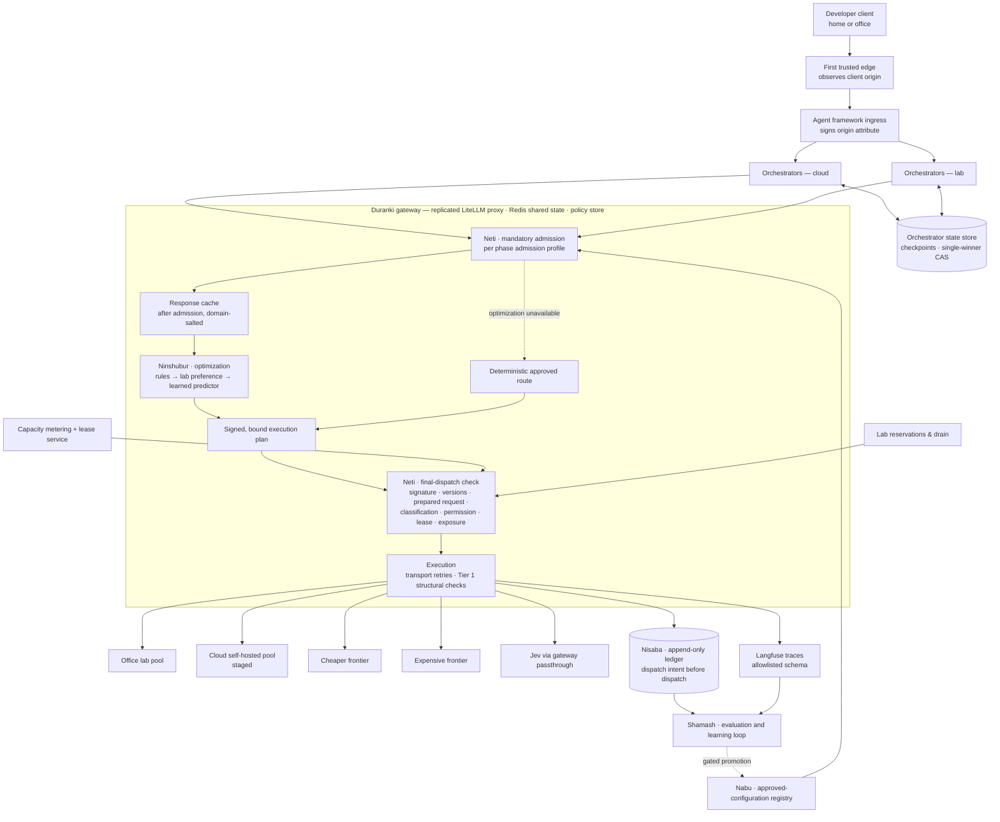

# Duranki — LLM Routing & Metering Infrastructure — Architecture Baseline

**Status:** v1.1 — architecture baseline for Phase 0 and Phase 1a
**Date:** 16 October 2026
**Owner:** Larry Mitchell
**History:** v0.1 → v0.2 → v0.3 → v1.0, across three rounds of review by four external frontier models (Grok, Gemini, DeepSeek, GPT-6.1); v1.1 is an internal update following the competitive landscape review
**Companions:**
- `review-tracker.md` — complete disposition of all review comments and the error record for each version
- *Duranki — Components and Legends* — the agent names and the myths behind them
- *Duranki — Competitive Landscape* (16 October 2026) — the market review that prompted v1.1

---

## 0. Baseline status

All four round-3 reviewers recommended adopting v0.3 as the architecture baseline. None raised a structural objection. v1.0 folded in the round-3 corrections; all of them were local to their sections.

v1.1 is an internal update and was not sent for external review. Its changes add to v1.0 without altering any contract, invariant or phase gate, except that Phase 1a gains the supply-chain controls of §4.4.

**What adoption means:**

- **Phase 0** may start immediately.
- **Phase 1a** may start once the items marked *1a* in this document are implemented and its acceptance tests (§16) pass.
- Adoption does **not** approve hard-budget enforcement (Phase 1b), live model substitution (Phase 4) or learned-policy promotion (Phase 5). Each is gated by its own phase criteria.

### Organizing invariants

> An isolated call is not necessarily a safe call. A valid response is not necessarily a correct response. A permitted destination is not necessarily an authorized next attempt.
>
> An expired owner is not a cancelled request, and an expired reservation is not evidence that its financial exposure disappeared.

### Changes in v1.1

1. **Names.** The system is named **Duranki**, and its five agents are **Neti**, **Ninshubur**, **Nisaba**, **Shamash** and **Nabu** (§4.2). Names are labels only; every contract still refers to the component it names.
2. **Off-the-shelf parts made explicit.** §4.1 names each commercial off-the-shelf (COTS) product and marks it decided, candidate or open.
3. **Supply-chain protection** for every off-the-shelf part, added to Phase 1a with acceptance tests 37–41 (§4.4, §15, §16).
4. **LiteLLM's built-in routing disabled.** LiteLLM now ships its own Auto Router; only Duranki's optimization plugin may choose a route, and only within the signed plan (§4.3).
5. **Two new risks**: a compromised release of an off-the-shelf part, and a vendor acquisition or shutdown (§17). The LiteLLM contingency decision now covers both (§18).

The Phase 3 bake-off (§6.5) is unchanged: it compares ways of building Duranki's own predictor, not outside products.

### Changes in v1.0 (from v0.3)

1. **Financial and capacity exposure** survive owner-lease expiry (§6.7, §10.4). This is the most consequential runtime correction.
2. **Explicit admission profiles** per phase, including a Phase 1a profile (§5.1).
3. **Derived data inherits source handling and retention** unless an approved feature schema says otherwise; retention applies at every persistence boundary (§13).
4. **Two-level request binding**: canonical work plus each candidate's prepared request, with signed plans (§5.3).
5. **Three identity levels**: logical step, execution generation, provider attempt; idempotency keyed by execution generation (§8.2).
6. **Authorization point** defined; the final-dispatch check verifies signature, policy versions and the final prepared request (§5.4).
7. **Gateway response cache** placed after admission and salted by security domain (§5.6).
8. **Recovery policy** and **approved-configuration registry** defined as artifacts with lifecycles (§6.8, §5.5).
9. **Presence attribute** bound to issuer, audience, principal and session, with TTL and key management (§7.1).
10. **Leaf validation** by orchestrator construction manifest (§6.1).
11. **Statistical corrections**: generalized cascade quality, analysis matched to design, common judging, pooling scope, separately justified latency study (§11).
12. **Fault tests** gate the first phase that relies on each guarantee (§16).

### v0.3 errors corrected

| v0.3 error | Correction |
|---|---|
| Budget reservation TTLs released exposure of dispatched or outcome-unknown work | Owner expiry ≠ exposure release (§10.4) |
| Plan's lease "released on failover" contradicted §6.7 | Capacity released only on confirmed completion or cancellation (§6.7) |
| "Mandatory admission in every phase" contradicted the Phase 1a/1b budget split; registry mandatory but scheduled for Phase 3 | Phase admission profiles; 1a approved-configuration file (§5.1, §5.5) |
| Derived features (Jev answers, scores) exempted as non-content | Inheritance unless approved feature schema (§13.1) |
| `request_hash` covered adapter output while fallbacks use different adapters | Two-level binding (§5.3) |
| References treated as content-bound | Versioned or materialized (§5.3) |
| Gateway response cache not placed after admission | §5.6 |
| Per-step idempotency key would deduplicate an authorized escalation into the rejected result | Execution generation (§8.2) |
| Tier 1 "escalate within the plan" conflicted with orchestrator ownership of identity changes | §6.2 |
| "p_s ≈ 1 because baseline" | Removed (§6.4) |
| Cascade quality equation omitted false rejection | Generalized (§11.1) |
| Paired analysis required universally | Analysis matched to design (§11.3) |
| Latency study asserted smaller; δ≈0 called mathematically impossible | Corrected (§11.3) |
| Fault tests scheduled after the phases relying on them | §16 |
| Error table cited the wrong subsection for the budget clause | Corrected in tracker |

---

## 1. Purpose and objective

Reduce the token cost of our collaborating agent systems without degrading task quality, by:

1. **Metering** every LLM call and attributing its true cost to principal, agent, session and task.
2. **Routing** each call to the cheapest *approved* configuration that keeps task quality within an approved envelope, across self-hosted open models (office lab and, later, cloud) and cheaper/more expensive frontier models.

### Governing metric

**Cost per accepted task** for a task class:

  M = E[C_task] / P(task accepted)

over complete task cohorts, including failed and abandoned tasks.

### Objective

Over eligible joint policies π = (routing policy, recovery policy), jointly versioned:

  minimize M(π)

subject to, per task class:

- **Quality (relative):** non-inferior to the incumbent within margin δ_class (§11.3)
- **Quality (absolute):** acceptance ≥ the class's fixed quality floor
- **Latency:** P(T_task ≤ D_class) ≥ 1 − ε

This specifies what the system must achieve, not an optimizer to build. The cost decision rules (§6.2, §6.4) are working heuristics inside an approved envelope.

### Non-goals

- Building our own gateway, model server or observability stack.
- Sophisticated routing models before contracts, accounting and evaluation are trustworthy.
- A full online contextual-bandit framework at launch.
- Training or fine-tuning models.

---

## 2. Summary

Duranki is the layer between our agent orchestrators and the models they call. Orchestrators run in the cloud and in the office lab. All of them reach models only through one logical gateway (replicated LiteLLM proxy). Every request passes **mandatory admission** under the current phase's admission profile: identity, attribution, purpose, deterministic classification, destination permission, capability, quality approval and budget. Admission produces an eligible set; optimization ranks it; the router issues a **signed execution plan bound to specific work**; a **final-dispatch check** runs before every attempt on every path and validates the final prepared request.

The gateway owns transport and structural checks. The orchestrator owns substantive verification, step acceptance, semantic recovery, model-identity changes and side effects. Verifiable leaf steps use cheap-first cascades; trajectory steps stay on the approved spine model except for leaves with explicit consumption contracts. The office lab is the preferred endpoint for people working in the office and absorbs background work otherwise. A durable, append-only ledger is the accounting authority, and financial exposure is held until settled. Training evidence comes from overnight replay, randomized task cohorts and narrow action-level exploration, with development and confirmation data kept separate.

---

## 3. Design principles

1. **The gateway is the only door.** Provider keys exist only in the gateway; network policy prevents agents from reaching self-hosted model servers directly. All model, classifier, verifier, judge, evaluation and replay calls pass through the gateway and are metered.
2. **Admission is mandatory; optimization is optional.** Rules can short-circuit ranking, never admission.
3. **One final-dispatch check for every path**, including the emergency gateway and any future lab replica.
4. **Availability never trumps policy.** If optimization fails, use a deterministic, approved, compliant route; if none exists, queue or fail explicitly.
5. **Plans authorize specific work**, are signed, and expire.
6. **Isolated ≠ safe; valid ≠ correct; permitted ≠ authorized.**
7. **Ownership expiry ≠ exposure release.** Money and capacity that may already be committed stay held until settled or proven unused.
8. **Derived data inherits source handling.** A boolean, category or score is not non-sensitive merely because of its representation.
9. **Quality is a constraint measured at the task level.** Structural signals are guards and features, never training rewards.
10. **Meter what matters**: queue depth, KV-cache occupancy, TTFT and predicted wait, not GPU utilization.
11. **Three separate affinities**: model affinity (behaviour), replica/cache affinity (placement), conversation state (recoverable independently of both).
12. **Extend, don't fork.**
13. **State what can be audited, reconstructed and re-executed**, and for how long (§13.1).

---

## 4. Architecture



### 4.1 Components

**Status key:** *Decided* — the product is chosen. *Candidate* — chosen subject to the Phase 3 bake-off. *Open* — a choice still listed in §18. *Existing* — a tool we already run. *Build* — written by us.

| Component | Agent | Role | Choice | Status | Build / buy |
|---|---|---|---|---|---|
| First trusted edge + ingress | Neti | Observe client origin from trusted network path; sign origin attribute | Corporate edge or zero-trust tunnel + agent framework front end + identity provider (products not yet named) | Existing | Extend |
| Orchestrator state store | — | Checkpoints; single-winner compare-and-swap; acceptance transitions | Orchestrators' existing durable store | Existing | Extend (orchestrator team) |
| Gateway | Neti, Ninshubur | Single logical entry; admission; execution | **LiteLLM** proxy, stateless replicas behind a load balancer | Decided | Off the shelf |
| Gateway shared state | Neti, Nisaba | Reservations, exposure, leases, policy cache | **Redis** | Decided | Off the shelf |
| Admission policy | Neti | Rules-engine classification, permissions, capability, approval, budget | LiteLLM hooks + custom module; deterministic, locally evaluable | Build | Extend |
| Approved-configuration registry | Nabu | Approved configurations per task class (§5.5) | Phase 1a: version-controlled file; Phase 3: versioned registry service | Build | Build |
| Optimization plugin | Ninshubur | Ranking; plan issuance and signing | Custom plugin via LiteLLM routing/callback hooks | Build | Build |
| Usage ledger | Nisaba | Accounting authority | Managed high-availability database, append-only (product not yet named); replica-local durable WAL for brief outages (§10.1) | Open | Extend |
| Tracing | Shamash (evidence) | Analysis and debugging | **Langfuse** (self-hosted) + async **OpenTelemetry Collector** with allowlisted schema and redaction | Decided | Off the shelf |
| Model serving | — | Inference with prefix caching | **vLLM** or **SGLang** | Open | Off the shelf |
| Serving orchestration | — | Deployment + cache-aware scheduling | One coherent stack: **KServe + llm-d**, or **Ray Serve** with prefix-aware routing (**GKE Inference Gateway** if on GCP) | Open (§18 item 4) | Off the shelf |
| Capacity metering | Ninshubur, Neti | Pool load | **Prometheus + Grafana** | Decided | Off the shelf |
| Lease service | Neti | Leases on lab and cloud capacity | Custom | Build | Build |
| Feature extraction | Ninshubur | Predictor inputs | Bake-off winner (§6.5); **Jev** via LiteLLM TypeSafe passthrough | Candidate | Buy + build |
| Lab policy service | Neti | Admission classes, reservations, drain | Custom | Build | Build |
| Learning loop and evaluation | Shamash | Replay, cohorts, judging, retraining, gated promotion | Custom offline jobs | Build | Build |
| Cloud and frontier access | — | Hosting; frontier models | **AWS** or **GCP** (§18 item 3); direct vendor APIs, **Bedrock** or **Vertex AI** (§14.4) | Open | Off the shelf |

Everything Duranki adds lives in its own modules behind LiteLLM's hooks, never in a fork. If the gateway product is acquired, abandoned or compromised, the cost is a migration, not a rebuild. The market for these parts is reviewed in *Duranki — Competitive Landscape*.

### 4.2 Duranki agents

The names come from one mythology, Mesopotamian, as the naming convention requires. *Duranki — Components and Legends* tells each myth in full.

| Agent | Legend | Component(s) | Limit |
|---|---|---|---|
| **Duranki** | "Bond of heaven and earth": the sacred precinct at Nippur | The whole system | — |
| **Neti** | Gatekeeper of the underworld, who admits Inanna through seven gates and takes something at each | Mandatory admission, signed plans, final-dispatch check, presence, leases, lab policy | Admits and checks; does not rank or choose |
| **Ninshubur** | Inanna's minister, who follows a pre-agreed list of gods to appeal to until one can help | Optimization plugin, cascades and escalation, feature extraction | Chooses only among destinations Neti admitted, in the plan's order |
| **Nisaba** | Goddess of grain, writing and accounting, given the measuring rod and line | Ledger, dispatch intent, cost views, reconciliation | Records; does not decide |
| **Shamash** | Sun god of justice who sees everything; gives Hammurabi the laws | Evaluation, acceptance judging, non-inferiority and floors, learning loop | Judges against the standard; does not approve or route |
| **Nabu** | Scribe god, keeper of the Tablet of Destinies | Approved-configuration registry | Records approvals Shamash's evidence and an owner support; never self-approves |

### 4.3 LiteLLM verification and built-in routing

**Verification (Phase 1a):** hooks, budget behaviour, fallback access checks, TypeSafe passthrough attribution and licence gating are verified against the pinned release. The licence check confirms which features Duranki relies on need LiteLLM's enterprise licence. Any option that admits requests under a fallback identity during a database outage is **disabled**.

**Built-in routing disabled.** LiteLLM ships its own Auto Router (version 2 from July 2026: complexity tiers, keyword rules, optional Thompson sampling). It is **disabled** in Duranki's configuration. Only Ninshubur's optimization plugin may choose a route, and only within the signed plan; the final-dispatch check rejects any dispatch whose deployment the plan does not name (test 40). LiteLLM's own load-balancing and fallback settings are likewise limited to what the plan permits.

**Contingency**, decided before Phase 1a starts: if verification fails, or the pinned release must be abandoned (§4.4, §17), a thin custom admission layer in front of LiteLLM (or an alternative gateway) carries §5, so Phase 1a does not stall.

### 4.4 Supply-chain protection

Every provider key lives in the gateway (§3 principle 1), so a compromised gateway release is the worst case. In March 2026 malicious LiteLLM releases were published to PyPI in a supply-chain campaign; Duranki treats this as a design input, not a one-off. These controls apply from Phase 1a to every off-the-shelf part, starting with those that see prompts or keys: LiteLLM, Redis, Langfuse and the OpenTelemetry Collector.

1. **Pin and verify.** Exact versions of each product and its dependencies, with hash checks; no floating versions or `latest` tags (test 37).
2. **Build our own images** from reviewed source in our own pipeline; deployments never pull published packages or images at run time (test 37).
3. **Delay adoption.** A new release is adopted only after a soak period and a recorded review of its changes, unless it fixes a vulnerability that affects us (test 41).
4. **Restrict egress.** The gateway reaches only allowlisted provider and destination endpoints; Langfuse and the collector reach only their stores. A compromised release cannot send keys or prompts elsewhere (test 38).
5. **Keys in a secrets manager**, readable only by the gateway's runtime identity, rotated on a schedule and immediately on suspected compromise (test 39).
6. **Inventory.** A software bill of materials for every deployed image; security advisories for listed components are monitored by the owner in §18 item 6.
7. **Fail closed on suspicion.** A suspected compromise triggers key rotation and a rollback to the last verified build; if no verified build is safe, the contingency in §4.3 applies.

---

## 5. Request lifecycle and contracts

```
validate identity, purpose, attribution            (admission profile)
  → classify: orchestrator taint + gateway guards + rules engine
  → establish eligible set: permission, capability, approval, budget
  → response cache lookup (if enabled; §5.6)
  → rank (optimization; may be skipped)
  → issue signed plan: canonical-work binding + candidate preparation specs
  → per attempt: prepare candidate request → FINAL-DISPATCH CHECK
  → AUTHORIZATION POINT: persist dispatch intent
  → transmit → settle
```

### 5.1 Mandatory admission

#### Admission profiles

Admission is mandatory in every phase. **What each control enforces depends on the phase's admission profile**, which states explicitly which guarantees are active.

| Control | Phase 1a profile | Full profile (1b onward) |
|---|---|---|
| Identity, purpose, destination permission, classification, retention | Enforced | Enforced |
| Quality approval | Fixed requested destination must appear in the approved-configuration file | Approved-configuration registry |
| Budget | Per-principal spend limits and alerts; **no hard concurrent ceiling guarantee** | Atomic reservation with exposure tracking (§10.4); fail closed |
| Destinations | Fixed requested destination; no model substitution | Ranked eligible set |
| Eligible workloads | Those not requiring hard concurrent ceilings | All |

#### Controls

1. **Identity.** Principal and task ownership derived or validated from authenticated context. Background work runs under a named service principal with a charging owner. Caller-supplied tags are validated, never trusted.
2. **Attribution** per §9. **Migration mode** admits agents with explicitly identified *accounting or analytical metadata gaps* (e.g. missing subtask labels) under their authenticated principal, flagged non-compliant and ineligible for optimization. Migration mode **never** bypasses identity, destination authorization, purpose validation, source classification or retention restrictions.
3. **Classification.**
   - The **orchestrator** performs monotonic taint tracking: every tool result, retrieved document and attachment carries its source's sensitivity and client-specific restrictions; a context's handling policy combines all of them and never weakens.
   - The **gateway** enforces structural guards: PII and secret scanning, rejection of untagged tool results and content blocks, payload validation.
   - Classification is a **deterministic, locally evaluable rules engine** (label inheritance, patterns, allowlists) with a named owner, a labelled test corpus, and minimum bars on false negatives (missed sensitive content) and false positives. Model-based signals are auxiliary only.
   - **Handling policy is the combination of applicable restrictions**, not only the maximum sensitivity level.
4. **Purpose.** Trusted purpose on every request: `execution`, `feature_extraction`, `verification`, `judging`, `evaluation`, `replay`. Supporting purposes follow fixed policies: no recursive optimization, no cascades.
5. **Derived-call inheritance.** Requests derived from another (verifier, judge, feature extraction including Jev, distillation, summarization) inherit the source's handling policy combined with their own. Feature-extraction and judge templates are reviewed as **policy artifacts**.
6. **Destination permission** per service, endpoint, inference profile, model and processing geography. Above public sensitivity, marketplace inference profiles must be region-pinned. Residency, export-control and per-client attributes are part of this record.
7. **Capability compatibility**, demonstrated by tests.
8. **Quality approval.** A destination is eligible only as part of an approved configuration for the task class (§5.5). Canaries use separately authorized experimental scope.
9. **Pinned-model mode.** The plan has no fallbacks; unavailability or ineligibility produces explicit failure to the orchestrator. Only the orchestrator may relax a pin.
10. **Budget authorization** per the admission profile. Under the full profile: atomic reservation; fail closed when budget state is unavailable or not yet safely recovered (§10.4); no configured exceptions.
11. **Per-client retention and handling terms** are principal/task attributes evaluated here, flowing into the plan's `retention_class`.

Output: the eligible set. If empty, reject or queue with an explicit reason.

### 5.2 Optimization (ranking)

May be skipped (Phase 1a, which uses fixed destinations) or fail without affecting admission.

1. Deterministic rules by agent role and step type (versioned).
2. Lab preference (§7).
3. Learned predictor (§6.5) for ready step types.

Decisions record a propensity; deterministic decisions record 1.0. Routing logic reads only the **avoidable incremental** cost view (§10.5).

### 5.3 Execution plan

The plan is **signed** by the optimization layer with a gateway-held key and authorizes only the work it is bound to.

**Binding (two levels):**

- **Canonical-work binding:** principal, purpose, `task_id`, `step_id` + revision, `execution_generation`, and a hash of the **canonical pre-adapter request**: messages, tool definitions, attachments, generation settings. Non-semantic metadata (trace IDs, timestamps) is excluded.
- **Candidate preparation:** for each authorized deployment, the adapter version from `prompt_adapter_map`. The prepared request for a candidate is produced deterministically from the canonical work and its adapter, and validated by the final-dispatch check **after all preparation and callbacks**.
- **References:** a versioned reference is bound as reference plus content version; an unversioned reference must be materialized and hashed. Mutable provider-managed state requires an immutable version or a controlled resolution rule.

| Field | Purpose |
|---|---|
| `plan_id`, `signature`, `expires_at` | Identity, integrity, validity; policy or permission changes revoke the plan |
| Canonical-work binding | As above |
| `purpose`, `task_class`, `step_class` | Validated values that cannot drift between admission and dispatch |
| `classification_snapshot` | Level, combined restrictions, content hash, rules-engine version — **audit only**; the FDC uses current classification |
| `quality_approval_ref` | Approved configuration(s) in effect |
| `deployment` | Model, version, pool, quantization |
| `permitted_fallbacks` | Ordered, each admitted; empty for pinned mode; same-deployment only for spine steps |
| `prompt_adapter_map` | Adapter version per candidate deployment |
| `capability_profile_version` | |
| `policy_version`, `recovery_policy_version`, `registry_version` | Checked at final dispatch |
| `predictor_version`, `feature_extractor_version` | If used |
| `failure_action_map` | Which failures permit transport retry, permitted fallback, return-to-orchestrator, or termination |
| `verifier_spec` | Tier 1 structural check the gateway may run |
| `originating_step_id`, `minimum_tier` | For escalation attempts |
| `per_attempt_ttft_timeout_ms`, `per_attempt_total_timeout_ms` | Prevent one hung attempt consuming the task deadline |
| `deadline` | Remaining task deadline |
| `retry_allowance`, `escalation_allowance` | Separate budgets (§8.3) |
| `max_output_tokens` | Output limit, set before dispatch |
| `budget_reservation_id`, `financial_scope` | Authorized **total** charge (input, output, reasoning, cache writes and any other enabled billable component) for the attempts covered; when a fresh atomic reservation is required |
| `lease_token` | Capacity lease; ownership may expire, capacity released only per §6.7 |
| `cancellation_token` | |
| `cache_hint` | `session_id` and stable-prefix information for the serving layer |
| `retention_class` | What may be persisted for this attempt, at every persistence boundary |
| `streaming` | False for internal agent steps |
| `decision_record` | Candidate set, scores, propensity, reason (stored in the ledger) |

### 5.4 Final-dispatch check and authorization point

**Final-dispatch check (FDC).** Before every attempt on every path (first dispatch, retry, fallback, deterministic route, emergency gateway, any future lab gateway replica), in order:

1. Plan signature valid; plan unexpired and not revoked.
2. `policy_version`, `recovery_policy_version` and `registry_version` match current, else replan.
3. Candidate prepared request, after all adapters and callbacks, matches the canonical-work binding and the candidate's adapter version.
4. **Current** classification and combined handling policy are within the destination's permission.
5. Destination still permitted and approved.
6. Current reservation state, admission class and a valid capacity lease (lab and pools).
7. Financial authorization covers the attempt's maximum exposure.
8. Deadline sufficient.

Any failure → replan via the orchestrator, or explicit failure.

**Authorization point.** An attempt is **authorized** when its dispatch intent is durably persisted after a passing FDC. A revocation (policy, permission, reservation) that occurs before the authorization point prevents transmission. A revocation after the authorization point does not recall an attempt already transmitted; it is recorded, and the attempt's outcome is settled normally. Attempts authorized but not yet transmitted when a revocation arrives are re-checked before transmission.

| Failure | Behaviour |
|---|---|
| Optimization error or timeout | Deterministic **approved** route from the eligible set |
| Predictor or feature extractor unavailable | Rules-only ranking, reported as such |
| Destination fails before dispatch | Next permitted fallback, subject to the FDC |
| Gateway replica failure | Healthy replicas take over |
| All replicas unhealthy | Emergency gateway preserving **all of §5.1 and the FDC** (no optimization); rules-engine classification lets it operate |
| Shared-dependency outage (Redis, policy store) | Budget or policy state unavailable ⇒ fail closed |
| Ledger primary unavailable | Replica-local durable WAL for a bounded window (§10.1); WAL unavailable ⇒ fail closed |
| No compliant route | Queue (if deadline allows) or explicit failure |

### 5.5 Approved-configuration registry

An **approved configuration** = model + version + quantization + pool + prompt adapter + verifier + recovery policy + consumption contract (where applicable), approved for a task class.

| Lifecycle step | Rule |
|---|---|
| Phase 1a | A version-controlled file listing incumbent configurations authorized for the onboarding cohort |
| Addition | Requires confirmation-set evidence (§11) or, for incumbents, explicit owner approval |
| Approver | Named registry owner |
| Revocation | Immediate; increments `registry_version`, which revokes outstanding plans at the FDC |
| Canary | Separately authorized experimental scope, never ordinary eligibility |
| Changes | Any change to a configuration's components is a new configuration subject to §12.4 |

### 5.6 Gateway response cache

If gateway-level response caching is enabled (Phase 2 or later), lookups run **after mandatory admission**, with cache keys salted by security domain, combined handling policy and `quality_approval_ref`. Cache hits are recorded in the ledger with their cost status and count against budget at their recorded cost. Provider prefix caching is unaffected.

---

## 6. Routing policy

### 6.1 Step taxonomy

**Verifiable** means a **registered checker evaluates the substantive acceptance condition** within a documented scope, with measured false-acceptance and false-rejection rates. Structural guards never by themselves qualify a step, unless the requirement is purely structural. **Adding or changing a verifier changes a step's classification and is a policy change** subject to §12.4.

| | **Verifiable** | **Trajectory** |
|---|---|---|
| **Spine** | Cascade within spine deployment where possible | Stays on approved spine model; cheap routing not permitted |
| **Leaf** | Cheap-first cascade (default) | Split further (§6.3) |

**Leaf validation.** The orchestrator constructs each leaf from a **registered step definition** and records a **construction manifest**: selected inputs (by message-block lineage ID), declared dependencies and source labels. The gateway validates the manifest, the source labels and the payload binding. It does not infer semantic dependencies from text. Verifiability labels are spot-audited.

**Context isolation** is a Phase 2 prerequisite for leaf routing.

### 6.2 Verifiable steps: two-tier cascades

- **Tier 1 (gateway):** structural checks named in `verifier_spec`. On failure, the gateway may retry the same deployment, or use permitted fallbacks **for leaf steps only**. On a spine step, any change of model identity returns an escalation request to the orchestrator.
- **Tier 2 (orchestrator):** substantive verification. The gateway's return to the orchestrator is **candidate delivery**, not acceptance. On rejection the orchestrator authorizes a new **execution generation** with `originating_step_id` and `minimum_tier`, from the last known-good state. Acceptance follows a passing verification, via the single-winner transition (§8.4).
- **Escalation allowance:** at most one escalation per step initially, separate from the failure-retry budget. When exhausted, the step returns to the orchestrator for a decision (fail the step or abandon the task); the failure-retry budget is not consumed.
- **Non-streaming** for internal steps.

**Cascade cost:**

  E[C_cascade] = c_w + c_v + q · E[C_escalation | escalation]

with `q` the escalation probability (§11.1). Compare against the complete expected cost of the approved direct route. A tail-adjusted version (90th–95th percentile or CVaR of escalation cost) may be used as a conservative **decision score**.

### 6.3 Trajectory steps

- Recovery cost for trajectory steps is a **hyperparameter per task class**, tuned on development cohorts (§11.4).
- Leaf trajectory steps split into **compressions/transformations** (summarize, translate, cluster, draft; cheap routing may be permitted) and **state-altering decisions** (filter, select, sub-plan; not cheap by default).
- Cheap routing of any leaf trajectory step requires an explicit **consumption contract** (independent verification, advisory-only use, retained citations, or approval before consequential action) **and** a passing quality gate for the complete parent–leaf policy. Isolation alone does not establish safety; accepted residual risk is stated.
- **Data-readiness threshold:** ~500 labelled outcomes per step type before learned routing is considered. A readiness threshold, not an approval.

### 6.4 Cost decision rule

For a direct choice between a cheaper and a stronger approved configuration, route cheaper when:

  c_w + (1 − p) · R < c_s  ⇔  p > 1 − (c_s − c_w) / R

- `p` is keyed by **deployment**.
- This simplified form omits the stronger option's own failure and recovery terms. It is used **only where those terms are empirically immaterial**; otherwise compare the complete expected costs of both approved execution policies.
- Costs use the avoidable incremental view, including cache state and switching cost.

### 6.5 Feature extraction and learned predictor

**Bake-off (Phase 3)**, on development cohorts and confirmed on the confirmation set:

| Candidate | Establishes |
|---|---|
| A. Deterministic rules | Minimum-complexity baseline |
| B. Metadata-only model | How much structure alone explains |
| C. Local embedding classifier + head | Whether cheap local semantics suffice |
| D. Jev features + head | Whether Jev adds decision value |
| E. Jev offline as teacher → distilled local classifier; Jev online only for rare step types | Hybrid; offline labelling cost amortized into per-call cost |

**Falsification:** Jev is not adopted online unless it improves cost per accepted task at equal quality and within the latency budget after its own cost and latency. Jev outputs are features or identified teacher signals, **never task-success labels**.

**Jev rules:** called only through the gateway with `purpose = feature_extraction`; subject to admission and inheritance; its outputs inherit source retention (§13.1); not in the synchronous path by default; if online, at subtask boundaries, cached while input is unchanged, skipped when deadline is insufficient.

**Fallback predictor:** own trained and validated head, own version, same promotion gate (§12.4). Fallback paths are exercised on a schedule.

**Latency budget:** admission + rules + local prediction ≤ 20 ms at p99.

### 6.6 Affinity and model identity

- **Model affinity:** pinned within a coherent subtask; reconsidered at explicit subtask boundaries.
- **Spine fallbacks at the gateway are same-deployment only.** Any model-identity change returns to the orchestrator, which restarts the subtask from known-good state.
- **Eligibility can shrink mid-spine** as tainted content arrives: forced re-route, orchestrator notified, cache loss accepted.
- **Cross-family migration** requires transcript normalization in adapters; fault-tested.
- **Replica/cache affinity** belongs to the serving layer's prefix-cache-aware scheduler.

### 6.7 Capacity, leases and overflow

- **Cloud self-hosted pool** (when it exists) sized for base load; **bursts go directly to the cheaper frontier tier**.
- **Overflow chain:** lab (if eligible) → cloud self-hosted (if headroom) → cheaper frontier → expensive frontier (if approved and permitted).
- **Admission by load below a threshold**, estimated from uncached input work, expected output work, active decode load, KV-cache occupancy and TTFT, against a defined per-pool capacity denominator that accounts for long-lived spine sessions. GPU utilization is diagnostic only. Hysteresis initially 80% stop / 60% resume.
- **Leases:** acquired at admission and renewed per attempt while server-confirmed work is active. **Lease ownership may expire; capacity is reclaimed only on server-confirmed completion or confirmed cancellation**, never on failover alone.
- **Stale telemetry** stops new admission to that pool.

### 6.8 Recovery policy

A **recovery policy** is a versioned artifact (`recovery_policy_version`) defining, per task class:

- failure-retry budget per task and per-attempt timeouts
- escalation allowance and exhaustion behaviour
- permitted fallback rules (leaf vs spine)
- known-good checkpoint rules
- outcome-unknown handling (timeout and grace period)
- consumption contracts for cheap trajectory leaves

Owner: orchestrator team, jointly with the routing policy owner. It is versioned with the routing policy as a joint policy (§1), included in approved configurations, and changes follow §12.4.

---

## 7. Office lab policy

### 7.1 Presence

**Presence is a property of the person, not of where the agent runs, and is a session-admission priority signal, not a continuous physical-presence guarantee.**

- The **first trusted edge facing the human** observes the client's network origin through the trusted network path (corporate edge or zero-trust tunnel), never from client-supplied forwarding headers.
- If the origin is an office LAN subnet, the agent framework ingress issues a **signed office-origin attribute** bound to issuer, gateway audience, authenticated principal and `session_id`, valid for 8–12 hours. VPN address pools and lab-hosted orchestrator addresses never confer presence.
- Where a web backend proxies to the agent framework, the web tier's edge observes and signs origin, and the attribute propagates. Where no trusted edge faces the human, presence is **unavailable** (a stated limitation).
- The gateway trusts only valid signed attributes for the session they were issued to. They are never carried in OpenTelemetry baggage.
- **Key management:** signing keys held in a managed key service, rotated on a schedule, minting restricted to the ingress; gateway components hold verification keys only. *Phase 1a.*

| Class | Who | Admission |
|---|---|---|
| **Priority** | Interactive sessions with a valid office-origin attribute | Up to the standard high-water mark |
| **Background** | Everything else (remote, batch, evaluation, replay) | Below a lower threshold (initial 50%); preemptible by cancelling in-flight requests on a lease-service signal |

Sessions stay sticky after their owner leaves, up to the attribute's validity.

### 7.2 Reservations

Explicit reservations, set by owners, override both classes.

### 7.3 Drain contract

| Step | Initial value |
|---|---|
| Destination-capacity precondition | T − 15 min; if insufficient, owner notified, in-flight work finishes on lab where possible |
| Stop new sessions | T − 15 min |
| Stop new requests incl. sticky continuations; reroute queued requests | T − 10 min |
| Maximum in-flight duration | 5 min; longer requests cancelled |
| Re-dispatch | Conditional on cancellation outcome, deadline, budget exposure, pinned mode and a currently permitted fallback; otherwise queue or explicit failure |
| Migration | Staggered across the window |
| Handover complete | No active requests; demo model loaded and health-checked |
| Emergency drain | Manual "drain now" with the same in-flight treatment |

Timings validated against measured cancellation, model-preparation and health-check durations.

**Spine admission rule:** a spine is admitted to the lab only if expected to finish before the next reservation, or a cross-family migration path for its model has been tested.

### 7.4 Quality gating

Approval per model **and** quantization; a quantized lab deployment is a distinct configuration.

### 7.5 Cache isolation

Per-security-domain cache salting; cache state never assumed portable across a drain.

### 7.6 Security

The lab is production infrastructure: the same access control, segmentation, logging and patching as the cloud pool. Network policy prevents any agent, including lab orchestrators, from reaching lab model servers except through the gateway.

---

## 8. Retry, recovery and completion contract

### 8.1 Ownership

- **Gateway:** transport retries, Tier 1 structural checks, dispatch within the plan.
- **Orchestrator:** substantive verification, step acceptance, known-good checkpoints, semantic escalation, model-identity changes, external side effects.

### 8.2 Identity levels

| Identity | Created by | Meaning |
|---|---|---|
| `step_id` + revision | Orchestrator | The logical work that may publish exactly one accepted result |
| `execution_generation` | Orchestrator | A particular authorized invocation; a new generation for each authorized escalation or orchestrator retry. **The idempotency key.** |
| `attempt_id` | Gateway | A particular provider dispatch within a generation |
| Provider request ID | Provider | Reconciliation |

A repeated submission of the same execution generation is deduplicated. An authorized escalation is a new generation and is never deduplicated into the rejected result.

### 8.3 Budgets

- **Failure-retry budget** per task, shared across layers, decremented atomically against a single authority (Redis-backed, reconciled from the ledger).
- **Escalation allowance**, separate and bounded (§6.2).
- Cancellation and remaining deadline are propagated.

### 8.4 Attempt states

| State | Required behaviour |
|---|---|
| Failed before dispatch | Another eligible attempt is safe; reservation for it may be reclaimed |
| Dispatched, outcome unknown | Uncertainty preserved; usage unknown; **financial exposure and capacity remain held**. After `per_attempt_total_timeout` + grace (initial 60 s), the orchestrator receives an explicit outcome-unknown signal |
| Owner lease expired (replica crash) | Ownership transfers; **exposure and capacity remain held** until settlement, proof of non-execution, or conservative accounting at the authorized maximum |
| Cancellation requested | Not proof of stop; exposure and capacity held |
| Cancellation confirmed | Capacity and unused exposure released |
| Partial output exposed | Never splice; restart the step |
| Superseded by escalation | Output discarded; tokens billed and counted toward step cost and realized recovery cost |
| Candidate delivered, verifier rejected | New execution generation from known-good state, charged to the escalation allowance |
| Output accepted, side effects not committed | Orchestrator recovers from checkpoint |
| External side effect committed | No replay without deduplication, reconciliation or compensation |

### 8.5 Single-winner acceptance

Acceptance is a compare-and-swap in the **orchestrator state store**, owned by the orchestrator team, keyed by `step_id` + revision: the first verified result from the currently authorized generation wins. Late or superseded results are recorded and billed but cannot advance the task. The store's availability is independent of the gateway's.

---

## 9. Agent instrumentation contract

Named owner. Phase 1a requires authentication and attribution to a principal; full compliance is a Phase 2 exit criterion.

| Field / behaviour | Requirement |
|---|---|
| Trace context | OpenTelemetry trace/span context with parent spans; span links across independently rooted traces |
| Identity | Authenticated principal; service principal + charging owner for background work; signed office-origin attribute where present (not in baggage) |
| `task_id`, `subtask_id`, `session_id`, `task_class` | Explicit subtask boundaries |
| `step_id` + revision, `execution_generation` | Per §8.2 |
| `purpose` | Per §5.1.4 |
| `step_type`, `step_class` | Validated via construction manifest (§6.1) |
| Message blocks | Lineage IDs on every block |
| Taint | Source sensitivity and client restrictions on every tool result, document and attachment |
| Construction manifest | For leaf steps (§6.1) |
| Lineage | Retries, escalations and re-executions linked to the originating step |
| Outcome signals | Three levels (§11.1); terminal acceptance not copied onto preceding steps |
| Pinned-model flag | Where model identity is required |

---

## 10. Metering and accounting

### 10.1 Ledger

- **Append-only**, durable, deduplicated per attempt; settlement and reconciliation append linked revisions. The `decision_record` lives here.
- **Dispatch intent is persisted before transmission** (the authorization point, §5.4).
- **Availability:** managed highly available database as primary. During brief primary outages, replicas may persist dispatch intent to a **replica-local write-ahead log on a persistent volume**, for a bounded window, flushed asynchronously. If the WAL is unavailable, dispatch fails closed.
- **Phase 1a fallback:** if the full ledger slips, a simpler append-only log with the same interface is acceptable; reconciliation may follow.
- Independent of trace sampling.

### 10.2 Usage capture

- Raw provider usage alongside normalized, mutually exclusive billable categories.
- Versioned by **price version** and **usage-semantics version**.
- Cost status: reported, calculated, estimated, reconciled. Missing usage is unknown/estimated, never zero.
- Provider-reported processing region logged where available.

### 10.3 Coverage

All model, feature-extraction, verification, judging, evaluation and replay calls; superseded attempts; response-cache hits. **Routing overhead** reported separately (above ~5% of cost per task, the learned stage must justify itself). Evaluation volume is a standing cost line.

### 10.4 Budgets and exposure (full profile, Phase 1b)

- Atomic concurrent reservation against the **authorized total charge** in `financial_scope`. Request types whose maximum exposure cannot be bounded are excluded from hard-ceiling workloads.
- **Reservation owners** hold renewable leases (initial 5 min). **Owner expiry transfers ownership; it does not release exposure.** Exposure for dispatched or outcome-unknown attempts remains counted against budget until settlement, proof of non-execution, or conservative accounting at the authorized maximum.
- Undispatched reservations are reclaimed once the absence of dispatch is established from the ledger.
- **Recovered budget state** (e.g. Redis rebuilt from the ledger) includes all outstanding exposure **before admission resumes**.
- Fail closed when budget state is unavailable. Loop detection and kill switch.

### 10.5 Cost views

| View | Used for |
|---|---|
| Avoidable incremental | Routing decisions only |
| Allocated | Reporting (GPU cost by GPU-seconds; shared-prefix cache writes allocated pro rata across consumers; idle shown separately) |
| Full operating | Capacity and procurement |

### 10.6 Reconciliation

Monthly reconciliation against provider invoices, initial tolerance ±1% per provider. Breaches are tracked and adjudicated by a named owner with the cause recorded; they are **not** stop-the-world events.

### 10.7 Reports

Cost per accepted task by class (complete cohorts); spend share by taxonomy quadrant; re-sent context share; steps per task and loop outliers; cache hit/miss per deployment; spend by principal/team/agent; routing overhead; unknown/estimated usage share; non-compliant-agent traffic share; outstanding exposure.

---

## 11. Quality and evaluation

### 11.1 Outcome levels and cascade quality

| Level | Meaning |
|---|---|
| Execution success | Call completed; output structurally usable |
| Step correctness | Output met the step's substantive requirement |
| Task acceptance | Completed task met acceptance criteria |

Execution signals are guards and features only. Predictors train on step correctness (verifiable steps) and task acceptance (trajectory policies).

For a simple cascade with cheap-output correctness `p_w`, escalation probability `f` when the cheap output is correct (false rejection), `d` when it is incorrect (detection), and final correctness `r` after escalation:

  q = p_w · f + (1 − p_w) · d
  P(correct final) = p_w · (1 − f) + q · r

False rejection matters: an unnecessary escalation can replace a correct answer with an incorrect one.

### 11.2 Acceptance measurement

- Automated where a qualifying checker exists.
- Otherwise a rubric judge: for each comparison, a **common judge** (or balanced assignment) with a frozen rubric and normalization procedure, drawn from a model family different from **all** candidates in that comparison. Outputs are format-normalized before judging. Judge–human agreement (Cohen's kappa) is tracked monthly.

### 11.3 Non-inferiority, floors and power

For Δ = P(accepted | candidate) − P(accepted | baseline), a candidate passes when the **one-sided 95% lower confidence bound** satisfies L₉₅(Δ) > −δ_class, **and** acceptance is at or above the class's absolute quality floor.

- **Analysis matched to design:** paired risk-difference methods for paired replay comparisons; two-arm, cluster-aware methods for task-randomized live cohorts. Both account for missing outcomes.
- **Power:** sample-size requirements apply to the **confirmation set**. Illustratively, 90% acceptance, δ = 2 points, one-sided α = 0.05, 80% power: ≈ 2,780 tasks per arm unpaired; ≈ (z_α + z_β)² · p_disc / δ² pairs when paired (≈ 1,240 at 8% discordance). Pairing's benefit depends on observed discordance.
- **Sequential monitoring** (mixture SPRT or confidence sequences) for early stopping on harm.
- **Pooling:** small classes may be grouped into **predeclared, substantively justified** macro-tiers. The level at which approval is established is stated; an underpowered absence of detected harm is **not** per-class qualification. Unsupported classes stay on the baseline.
- **Frozen baseline** per study; a baseline version change restarts it.
- **High-consequence classes (δ ≈ 0)** are excluded from cheap routing **as a risk policy**. (δ = 0 would require demonstrating superiority.)
- **Latency:** deadline compliance P(T ≤ D_class) tested with its own **separately justified** sample size.

**Open decision:** δ per class, quality floors, high-consequence classes, grouping.

### 11.4 Data splits

Split **by originating task**: training; development/selection (hyperparameters, bake-off); confirmation (promotion only, separately controlled). A **minimal acceptance protocol and baseline cohort** exist from Phase 0.

---

## 12. Learning loop

### 12.1 Evidence sources

**Overnight counterfactual replay** (evaluation-only pool until Phase 4):

- Only retained inputs replayable without side effects; recorded tool responses valid only where the candidate chooses the same tool actions; otherwise sandboxes, simulators, or exclusion.
- k ≈ 4 samples per (prompt, candidate).
- Labels **deployment-specific**.
- **Coverage** measured per step type against live share; low-coverage types stay rules-only.
- Costs recomputed from a **cache-state model**; idle-lab latency never used as production evidence.
- Re-baselined when spine routing policy changes.
- Paired validity under a mutating retrieval corpus requires a controlled common environment or recorded responses.
- **Reported separately from live evidence** and cross-checked against cohorts before promotion.

**Randomized cohorts** for trajectory policies, randomized at the **task level**.

**Live exploration**, restricted to approved, recoverable, verifiable workloads: a sampled slice (initially 1%) randomized among **explicitly approved experimental actions**; uncertainty-driven rates (up to 10–20%) only where a Tier 2 verifier stands behind the step. The off-policy target is therefore restricted to the approved experimental action set (a stated limitation). Unsafe destinations are never explored.

Shadow decision logs are not counterfactual evidence.

### 12.2 Logged per decision

Eligible candidate set; scores; propensity; full execution chain; permitted feature snapshots; extractor, predictor, routing- and recovery-policy and registry versions.

### 12.3 Off-policy evaluation

IPW/doubly robust estimates claimed only where positivity holds. Delayed and censored outcomes handled explicitly. Whole-task claims rest on cohorts.

### 12.4 Change control

**Triggers:** any change to model, version, quantization, prompt adapter, feature extractor, primary or fallback predictor, substantive verifier, recovery or escalation rules, routing thresholds, consumption contracts, or acceptance measurement (judge, rubric; these require a measurement review).

**Sequence:**
1. Canary under authorized experimental scope, against the incumbent.
2. On regression → affected step types run rules-only on approved configurations.
3. On pass → recalibrate → confirmation-set evaluation → promotion via the registry (§5.5). Rollback is proven.

The fallback predictor follows the same sequence.

---

## 13. Data handling and retention

### 13.1 Capabilities and windows

| Capability | Requires | Window |
|---|---|---|
| **Accounting audit** | Ledger rows: attribution, usage, cost, settlement, versions, decision records, propensities, outcomes (no content) | ~13 months |
| **Decision reconstruction** | Feature snapshots permitted by their handling policy + executable policy versions | Per §13.2 |
| **Model re-execution / replay** | Full content + execution environment | Per content tier |

### 13.2 Retention rules

| Data | Retention |
|---|---|
| Low/internal prompts and responses | 30 days rolling |
| Confidential | 7–14 days; sampled (1–5%) or per-agent opt-in; restricted access |
| Highest sensitivity | Not stored; hashes and metadata only |
| **Derived features** (Jev answers, scores, embeddings, summaries) | **Inherit the source's handling and retention**, unless an **approved feature schema** establishes that the retained representation is permitted for longer under the applicable classification and client terms |
| Eval and replay sets | Long-lived, by explicit curation with review only |

Consequences: re-execution only within content windows; highest-sensitivity workloads are outside replay coverage and rely on synthetic or sanitized tasks; the effective retraining window for content-derived features equals their inherited window.

**Every persistence boundary** enforces `retention_class`: primary content store, ledger, traces, exception logs, exporter queues, feature caches, response cache, evaluation stores. From Phase 1a, telemetry uses an **allowlisted schema** with redaction, so prohibited content never enters the export pipeline.

Content is stored separately from the ledger, encrypted, with role-based access for a small group and all access logged. Per-client terms are enforced via `retention_class`.

### 13.3 Residency

No current requirement (Mach33 is US-based); US regions eligible; residency kept as a dormant destination attribute.

### 13.4 Export control

If any agent work touches export-controlled technical data (ITAR/EAR), it becomes its own classification level constraining vendors, regions, the office lab and potentially personnel. **To be confirmed applicable or not applicable.**

---

## 14. Hosting

### 14.1 Topology and staging

**Target:** hybrid. Gateway, ledger and telemetry in one cloud; orchestrators in cloud and lab; office lab serving pool as preferred capacity; optional cloud self-hosted pool; frontier endpoints.

**Staging:**
1. Cloud gateway, ledger and telemetry with existing frontier endpoints.
2. One office lab serving pool (evaluation-only replay first, then Phase 4 production admission).
3. Cloud self-hosted inference only when measured demand justifies it.

Lab and cloud are independently operable pools under shared policy.

### 14.2 Lab-hosted orchestrators

Lab orchestrators call the cloud gateway; lab-to-lab traffic hairpins through the cloud, which is acceptable for text payloads. A future **lab gateway replica** runs the **identical admission and FDC**, shares policy and state, and fails closed when its connection to shared state is lost.

### 14.3 Region and cloud

US-east default (AWS us-east-1/us-east-2 or GCP us-east4/us-east5), chosen by GPU and model availability and price. GCP has a slight technical edge for cache-aware serving; existing commitments or credits should decide.

### 14.4 Frontier access paths

| Path | Pros | Cons |
|---|---|---|
| Direct vendor APIs | Newest models and features first | Separate billing; data leaves our cloud account |
| Cloud marketplaces (Bedrock, Vertex AI) | Unified IAM and billing; committed spend | Feature lag; cross-region profiles and global endpoints can process data outside the source region, so **region-pinned profiles above public sensitivity** |

### 14.5 Operational notes

Stateless gateway replicas; Redis for shared state; async telemetry export; spot/preemptible capacity only for idempotent background work; watch hairpinning for large payloads.

---

## 15. Phased plan

| Phase | Scope | Exit criteria |
|---|---|---|
| **0 — Instrument and baseline** | Representative task cohorts; token breakdown; minimal acceptance protocol; baseline cohort; spend share by taxonomy quadrant | Baseline cost per accepted task by class; savings ceiling estimated. **Consequence:** if trajectory-spine exceeds ~50% of spend, Phase 3–5 targets are re-scoped before Phase 3 begins |
| **1a — Door and ledger** | Phase 1a admission profile (§5.1); replicated gateway; keys in gateway + network policy; identity, purpose, attribution (bounded migration mode); rules-engine classification with owner, corpus and bars; signed plans; FDC incl. policy-version check; approved-configuration file; supply-chain controls (§4.4) and LiteLLM built-in routing disabled (§4.3); append-only ledger with dispatch intent (or interface-compatible fallback); allowlisted telemetry; origin-attribute signing keys; LiteLLM verification with pre-decided contingency | **Binary:** all traffic in the eligible onboarding cohort authenticated and attributed to a principal; non-compliant share reported; Phase 1a acceptance tests pass; basic reconciliation within tolerance |
| **1b — Budgets, recovery, faults** | Full admission profile; atomic reservations with exposure tracking; recovered-state safety; crash recovery; execution generations and single-winner acceptance; reconciliation under faults | Hard-ceiling workloads onboarded; Phase 1b tests pass |
| **2 — Quick wins** | Context discipline and leaf isolation; caching (response cache per §5.6); loop guards | Cost per accepted task reduced; non-inferior on the Phase 0 protocol; cache-miss rate not worse; **full instrumentation-contract compliance** |
| **3 — Evaluation and bake-off** | Eval sets with splits; acceptance judging; registry service; overnight replay (evaluation-only); five-way bake-off | Candidates compared on development cohorts, confirmed on confirmation set; predictor selected |
| **4 — Rules, cascades and lab live** | Deterministic rules; two-tier cascades; leaf manifests; lab production admission (presence attribute, classes, leases, reservations, drain) | Non-inferior and above floor; drain and cross-family migration demonstrated; lab savings measured |
| **5 — Learned routing** | Selected predictor for ready step types; gradual rollout | Beats rules and simpler predictors on cost per accepted task after overhead and recovery; rollback proven |
| **6 — Closed loop** | Approved exploration scope; propensities; delayed outcomes; drift detection; gated promotion | Quality stable or improving across version changes |

---

## 16. Fault and acceptance tests

**Rule:** each test is an entry or exit requirement for the **first phase that relies on its guarantee**; later phases keep exercising it.

**Phase 1a**
1. Invalid or missing identity → rejected
2. Forbidden fixed destination → rejected
3. Missing source taint on tool result → rejected (migration mode does not bypass)
4. Ledger primary unavailable → WAL path; WAL unavailable → fail closed
5. Prohibited content (incl. a sensitive derived feature) presented to telemetry → blocked by allowlist/redaction
6. Forged, unsigned, expired or wrong-session office-origin attribute → rejected
7. Plan with invalid signature or stale policy version → rejected
8. Plan reused after payload mutation or revocation → rejected or replanned
9. Changed adapter output under an existing plan → detected at FDC

**Phase 1a — supply chain (added in v1.1; numbered after the v1.0 list so existing references stay valid)**

37. Image for the gateway, Redis, Langfuse or the collector not built from pinned, hash-verified sources → deployment refused
38. Gateway, Langfuse or collector connects to a host outside its egress allowlist → blocked and alerted
39. Provider key read by any identity other than the gateway's runtime identity → denied; scheduled rotation → old key revoked, no request dispatched with it
40. LiteLLM built-in routing enabled, or a dispatch to a deployment the signed plan does not name → startup check fails / rejected at FDC
41. Release adopted before its soak period ends or without a recorded review (no vulnerability exception) → deployment pipeline refuses

**Phase 1b**

10. Reservation-owner expiry while the provider request is still running → exposure remains held; no overspend
11. Concurrent budget exhaustion → no overspend
12. Budget state rebuilt from ledger → outstanding exposure counted before admission resumes
13. Replica fails after dispatch; original and replacement both return → single winner, both billed
14. Duplicate submission of the same execution generation → deduplicated; authorized escalation (new generation) → not deduplicated
15. Delayed cancellation acknowledgement → exposure and capacity held until confirmed
16. Outcome-unknown timeout → explicit signal to orchestrator
17. Partial-stream failure → no splicing; usage unknown
18. Missing provider usage → estimated, later reconciled by appended revision
19. Shared-state outage (Redis, policy store) → fail closed
20. All replicas unhealthy → emergency gateway enforces §5.1 and the FDC
21. Supporting calls (classifier, verifier, judge) → no recursion; inheritance enforced
22. Nested sub-agent roll-up under concurrent retries → correct attribution; atomic retry budget holds
23. Tainted tool result mid-task makes pinned/spine model ineligible → explicit return to orchestrator
24. Revocation between FDC and transmission → behaviour per authorization point

**Phase 2**

25. Identical prompt from a different security domain → no cross-domain response-cache hit

**Phase 3**

26. Confirmation-set isolation → enforced; evaluation-data reuse rejected
27. Verifier or recovery-policy change → treated as new configuration; promotion gate applies

**Phase 4**

28. Stale lab metrics → lab admission stops
29. Reservation drain during long session; queued requests at T−10; emergency drain
30. Mid-spine cross-family migration on drain → transcript normalized, no provider errors
31. Schema-valid but substantively wrong leaf → caught at the real acceptance boundary
32. Leaf with invalid construction manifest → rejected
33. Background preemption under priority burst → KV cache freed; work re-queued idempotently
34. Lease ownership expiry during a long generation → capacity not reallocated until confirmed

**Phase 5**

35. Primary or fallback predictor / feature-extractor version change → §12.4 sequence

**Ongoing**

36. Scheduled exercise of every fallback path

---

## 17. Risks

| Risk | Impact | Mitigation |
|---|---|---|
| Exposure released on owner expiry | Budget overspend | Ownership ≠ exposure; recovered-state safety; tests 10–12 |
| Constraint bypass on retry/fallback | Data to unpermitted destination | FDC on every path; signed bound plans |
| Derived data leakage (calls or retention) | Confidential disclosure via features, scores, telemetry | Inheritance for calls and retention; approved feature schemas; allowlisted telemetry |
| Response-cache cross-domain hit | Disclosure; unaccounted use | Cache after admission, salted; test 25 |
| Signing-key compromise (plans, origin) | Authorization or priority forgery | Managed keys, rotation, restricted minting |
| Orchestrator mislabelling | Cheap routing of spine work | Construction manifests; audits |
| Undetected semantic failure | Silent quality loss | Verifiable definition; consumption contracts; task acceptance |
| Goodhart on structural signals | Wrong routing | Train on correctness/acceptance |
| Duplicate/late completion; escalation deduplication | Task advanced twice or escalation lost | Identity levels; single-winner acceptance |
| Ambiguous execution/cancellation | Double effects; premature release | State model; confirmation before release |
| Accounting loss or drift | Wrong cost picture | Append-only ledger; dispatch intent; WAL; reconciliation |
| Shared-dependency outage | Admission unenforceable | Fail closed; rules-engine classification |
| Instrumentation adoption lag | Unattributed or unoptimizable traffic | Bounded migration mode; Phase 2 compliance exit |
| LiteLLM capability gaps | Phase 1a stall | Verification + pre-decided contingency |
| Compromised release of an off-the-shelf part (as with LiteLLM on PyPI, March 2026) | Provider keys or prompts stolen; traffic misrouted | Pinned, hash-verified builds; soak period; egress allowlist; secrets manager and rotation (§4.4); tests 37–41 |
| Vendor acquisition or shutdown (Portkey acquired by Palo Alto Networks, May 2026; TensorZero wound down, June 2026) | Product direction, licence or maintenance changes under us | Duranki logic in own modules behind hooks; pre-decided gateway contingency (§4.3); licences reviewed on each upgrade |
| Built-in gateway routing overriding the plan | Dispatch outside admission | LiteLLM Auto Router disabled; FDC names the deployment (§4.3, test 40) |
| Jev vendor risk | Feature loss, latency, exposure | Out of sync path; bake-off; own-head fallback |
| Invalid learning evidence | Wrong policy promoted | Action positivity; task-level randomization; splits; separate replay reporting |
| Replay label bias | Optimistic labels | Coverage, cache-state model, deployment-specific labels, re-baselining |
| Cumulative quality erosion | Gradual degradation | Absolute floor |
| Pooled approval masking class harm | Hidden regression | Predeclared grouping; stated approval level |
| Judge bias or drift | Mis-measured acceptance | Common cross-family judge; normalization; kappa |
| Version drift | Silent calibration/accounting errors | Expanded change triggers; dual usage versioning |
| Cross-family transcript failure | Provider errors on migration | Adapter normalization; test 30 |
| Quantization differences | Calibration error | Approval per model + quantization |
| Cache-miss amplification | Savings erased | Exit metric; affinity design |
| Prefill storm on drain | Latency spikes | Staggered, conditional migration |
| Gateway SPOF | Outage | Replicas; emergency gateway |
| Savings ceiling lower than expected | Under-delivery | Phase 0 quadrant threshold with consequence |
| Usage expansion (Jevons) | Spend rises | Cost per accepted task; budgets |
| Export-controlled data (if applicable) | Legal exposure | Confirm; classification level |

---

## 18. Open decisions

1. **Quality:** δ per class, quality floors, high-consequence classes, grouping.
2. **Export control:** applicable or not.
3. **Cloud provider:** existing commitments or credits.
4. **Serving stack:** inference engine (vLLM vs SGLang) and orchestration (KServe + llm-d vs Ray Serve, vs GKE Inference Gateway on GCP).
5. **Lab hardware** and initial models and quantizations.
6. **Owners:** routing policy; recovery policy; approved-configuration registry; classification rules engine; instrumentation contract; orchestrator state store; ledger reconciliation; signing keys; retention and access; **supply chain** (pinned builds, advisories, soak reviews — §4.4).
7. **LiteLLM contingency** (before Phase 1a): thin custom admission layer or alternative gateway. It must cover verification failure, a compromised release that cannot be rolled back (§4.4), and an acquisition or licence change.
8. **Initial numeric defaults** (thresholds, timeouts, TTLs, drain timings, exploration rates, readiness threshold, retention periods, reconciliation tolerance): starting points to confirm.
9. **Soak period** for new releases of off-the-shelf parts (§4.4) and the vulnerability-exception process.
10. **Ledger database product** (managed, high-availability, append-only; §10.1).

**Decided:** orchestrators run in cloud and lab; presence derives from the human's client origin at the first trusted edge. No residency requirement.

---

## 19. Targeted verification

v1.0 is the baseline. A full further review round is not planned. Targeted verification is requested on the three areas carrying the most consequential round-3 corrections:

1. **Budget exposure (§10.4, §8.4, §6.7):** do owner expiry, exposure retention, recovered-state safety and capacity release close every overspend and double-allocation path?
2. **Identity levels and idempotency (§8.2, §8.5, §6.2):** do step, execution generation and attempt identities correctly separate deduplication, escalation and acceptance?
3. **Phase 1a admission profile (§5.1, §15, §16):** are its guarantees stated precisely, achievable quickly, and fully covered by its acceptance tests?

---

## 20. References added in v1.1

- [LiteLLM Auto Router v2](https://docs.litellm.ai/blog/autorouter-v2) — LiteLLM's built-in routing (§4.3)
- [Datadog Security Labs: LiteLLM compromised on PyPI](https://securitylabs.datadoghq.com/articles/litellm-compromised-pypi-teampcp-supply-chain-campaign/) — the March 2026 supply-chain campaign (§4.4)
- [Braintrust: Portkey alternatives 2026](https://www.braintrust.dev/articles/portkey-alternatives-2026) — Palo Alto Networks' acquisition of Portkey (§17; published by a competitor)
- [TensorZero shutdown](https://future-stack-reviews.com/tensorzero-shut-down/) — TensorZero's wind-down (§17)
- [Langfuse joins ClickHouse](https://langfuse.com/blog/joining-clickhouse) — Langfuse stays open source and self-hostable (§4.1)
